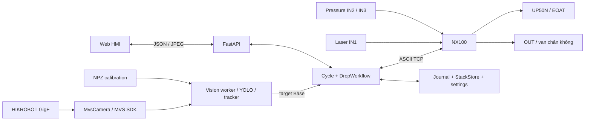
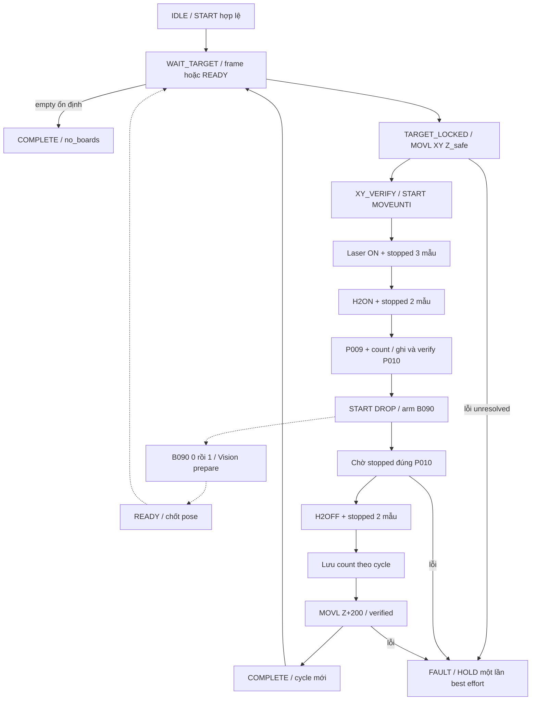
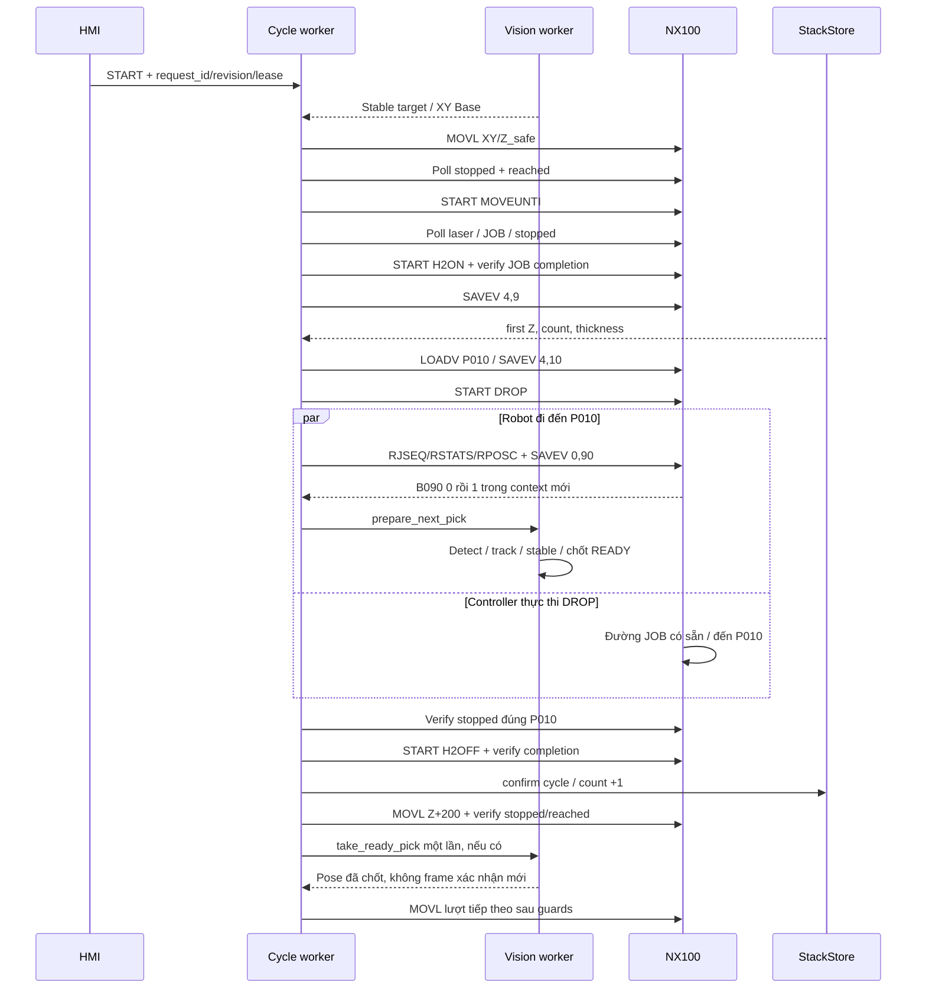
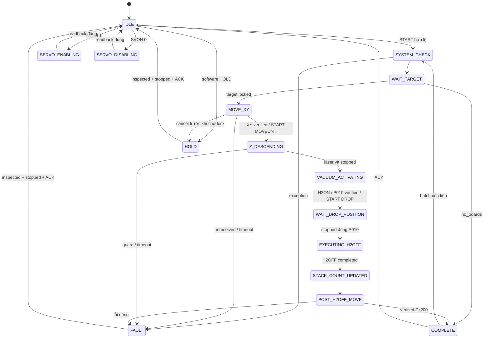

# PICKING_FULL_CYCLE — TÀI LIỆU KỸ THUẬT VÀ AI HANDOFF

**Cập nhật:** 27/10/2026, 08:08, Asia/Bangkok (UTC+07:00). **Workspace:** `C:\Data\Picking_full_cycle`. **Phạm vi:** source và dữ liệu đang có trên filesystem, bao gồm các sửa đổi hiện hành, không phụ thuộc commit. Không chạy backend/test, không mở model bằng pickle, không kết nối thiết bị trong nhiệm vụ lập tài liệu này.

<a id="p0"></a>
## PHẦN 0 — AI QUICK CONTEXT

Đây là hệ thống gắp–xếp ván bằng robot Yaskawa Motoman UP50N với controller NX100, camera HIKROBOT GigE cố định bên ngoài robot, laser tìm độ cao và đầu hút chân không. PC Windows chạy Python/FastAPI/Uvicorn, MVS SDK để nhận ảnh, Ultralytics YOLO để phát hiện vật và Eye-to-Hand để đổi pixel sang BASE. Tên UP50N và cách bố trí phần cứng là ngữ cảnh dự án/người vận hành; source giao tiếp với NX100 nhưng không xác minh model cánh tay. Model camera, serial, lens, EOAT và sơ đồ dây chưa được lưu thành hồ sơ nghiệm thu trong project này.

Mạng được cấu hình: NX100 `192.168.255.1:80`, camera `192.168.255.3`, HMI `http://127.0.0.1:8011`. Port 80 là TCP ASCII NX Information Server, không phải HTTP robot. IP/subnet của PC, version firmware NX100 và quyền Ethernet Server hiện tại chưa được kiểm tra trực tiếp. Địa chỉ trong file là giá trị cấu hình, không chứng minh thiết bị đang online.

Entry point là `app.py`. Chạy script sẽ dùng `.venv/Scripts/python.exe` nếu có, mặc định **REAL**, tạo server và có thể mở Edge sau khi Uvicorn sẵn sàng. `--real` chỉ còn là tùy chọn tương thích, không có CLI `--mock`. Factory `create_app(mock=True)` và `Cycle(..., mock=True)` vẫn phục vụ simulator/test. Không chạy script để “xem thử” nếu chưa hiểu chế độ này. Khởi động không tự CONNECT, không tự START: CONNECT trên web mới kết nối robot rồi camera. Tuy nhiên constructor vẫn đọc calibration và mở/lưu journal, nên import/factory và chạy server không phải thao tác đọc hoàn toàn đối với filesystem.

Source đã chuyển cấu hình sang `config/config.json`, utility sang `core/settings.py`, launcher sang `core/launcher.py`; không còn giả định ba file này ở root. Runtime tách `robot/`, `vision/`, `workflow/`, HMI tại `templates/index.html`, `static/app.js`, `static/style.css`. Assets nằm trong `models/` và `calibration/`; dữ liệu vận hành tách `data/real` và `data/mock`. Bản tài liệu cũ trong `docs/SYSTEM_TECHNICAL_DOCUMENTATION.md` được giữ nguyên như hồ sơ lịch sử, không phải bản handoff mới này.

Ảnh REAL phải đúng kích thước calibration **5472×3648**. YOLO nhận BGR gốc, dùng `conf=0.5`, `imgsz=960`, `device=cpu`. Kết quả `xyxy` được quy về ảnh gốc bởi thư viện; backend lấy tâm bbox, undistort bằng K/distortion, chiếu tia qua `T_base_camera`, giao với mặt phẳng `plane_z_mm`. Cuối cùng cộng offset BASE **X +280 mm, Y +215 mm**, đúng một lần. Z từ phép chiếu là mặt phẳng giả định để tính XY, không phải chiều cao gắp đo được. Pose MOVL sử dụng XY này nhưng Z bằng `z_safe=500`, RX/RY/RZ bằng `180/0/90` độ hiện lưu.

ID do `BoardTracker` tự gán bằng ghép bbox theo class, IoU/khoảng cách; không phải ID của YOLO tracker. Track mất tạm thời giữ ID 10 giây nhưng không phát detection cũ. `StableTarget` chọn ID lớn hơn ID gắp cuối trước, rồi quay vòng về ID nhỏ nhất. Nó yêu cầu ít nhất **5 frame khác nhau và 1 giây**, XY cách mọi mẫu không quá 3 mm, tuổi frame tối đa 1 giây, gap tối đa 0.5 giây. Không yêu cầu XY khác lần gắp trước, vì nhiều lớp ván có thể trùng XY. Instance của ID giúp tránh dùng lịch sử ổn định của một vật đã hết hạn.

START chạy batch full cycle theo thứ tự thực tế: target ổn định → MOVL tới XY/Z_safe và chờ dừng/tới đích → START MOVEUNTI → chờ laser ON đồng thời RUNNING OFF → H2ON → đọc P009 → tính Z thả → ghi/verify P010 → START DROP → chờ dừng đúng P010 → H2OFF → lưu tăng bộ đếm → MOVL Z+200 và xác minh → target tiếp theo. PC không gửi một lệnh TCP IMOV UNTIL: thao tác tìm Z thuộc JOB MOVEUNTI sẵn có trên NX100. Không có export JBI để khẳng định đầy đủ nội dung hoặc giới hạn hành trình JOB.

Nhánh hiện dùng `workflow.z_completion=laser_on_and_stopped`, `end_after_moveunti_start=false`, `repeat_until_empty=true`. PC yêu cầu đúng current JOB, giữ XY/tư thế trong dung sai, laser ON và RUNNING OFF đủ ba mẫu; sau đó gọi H2ON và chờ JOB đó dừng đủ hai mẫu. Nhánh này chủ ý không đòi phải nhìn thấy RUNNING ON của JOB ngắn. Nó không chứng minh nhân quả “JOB kết thúc chính vì laser”, không chờ pressure đạt trước DROP và không giám sát mất hút trong lúc mang vật. H2OFF hoàn thành theo JOB cũng không chứng minh vật đã rời EOAT.

Z thả tổng quát là `first_drop_z_mm + stacked_count × board_thickness_mm`; default hiện **330 + n×12 mm**. Sau H2ON, `SAVEV 4,9` đọc P009; giữ tất cả trường trừ Z, thêm prefix để `LOADV` ghi P010; `SAVEV 4,10` phải khớp số học toàn bộ trường. XY/tư thế DROP đến từ P009, không lấy từ pick pose hay P010 cũ. JOB DROP đi đến P010; backend không gửi MOVL hạ Z riêng trong nhánh đang bật. P010 phải trong workspace, không cao hơn DROP SAFE 600 mm theo kiểm tra runtime. Tăng đếm dựa H2OFF completed, chống trùng cycle ID bằng `StackStore`; ghi trước nâng Z+200 để lỗi nâng không làm đếm lại.

B090 prefetch đã được tích hợp trong source. Sau START DROP ACK, PC tạo context theo cycle ID/connection generation, kiểm `RJSEQ=DROP`, phải đọc **0 rồi 1** bằng `SAVEV 0,90` trong context đó. Người vận hành xác nhận JOB DROP có `SET B090 0` ở đầu, `SET B090 1` sau khi đến P009; đây là xác nhận vận hành, chưa có JBI để đối chiếu. Bỏ lỡ khoảng 0 thì không tin một giá trị 1 cũ; DROP vẫn tiếp tục và lần pick sau dùng nhận diện bình thường. PC chỉ đọc B090, không ghi byte này.

Khi checkpoint hợp lệ, cùng vision worker chuẩn bị target kế tiếp trong DROP/H2OFF/Z+200. Khi đạt READY, lưu cả target và pose MOVL; các frame sau không thay thế tọa độ này. Sau nâng đã xác minh, `take_ready_pick()` lấy một lần, kiểm cycle nguồn, thứ tự ID, config/calibration identity và connection generation; **không lấy frame sau nâng, không YOLO xác nhận lại cảnh và không loại READY chỉ do tuổi**. Đây là quyết định vận hành đã chốt: sau B090 robot đã ra khu DROP, khu PICK trống và ổn định. Nếu chưa READY, nhánh lịch sử vẫn cần frame mới; nếu không có lịch sử hợp lệ, ổn định lại từ đầu. B090 không cho quyền MOVE sớm trước nâng.

HMI hiện có 11 trạng thái trên hai hàng ở desktop, CONNECT bên phải, Camera/Robot cạnh nhau. Robot chứa SERVO ON/OFF, START, HOLD/UNHOLD, RESET, Xếp ván và tọa độ thu gọn. Thông số vận hành có tám input đồng đều, gồm Z Drop/độ dày sửa được khi IDLE; HAND 1/2 ở dưới. RESET chỉ ACK trạng thái phần mềm, không reset stack, alarm hoặc tự resume. Muốn đếm về 0 thì nhập 0 và LƯU. Thông báo cố định tự ẩn sau 15 giây với nội dung không đổi. Icon fullscreen 32 px ở góc phải; fullscreen mới chia hai section 100dvh, Scroll Snap; màn hình thấp/hẹp cuộn tự do.

Tình trạng bằng chứng: code end-to-end có mặt; 21 file test định nghĩa 194 test, báo cáo ngày 26/10 ghi PASS nhưng không chạy lại trong lần lập tài liệu. Source UI fullscreen đã đổi sau báo cáo nên không thể gọi báo cáo đó là regression của toàn bộ snapshot hiện tại. Log REAL có các cycle COMPLETE lịch sử nhưng không chứa mốc B090 mới. Journal REAL lưu HOLD chưa xác nhận do TCP timeout; stack đang lưu 6, suy ra Z kế tiếp 402 mm, không đồng nghĩa biết trạng thái robot tức thời. Calibration **needs_review, 22/22 outlier, translation residual RMS ~63.97 mm**; không được coi cấu trúc ma trận hợp lệ là độ chính xác đã nghiệm thu.

Điểm quan trọng nhất cho AI tiếp tục: config file lẫn operator settings REAL đều đang **350 mm/s**, không còn default 80 như tài liệu/browser smoke cũ. Nhánh operator workflow bỏ qua commissioning flags tĩnh, nên các cờ false không bảo đảm khóa chuyển động REAL. Không tự sửa IP, calibration, offset, JOB, biến, mapping, công thức thả, tốc độ hoặc chính sách READY không xác nhận lại. Phát triển gần nhất là fullscreen hai màn hình; không có nhiệm vụ sửa robot dở được xác định từ source. Ưu tiên ghi nhận hiện trạng thật, nghiệm thu calibration/JOB/I/O và làm mới bằng chứng test trước thay đổi motion.

**HƯỚNG DẪN CHO CHATGPT KHI NHẬN FILE NÀY:** dùng đây làm ngữ cảnh hệ thống, không coi là bản sao source hiện tại mãi mãi. `VERIFIED` nghĩa là xác nhận được từ source/dữ liệu được chỉ rõ, không mặc nhiên là test phần cứng. `HISTORICAL` là hồ sơ hoặc kết quả cũ; `INFERRED` là suy luận có cơ sở; `UNKNOWN` là chưa có bằng chứng. Khi cần patch chính xác phải đọc source mới của các file liên quan và ưu tiên source mới hơn. Không tự chạy REAL hoặc gửi lệnh để bổ sung thông tin còn thiếu.

## Mục lục

- [0. AI Quick Context](#p0)
- [1. System overview](#p1)
- [2. Project architecture](#p2)
- [3. Complete workflow](#p3)
- [4. Vision, YOLO và tracking](#p4)
- [5. Calibration và tọa độ](#p5)
- [6. NX100 TCP protocol](#p6)
- [7. JOB, I/O và biến](#p7)
- [8. Z search và vacuum](#p8)
- [9. Drop height và stack count](#p9)
- [10. B090 prefetch](#p10)
- [11. State machine và đồng bộ](#p11)
- [12. Web UI và API](#p12)
- [13. Config và triển khai](#p13)
- [14. Test và log](#p14)
- [15. Lỗi, rủi ro, giới hạn](#p15)
- [16. Source code map](#p16)
- [17. Current development status](#p17)
- [18. AI continuation context](#p18)

<a id="p1"></a>
## PHẦN 1 — SYSTEM OVERVIEW

Mục tiêu là phát hiện ván trong vùng pick, chọn lần lượt, gắp bằng HAND 2, chuyển qua vùng drop và xếp chồng theo độ dày. PC điều phối và giám sát; controller thực hiện đường chạy nội bộ JOB và MOVL được gửi. HMI là giao diện điều khiển thực, không phải bản mô phỏng đồ họa robot.

| Thiết bị/thành phần | Thông tin có bằng chứng | Điều chưa xác minh |
|---|---|---|
| UP50N / NX100 | Ngữ cảnh vận hành; client NX100 ASCII, RSTATS/RPOSC/JOB | Serial, firmware, option Ethernet, tải EOAT, vùng an toàn |
| HIKROBOT GigE | MVS enumerate, chọn đúng IP 192.168.255.3 | Model/serial/lens, exposure/gain/ROI thực tế, SDK version máy đang chạy |
| Camera cố định Eye-to-Hand | NPZ định nghĩa Camera → robot BASE, ảnh 5472×3648 | Độ chính xác nghiệm thu; vị trí gá có đổi không |
| Laser | IOREAD 20050 bit 0, active high | Model, gá, vùng phát hiện, ngưỡng, wiring thực tế |
| Vacuum / EOAT | Bốn JOB HAND, input 20051/20052, output 30050/30051 | Logic van/bù áp, mapping điện thực tế và chứng minh giữ vật |
| PC | Windows adapter, interpreter đang đọc là Python 3.10.0 64-bit | GPU/CPU vật lý và latency trên máy vận hành |
| Software | FastAPI, Uvicorn, OpenCV, NumPy, Ultralytics | Kiến trúc checkpoint thực, chất lượng dataset và accuracy |

Nguồn: `app.py`, `config/config.json`, `robot/controller.py`, `vision/camera.py`, `vision/pipeline.py`; thông tin asset xem phần 5/13. MOCK dùng `MockClient`, ảnh tổng hợp và hai detection định sẵn, không tương đương kiểm chứng robot thật. REAL vẫn phải vượt guard động; nhánh nào vượt guard tĩnh mô tả ở phần 8/15.



<a id="p2"></a>
## PHẦN 2 — PROJECT ARCHITECTURE

### 2.1 Cây filesystem tại thời điểm đọc

```text
Picking_full_cycle/
├── app.py                         # entry point + factory/routes
├── .gitignore
├── SYSTEM_TECHNICAL_DOCUMENTATION.md  # tài liệu handoff này
├── config/config.json
├── core/{__init__,settings,launcher}.py
├── robot/{__init__,protocol,controller,cartesian,status,io,vacuum,
│          job_control,position_variable,mock}.py
├── vision/{__init__,camera,detector,calibration,tracker,stability,pipeline}.py
├── workflow/{__init__,cycle,drop,state_machine,safety_checks}.py
├── templates/index.html
├── static/{app.js,style.css}
├── calibration/{eye_to_hand.npz,camera_intrinsic_2.npz}
├── models/best.pt
├── requirements/{base,dev,real,lock,real-lock}.txt
├── data/
│   ├── real/{.gitkeep,execution.json,execution.lock,
│   │         execution.before_auto_count.json,operator_settings.json,drop_stack.json}
│   └── mock/{execution.json,execution.lock}
├── docs/{SYSTEM_TECHNICAL_DOCUMENTATION.md,B090_PREFETCH.md,
│         HW0483202.pdf,asset_hashes.json,LAYOUT_REGRESSION_RESULT.json}
├── logs/
│   ├── real/{.gitkeep,app.log}
│   ├── mock/{.gitkeep,app.log}
│   ├── ultralytics/Ultralytics/settings.json
│   └── reports/{file_audit.json,tests/{test_result.json,test_output.txt},ui/*.png}
├── tools/{run_tests,browser_smoke}.py
├── tests/                         # 21 test_*.py, xem phần 14
└── .venv/                         # không phân tích sâu; cache cũng bỏ qua
```

Root lúc bắt đầu nhiệm vụ không có README, LICENSE, `jobs/`, `nx100_variables_web/` hoặc ba file settings/config/launcher cũ. Không suy đoán chúng còn là dependency. Các `__init__.py` runtime rỗng, chỉ đánh dấu package. Log được kiểm kê 56 file, docs 5, calibration 2, model 1 và data 8, không tính file mới này hay cache. Ảnh UI có nhiều snapshot lịch sử; tên nhóm gồm connection_panels, connect_header, control_colors, drop_settings, fullscreen, operating_parameters, robot_compact, robot_controls, robot_stack, servo_on/toggle, status_bar/io/two_rows, unknown_as_dash. Đây không phải tài nguyên frontend được load.

### 2.2 Module và hợp đồng

Các đường dẫn bên dưới tương đối root. Cột I/O là hợp đồng phần mềm, không mặc nhiên là I/O vật lý.

| Path | Vai trò | Class/function chính | Input → output | Được gọi bởi |
|---|---|---|---|---|
| `app.py` | Lifecycle/API/HMI | `main`, `create_app`, `authorized` | args/config/request → Uvicorn, snapshot, receipt | CLI/browser |
| `config/config.json` | Default được load | dữ liệu JSON | mạng/vision/motion/drop/web → cfg | `load_config` |
| `core/settings.py` | Root path, validation, identity | `owned`, `load_config`, `validate_settings`, `fingerprint` | relative path/settings/dict → owned path/validated values/SHA256 | app, Cycle, Vision |
| `core/launcher.py` | Khởi động HMI | `hmi_url`, `existing_real_hmi`, `open_edge`, `open_when_ready` | host/port/server → URL/mở Edge | `app.main` |
| `robot/protocol.py` | Transport/validate | `encode_command`, `Client.execute`, `_Reader` | command + ASCII data → result string/exception | Controller/workflow |
| `robot/controller.py` | Adapter robot và telemetry | `Controller.observe/status/pose/read_b090/move` | cfg/action → flags/pose/I/O/result | Cycle |
| `robot/cartesian.py` | Pose và MOVL | `Pose.parse`, `read_pose`, `build_move`, `coordinate` | RPOSC + target/speed → validated pose/payload | Controller |
| `robot/status.py` | Bit RSTATS | `Status.is_*` | hai số nguyên → bool từng cờ | Controller.status |
| `robot/io.py` | Read input | `read_byte`, `laser_sample`, `laser` | contact/config → raw byte, bool | Controller.laser |
| `robot/vacuum.py` | Mapping, readback và nhánh network | `validate_mapping`, `monitor_inputs`, `read_outputs`, `write` | mapping/raw/channel/on → trạng thái/exception | Controller, safety_checks |
| `robot/job_control.py` | MOVEUNTI JOB | `exists`, `current`, `start`, `stop_reason_proven` | client/observed → existence/JOB/boolean proof | Cycle._start_moveunti/_job |
| `robot/position_variable.py` | P009→P010 | `parse_p010`, `with_z`, `verify_p010` | SAVEV + Z → expected fields, LOADV payload, pose | DropWorkflow |
| `robot/mock.py` | Simulator deterministic | `MockClient.execute` | command/scenario → simulated reply/state | Controller(mock=True), tests |
| `vision/camera.py` | Vendor SDK acquisition | `MvsCamera`, `_InstalledSdkFinder` | SDK/IP device index → BGR frame/frame ID/stamp | Vision |
| `vision/calibration.py` | Geometry | `PixelToRobot.check_frame/convert/quality_message` | NPZ, pixel, plane Z → XYZ Base/cảnh báo | Vision, Detector |
| `vision/detector.py` | Inference | `Detector.detect` | BGR gốc + calibration/settings → items bbox/u/v/xyz/conf/name | Vision._work |
| `vision/tracker.py` | ID liên tục | `BoardTracker.match_score/update` | detections + capture stamp → id/instance/uncertain | Vision._work |
| `vision/stability.py` | Chọn và ổn định target | `StableTarget.update` | frame ID/stamp/items/now → target hoặc None | Cycle._target, Vision prefetch |
| `vision/pipeline.py` | Vision orchestration/cache | `Vision._work`, `prepare_next_pick`, `take_ready_pick`, `sample`, `status` | cfg/frames/context → preview/items/ready pose | Cycle/API |
| `workflow/cycle.py` | Main orchestration | `Cycle.start/_run_batch/_run_once/_move/_job` | request/stage/target → transitions + serialized commands | API |
| `workflow/drop.py` | Drop + persistence | `DropWorkflow`, `StackStore` | P009/config/count/cycle → P010/drop/count/lift | Cycle |
| `workflow/state_machine.py` | Durable intent/process ownership | `Journal`, `InstanceLock`, `STEPS`, `TERMINAL` | path/values → durable state/lock | Cycle |
| `workflow/safety_checks.py` | Guard | `ready`, `workspace`, `reached`, `real_gate`, `manual_io_ready`, servo/hold checks | flags/pose/cfg → pass/exception | Cycle/DropWorkflow |
| `templates/index.html` | DOM | IDs `flags`, `position`, `settings`, `stackCountForm`, `fullscreen` | static markup → UI nodes | GET `/` |
| `static/app.js` | Polling, commands, local layout | `refresh`, `render`, `command`, `showNotice`, `layoutFullscreen`, `fitFullscreenPages` | JSON/UI actions → DOM/API requests | browser |
| `static/style.css` | Responsive/fullscreen | statusBar, panels, `:fullscreen` rules | viewport/fullscreen → layout | browser |
| `tools/run_tests.py` | Test launcher | `main` | unittest discovery → log + JSON report | developer; có ghi reports |
| `tools/browser_smoke.py` | HMI MOCK integration | `main`, `wait_vacuum` | private MOCK server → browser assertions/screenshots | developer; không phải production launcher |
| `tests/test_*.py` | Regression contracts | unittest classes, FakeSocket/patch fixtures | mock/temp config → assertions | run_tests |

`core/` không chứa model robot hoặc event bus: chỉ settings/path và browser launcher. Config chỉ load JSON, chưa có schema tổng thể/validator toàn bộ cfg. Operator override xem phần 13. Không có package độc lập cho B090: logic chia Controller, Cycle, Vision và DropWorkflow.

<a id="p3"></a>
## PHẦN 3 — COMPLETE WORKFLOW

### 3.1 Nhánh hiện có hiệu lực

Nguồn chính: `Cycle.start`, `_run_batch`, `_run_once`, `_target`, `_move`, `_job`; `DropWorkflow._prepare_drop_variable`, `_finish_drop`. Trước START cần IDLE, không busy, request/revision hợp lệ, robot/camera kết nối, flags ready, laser OFF, mapping HAND job hợp lệ và REAL gate qua. Nếu fail preflight thì không phát chuyển động; sau khi đã phát lệnh, lỗi có thể để robot tiếp tục chạy và phải xử lý outcome unknown.

| Bước / state | Function và input → output | Command, điều kiện hoàn thành | Deadline/lỗi → bước sau |
|---|---|---|---|
| Connect / IDLE | `Cycle.connect`, cfg → robot connected, telemetry, vision worker | RSTATS, RPOSC `0,1`, RPOSJ; refresh rồi Vision.connect | TCP 3 s/pha; camera connect/inference không có deadline tổng; không tự START |
| SYSTEM_CHECK | `start` → UUID cycle, journal reset fields, worker | Guard động, không command MOVE tại đây | Sai state/camera/laser/lease → từ chối; → WAIT_TARGET |
| CAMERA→YOLO→TRACKING | `Vision._work`, ảnh gốc → items id/xyz và JPEG | Không phát robot command | Camera stale/error → samples lỗi; → ổn định |
| WAIT_TARGET | `_target`, cursor ID + frame/prefetch → pose | Nếu READY đúng context lấy ngay; còn lại StableTarget/fresh frame | 30 s cho vòng chờ thường; empty liên tục 2 s + đủ 5 frame → COMPLETE/no_boards |
| TARGET_LOCKED | `_target` lưu target, frame ID, pose, cycle ID | XYZ workspace; pose Z_safe/orientation từ settings | Không có target ổn định → FAULT; → MOVE_XY |
| MOVE_XY | `_move(target)` đọc start/ref → verified target arrival | RSTATS/RPOSC; MOVL một lần; stopped + reached đủ 3 mẫu, metadata không đổi | 120 s vòng chờ, socket có thể cộng thêm; → XY_VERIFY |
| XY_VERIFY | `_run_once`, đọc telemetry → recheck target | Flags ready, reached XYZ/angles | Sai → FAULT; → START_MOVEUNTI |
| START_MOVEUNTI | `_start_moveunti`, pose hiện tại → start pose | Đúng Z_safe/tư thế; RJDIR có MOVEUNTI, laser OFF; intent rồi START MOVEUNTI | TCP ambiguity → FAULT/HOLD best effort; → Z_DESCENDING |
| Z_DESCENDING / LASER_CONFIRMED | `_wait_laser_and_stopped(start)` → stop_position | Current JOB MOVEUNTI; XY/orientation không đổi, workspace, laser known | 60 s; laser ON + RUNNING OFF đủ 3 mẫu → MOVEUNTI_COMPLETE |
| VACUUM_ACTIVATING | `_execute_hand_job(2,True,cfg,require_laser=True)` → H2ON receipt | Recheck ready/current job/laser; START H2ON; current job H2ON + stopped 2 mẫu | 10 s; không phải pressure proof; → chuẩn bị DROP |
| WRITING_DROP_P010 | `_prepare_drop_variable` → expected/payload/drop_target | SAVEV `4,9`, tính Z, LOADV P010; giữ các trường P009 khác | Validate/workspace/safe/read/write lỗi chặn DROP |
| DROP_P010_WRITTEN | `verify_p010` → verified receipt | SAVEV `4,10`, tất cả trường bằng expected dạng Decimal | Mismatch → FAULT, không START DROP |
| WAITING_B090 + WAIT_DROP_POSITION | `_run_once` START DROP, arm; `_wait_drop_variable_target` → stopped P010 | START DROP; RJSEQ, RSTATS, RPOSC; B090 polling; reached + stopped 3 mẫu | DROP 120 s; sai JOB/flags/pose → FAULT, không H2OFF |
| DROP_Z_REACHED | `_finish_drop` → guard attempt/verified target | Nhánh P010 đã tới đúng pose; ngừng chờ B090 nếu chưa chứng minh checkpoint | Prefetch lỗi không tự làm DROP fail; → EXECUTING_H2OFF |
| EXECUTING_H2OFF / H2OFF_COMPLETE | `_execute_hand_job(2,False,...,required_pose=target)` → receipt | Recheck ready và pose; START H2OFF; JOB đúng + stopped 2 mẫu | 10 s; lỗi/ACK mất → không đếm tự động |
| STACK_COUNT_UPDATED | `StackStore.confirm(cycle_id,picked_id)` → durable count/cursor | Không command NX100; idempotent trên cycle ID | Lỗi disk → FAULT; đếm trước nâng, không rollback khi nâng lỗi |
| POST_H2OFF_MOVE | `_after_h2off_move`, drop pose → Z+200 pose | MOVL, workspace, start pose đúng, stopped/reached/metadata 3 mẫu | MOVL 120 s; chỉ khi xong mới log Z200_COMPLETED |
| COMPLETE→SYSTEM_CHECK | `_run_batch` → UUID mới | Ready + laser OFF; repeat=true và không stop_reason | Không resume JOB; → lấy READY/history/target mới |

Không có state riêng cho CALCULATE_Z trong nhánh P010 đang chạy: phép tính nằm trước LOADV. States `WAIT_DROP_SAFE`, `DROP_SAFE_REACHED`, `CALCULATE_DROP_Z`, `MOVING_TO_DROP_Z` thuộc nhánh legacy khi không cấu hình `position_variable`. Không trình bày các state này như một chuyển động hạ riêng đang chạy ở cấu hình hiện tại.





### 3.2 Hợp đồng hoàn thành và phục hồi

ACK TCP chỉ cho biết command accepted. MOVL phải được đo lại tới đích; JOB HAND phải đúng tên và dừng; DROP phải dừng đúng P010. `_run_once` bắt exception, xóa prefetch, ghi FAULT; nếu `motion_sent` hoặc `job_start_attempted` hoặc `pending` còn tồn tại thì đánh dấu outcome unknown và thử HOLD một lần, trừ khi đã cancel/HOLD. Không retry điều khiển và không tự bật hút/nhả để “phục hồi”. Người vận hành kiểm tra robot, dùng ACK/RESET khi dừng; nhả HOLD là thao tác riêng. Phần mềm không thể khẳng định robot đã dừng nếu TCP lỗi.

<a id="p4"></a>
## PHẦN 4 — VISION, YOLO VÀ TRACKING

### 4.1 Acquisition và inference

`MvsCamera.__init__` tìm vendor wrapper theo `vision.sdk_root`, `MVCAM_COMMON_RUNENV`, hoặc MVS Development trong Program Files; kiểm PE architecture DLL phù hợp Python, thêm DLL directory và import wrapper cài sẵn qua meta-path finder tạm thời. Không copy SDK vào repo. Khi nối: enum GigE/USB nhưng `Vision.connect` chỉ chấp nhận đúng một GigE có IP cấu hình; mở exclusive, set optimal packet size nếu có, TriggerMode OFF, StartGrabbing.

Thread `mvs-preview` gọi GetImageBuffer 300 ms, convert RGB8 Packed bằng SDK rồi đổi BGR, copy buffer, luôn FreeImageBuffer. Mười lần lỗi liên tiếp → camera disconnected. Kích thước tối đa 100 triệu pixel; frame buffer phải đúng chiều dài. Dùng SDK `nFrameNum`, delta uint32, không phát lại ID khi trùng; timestamp bằng `time.monotonic` lúc nhận/publish trên PC, không phải timestamp exposure đã đồng bộ phần cứng. `frame()` từ chối dữ liệu quá 2 giây.

Thread `vision` đợi 0.1 s mỗi vòng, lấy frame ID chưa xử lý, gọi detector, tracker, vẽ bbox/ID/XY và encode JPEG. Preview hardcode scale tối đa chiều rộng **960**; `vision.preview_max_width=960` hiện không được đọc để tính scale. Inference làm việc trên ảnh gốc; chỉ preview được resize rõ ràng tại pipeline. Trong model.predict thư viện có thể letterbox/resize tới imgsz rồi quy bbox về orig_shape; backend kiểm orig_shape khớp calibration. Không resize ảnh đầu vào để ép vừa calibration.

`Detector.detect` trả `{bbox:(x1,y1,x2,y2), u,v, confidence,name,xyz}`; bbox hữu hạn, đúng biên ảnh; lỗi convert lưu `error` trên item, item thiếu XYZ không qua stability. Không có whitelist class/segmentation/grasp-angle trong source; class ảnh hưởng ghép tracker. Trọng số `models/best.pt` được nạp bằng `YOLO(path)` trong runtime, **không được nạp khi audit**. Tên dự án là YOLOv8; chưa có chứng cứ an toàn xác nhận chính xác architecture/class list từ checkpoint.

### 4.2 Association, ID và target policy

`BoardTracker.match_score` yêu cầu cùng class; tỉ lệ chiều rộng/cao không vượt 2. Tính IoU, khoảng cách tâm chuẩn hóa theo đường chéo bbox lớn hơn. Reject nếu IoU <0.1 **và** relative distance >0.5. Điểm ghép = `IoU + 0.2*(1-min(relative_distance,1))`. Greedy theo điểm giảm dần, không ghép trùng ID hoặc detection. Hai candidate cạnh tranh cùng track/detection chênh điểm <0.05 khiến detection `uncertain=True`. Đây là heuristic, không phải Hungarian/Kalman/ReID.

Track chưa thấy dưới 10 giây vẫn giữ chỗ cho ID nhưng không tạo output item cũ. Track quá hạn bị xóa. Detection mới cùng frame được xếp trái→phải rồi trên→dưới, cấp số nguyên nhỏ nhất chưa reserved. Mỗi track mới có `instance` tăng đơn điệu; ID tái sử dụng có instance mới. Không có bước deduplicate bbox độc lập hoặc NMS bổ sung trong tracker; NMS phụ thuộc YOLO, detection trùng có thể trở thành track khác hoặc uncertain.

`StableTarget.update(frame,stamp,items,now)` bỏ frame/stamp không tăng. Stale frame clear history. Lọc uncertain, thiếu XYZ, confidence thấp, XYZ NaN/inf. Với cursor `after_id`, ưu tiên nhóm `id>after_id`, trong nhóm lấy ID nhỏ nhất; nếu không có nhóm đó quay vòng về ID nhỏ nhất còn thấy. Identity là `(id,instance)`. Đổi identity, gap lớn hoặc XY cách bất kỳ mẫu trước >3 mm thì reset history. Đủ số mẫu **và** dwell mới trả deepcopy **mẫu mới nhất**, không trung bình/lọc pose. Lịch sử cắt bớt nhưng giữ đủ dwell window.

Cùng XY được gắp lại nếu cùng một chồng còn hiện vật hoặc lượt quay vòng ID; không dùng blacklist XY. Cursor `last_picked_id` chỉ đổi sau count commit. Không chứng minh hai detection là hai tấm vật lý hoặc ván đã rời vùng pick; đây là giới hạn perception và vận hành.

### 4.3 Freshness và hiệu năng

`Vision.sample/status`: connected chỉ hợp lệ với stamp mới trong `max_frame_age=1`; worker lỗi sau giai đoạn startup → connected false, items rỗng, clear prefetch, stop event. Startup cho phép exception tạm thời trong 3 giây khi frame_id=0. CONNECT có thể trả trước khi frame đầu đã sẵn sàng; START phải đợi status connected thật.

FPS là nghịch đảo khoảng thời gian giữa hai lần publish trong `_work`, bao gồm thời gian chờ/inference, không phải benchmark riêng camera hoặc latency end-to-end. Source không lưu phân bố inference time, thời gian TCP aggregate hay cycle-time đã nghiệm thu. Khẳng định hiệu quả B090 trên máy thật vẫn UNKNOWN. READY cố ý có quy tắc tuổi khác với nhánh sample/history, xem phần 10.

<a id="p5"></a>
## PHẦN 5 — CALIBRATION VÀ CÔNG THỨC TỌA ĐỘ

Nguồn: `vision/calibration.py:PixelToRobot`, `Detector.detect`, metadata hai NPZ đọc bằng `numpy.load(...,allow_pickle=False)`. `Vision.__init__` còn kiểm K/distortion của intrinsic asset allclose với Eye-to-Hand; không yêu cầu quality là passed để connect.

### 5.1 Asset và hệ trục

- Camera OpenCV: +X phải, +Y xuống, +Z phía trước camera.
- BASE: hệ Cartesian controller, mm; hướng trục vật lý tại máy phải xác minh trên pendant.
- Tool frame trong report tên `Vacuum`; TCP/tool index thực tế lấy RPOSC, không suy từ tên này.
- `T_A_B` biến tọa độ B sang A theo vector cột đồng nhất: \(p_A=T_{A\_B}p_B\).
- Report calibration dùng Euler intrinsic `xyz`, input rx/ry/rz độ; rotation residual rad/deg tùy trường. Runtime không tính orientation từ ảnh: RX/RY/RZ do operator settings cung cấp, controller giải nghĩa theo giao thức NX100.

\[
K=\begin{bmatrix}4674.729315&0&2549.936888\\0&4693.272834&1973.510994\\0&0&1\end{bmatrix}
\]

Distortion OpenCV `(k1,k2,p1,p2,k3)` = `(-0.2532737023, 0.2234199981, -0.0031651037, 0.0109485923, 0.0634522970)`.

\[
T_{base\_camera}\approx\begin{bmatrix}
0.024963289&-0.998402026&-0.050697426&1260.248627\\
-0.999665076&-0.024584400&-0.008083517&73.614719\\
0.006824233&0.050882237&-0.998681344&1390.587877\\
0&0&0&1
\end{bmatrix}
\]

Bản làm tròn trên để hiểu geometry; không dùng để thay asset. NPZ có `T_tool_board` và 22 cặp transform samples; chỉ `T_base_camera`, K, distortion, size, report/quality được runtime PixelToRobot sử dụng. Phương trình calibration trong report là \(T_{base\_tool,i}T_{tool\_board}=T_{base\_camera}T_{camera\_board,i}\). Project này không có chương trình solve/recalibrate; report là kết quả đã mang sang, đường dẫn phiên calibration cũ trong report không phải dependency runtime.

### 5.2 Pixel → normalized ray → giao mặt phẳng

Với bbox ảnh gốc:

\[
u=(x_1+x_2)/2,\quad v=(y_1+y_2)/2,
\qquad (x_n,y_n)=\operatorname{undistortPoints}((u,v),K,D).
\]

Tách \(T=[R\mid t]\), đặt \(o=t\), \(d=R[x_n,y_n,1]^T\). Tia BASE là \(p(\lambda)=o+\lambda d\). Với mặt phẳng BASE \(Z=z_p\):

\[
\lambda=\frac{z_p-o_z}{d_z},\quad
p_{raw}=o+\lambda d,\quad
p_{out}=p_{raw}+[280,215,0]^T,\quad p_{out,z}=z_p.
\]

Không bắt buộc chuẩn hóa d thành vector đơn vị. Reject pixel ngoài ảnh, nonfinite, \(|d_z|<10^{-9}\), \(\lambda\le0\), sai kích thước ảnh, K/T không hợp lệ, units không phải mm hoặc thiếu định nghĩa Camera→BASE. T phải rigid: hàng cuối `[0,0,0,1]`, R trực chuẩn, det≈1.

Phân biệt bốn Z: `plane_z_mm=0` để tính XY; `z_safe=500` cho pose gắp ban đầu; `stop_position.z` đo từ robot khi MOVEUNTI dừng; `Z_drop=first+n*h` cho thả. Ngoài ra `drop.safe_z_mm=600` là mốc DROP SAFE khác `z_safe`. Không thay thế chúng cho nhau. Nếu mặt phẳng pick thật khác giả định, XY có thể sai vì ray-plane; độ sai cần đo, không được tự bù bằng laser Z sau đó khi XY đã gửi.

### 5.3 Chất lượng

| Chỉ số trong asset | Giá trị | Ý nghĩa bằng chứng |
|---|---|---|
| Intrinsic samples / RMS | 16 / 0.630883 px | HISTORICAL calibration fit, không phải accuracy gắp |
| Eye-to-Hand samples / quality | 22 / `needs_review` | VERIFIED metadata |
| Outlier | 22/22 | Residual checks không đạt |
| Translation residual RMS / max | 63.9673 / 129.2721 mm | Sai số nhất quán của tập calibration, không đồng nhất với error mọi target |
| Rotation residual RMS / max | 16.8121 / 38.0122 độ | Chưa nghiệm thu orientation calibration |
| Reprojection RMS / max | 184.3329 / 424.4001 px | Residual toàn chuỗi rất lớn |
| PnP reprojection RMS | 2.35375 px | Chỉ khâu PnP riêng |

Report cảnh báo coverage chưa đủ và cần kiểm ghép pose/ảnh, quy ước góc, thứ tự board; intrinsic board 6×9, Eye-to-Hand board 9×6, square 27 mm. Constructor chỉ xác minh cấu trúc/units; `Vision.status` trả `coordinates_verified=false` và cảnh báo, nhưng nhánh operator workflow không khóa motion theo quality. Đây là vấn đề ưu tiên cao; không thay asset, offset hoặc quality flag chỉ để tắt cảnh báo.

<a id="p6"></a>
## PHẦN 6 — NX100 TCP PROTOCOL

Nguồn chính: `robot/protocol.py:encode_command/Client.execute/_Reader`, `robot/controller.py`. Client dùng IPv4, port 1..65535, timeout hữu hạn >0 và ≤60 s; cấu hình hiện 3 s. Mỗi command mở **một socket mới**, có `_WIRE_LOCK` toàn process; không giữ persistent session, không HTTP/YERC UDP. Controller RLock tuần tự hóa nhóm giao dịch. Không có auto-retry; CONNECT của HMI có thể được người vận hành gọi lại.

### 6.1 Framing

```text
PC → NX: CONNECT Robot_access\r\n
NX → PC: OK: NX Information Server (...).\r\n
PC → NX: HOSTCTRL_REQUEST <COMMAND> <N>\r\n
NX → PC: OK: <COMMAND>\r\n
PC → NX: <data>\r                    # chỉ gửi sau ACK, nếu có data
NX → PC: <result>\r                  # read command
NX → PC: 0000\r\n                    # control success
```

N là số **byte ASCII của data gồm CR cuối**, bằng 0 nếu không data. Chỉ nhận printable ASCII trước khi tự thêm framing; payload ≤256 byte. `_Reader` xử lý fragmentation/coalescing, giới hạn response 65536 byte. `RJDIR` đặc biệt đọc tới socket close, bắt buộc terminator cuối; CR đầu không có nghĩa hết directory. Error/NG rõ ràng là reject; response control phải chính xác `0000` + CRLF.

Nếu mất kết nối trước khi gửi command, báo transport failure và “chưa gửi lệnh”. Nếu payload/control có thể đã tới controller mà thiếu xác nhận, raise `OutcomeUnknown`; không được diễn giải thành chưa thi hành hoặc tự gửi lại. `_CONTROL` chứa vài tên phòng thủ ngoài public whitelist; việc một tên nằm trong set đó không có nghĩa ứng dụng cho phép command đó. `RESET`, `CANCEL`, `MOVJ`, `SETMJ` không nằm trong whitelist đang dùng.

### 6.2 Command map

| Command | Payload được cho phép/đang dùng | Output và người gọi |
|---|---|---|
| RSTATS | rỗng | `data1,data2`; Controller.status → Status bits |
| RPOSC | validator coord 0..25, external 0/1; runtime `0,1` | 14 trường XYZ, RX/RY/RZ, posture, tool, 6 external axes; Controller.pose |
| RPOSJ | rỗng | joint string; chỉ đọc khi connect, không dùng inverse kinematics |
| RJSEQ | rỗng | `JOB,line,step` ba trường; Controller.current_job/job_control.current |
| RJDIR | `*` | list tên JOB nhiều record; job_control.exists tìm MOVEUNTI sau khi đọc đủ |
| MOVL | 17 trường: `0,speed,0,X,Y,Z,RX,RY,RZ,posture,tool,ext1..ext6` | `0000`; Controller.move/build_move; selection 0 = mm/s, coord 0 = BASE |
| START | MOVEUNTI hoặc JOB cấu hình được whitelist, gồm DROP | `0000`; explicit tên, không START rỗng để resume |
| HOLD | `1` / `0` | `0000`; hold/release_hold, readback riêng |
| SVON | đúng `1` / `0` | `0000`; set_servo, sau đó xác minh bit servo |
| IOREAD | `start,count` count 8..256 bội số 8; dùng `20050,8`, `30050,8` | byte decimal, validate 0..255 trong wrapper |
| IOWRITE | network inputs 22010..23287, whole-byte values | `0000`; chỉ nhánh network verified, không nhánh REAL JOB hiện tại |
| SAVEV | chỉ `4,9`, `4,10`, `0,90` | P009/P010 body hoặc B090 decimal; read-only |
| LOADV | chỉ `4,10,1,0,X,Y,Z,RX,RY,RZ,posture,tool` | `0000`; chỉ Cartesian BASE P010, không ghi P009/B090 |

MOVL builder serialize tọa độ 3 số thập phân, giữ metadata từ RPOSC hiện tại. `Pose.verify_unchanged` có sẵn (0.05 cho pose, 0.001 external) nhưng đường Cycle._move hiện dùng guard reached và so `reference.fields[6:]` giữa các lần đọc; không giả định helper này được gọi trên mọi MOVE. Static expected_tool/posture bị bỏ qua ở operator workflow, nhưng metadata thay đổi trong MOVL vẫn gây lỗi.

`Status`: data1 bit 3 RUNNING, 5 TEACH, 6 PLAY, 7 command REMOTE; bit 0 step, 1 one-cycle, 2 auto, 4 safety-speed có parser. Data2 bit 1 pendant HOLD, 2 external HOLD, 3 command HOLD, 4 alarm, 5 error, 6 servo. Cờ HOLD tổng là OR ba nguồn. UI ON/OFF không đảo ý nghĩa theo “tốt/xấu”.

<a id="p7"></a>
## PHẦN 7 — ROBOT JOB, I/O VÀ BIẾN

| Tên/địa chỉ | Kiểu | Chức năng thực tế | Độ tin cậy / nguồn |
|---|---|---|---|
| MOVEUNTI | JOB controller | Tìm Z, PC START và quan sát laser/JOB/stopped | Contract source VERIFIED; nội dung JBI/giới hạn cơ khí UNKNOWN |
| DROP | JOB controller | Đưa tới P010 sau khi PC tính biến | Contract source VERIFIED; toàn đường chạy UNKNOWN |
| H1ON / H1OFF | JOB controller | ON/OFF HAND 1 manual | Config verified=true là cờ cấu hình, không thay hồ sơ nghiệm thu |
| H2ON / H2OFF | JOB controller | Hút/nhả HAND 2 trong cycle và manual | JOB completion được kiểm; không có physical proof |
| P009 / SAVEV `4,9` | position | Nguồn XY/Z/tư thế chuẩn DROP; chỉ đọc | PC giữ tất cả trường trừ Z khi tạo P010 |
| P010 / SAVEV `4,10`, LOADV | Cartesian BASE position | Đích DROP biến đổi theo stack | Write + numeric readback VERIFIED code |
| B090 / SAVEV `0,90` | byte 0..255 | Checkpoint 0→1 cho prefetch | Read adapter VERIFIED; JOB placement là operator-confirmed |
| 20050 bit 0 / IN#1 | digital input | Laser active high | Source/config; laser.verified=false, không phải đã nghiệm thu điện |
| 20051 bit 1 / IN#2 | digital input | Pressure 1 | UI dùng bit raw từ cùng IOREAD 20050 |
| 20052 bit 2 / IN#3 | digital input | Pressure 2 | Không suy từ laser hoặc relay output |
| 30050 bit 0 / OUT#1 | digital output readback | Relay/vacuum output 1 theo mapping | IOREAD `30050,8`; không IOWRITE trực tiếp output này |
| 30051 bit 1 / OUT#2 | digital output readback | Relay/vacuum output 2 theo mapping | Trạng thái logic output không chứng minh vacuum vật lý |
| 22xxx | network input | Adapter alternative ghi nguyên byte nếu được sở hữu | REAL start/bits=null, owned_byte=false; chưa mapping cho dùng nhánh này |

**Xác nhận của người vận hành trong yêu cầu bàn giao:** đầu JOB DROP có `SET B090 0`; sau MOVE đến P009 có `SET B090 1`. Không có `.JBI` trong filesystem đã quét để đối chiếu thứ tự, lệnh MOVE, tool, tốc độ, ladder, nhánh lỗi hoặc END. Chỉ ghi đúng hai dòng đã được xác nhận, không dựng lại JOB từ suy đoán. `RJDIR` chỉ xác minh MOVEUNTI tồn tại, không export nội dung; START DROP/HAND dựa whitelist/config và ACK controller.

`monitor_inputs` kiểm hai contact cùng byte và bit 0..7. Pressure lấy raw byte chưa đảo active_high của laser; output cũng là logical bit readback. Không đồng nhất `vacuum` output snapshot với `vacuum_inputs` áp suất. `vacuum.mode=complementary` không khiến backend tự gọi H1OFF khi START H2ON ở nhánh JOB: logic complementary khi JOB chạy phải được xác minh trên controller.

<a id="p8"></a>
## PHẦN 8 — Z SEARCH VÀ VACUUM

### 8.1 MOVL tới XY và tìm Z

`Cycle._move` phát **một đích Cartesian sáu trục** `(Xvision,Yvision,z_safe,RX,RY,RZ)`, không phải chỉ gửi riêng X/Y. Không có bước tự nâng Z_safe riêng đang được gọi trước đích này trong nhánh hiện hành; state `MOVE_TO_SAFE` tồn tại trong danh sách nhưng không được sử dụng ở đường chạy chính. Giữ đường tiếp cận đã được vận hành chọn, không tự chèn một MOVE mới từ tên state.

Trước MOVEUNTI, `_run_once` kiểm pose hiện tại khớp Z_safe và orientation settings. `_start_moveunti` kiểm lại ready, JOB existence và laser OFF, đọc pose, đặt job_start_attempted rồi lưu START intent. Tìm Z kiểu IMOV UNTIL laser là chức năng JOB trên pendant theo ngữ cảnh, không có command IMOV trong TCP whitelist. Backend chỉ quan sát kết quả.

Ở `laser_on_and_stopped`, `_wait_laser_and_stopped` mỗi vòng đọc fresh telemetry, current JOB phải MOVEUNTI, laser không UNKNOWN, XY thay đổi ≤1 mm, góc ≤0.5 độ, workspace hữu hạn. Laser ON + running false ba mẫu liên tiếp mới hoàn thành. Không yêu cầu quan sát cạnh OFF→ON đi cùng RUNNING trước đó; `_start_moveunti` đã có guard laser OFF. Không kiểm min_z/max_descent_mm trong nhánh này; config hai trường còn null. JOB phải có giới hạn thực ở controller, hiện chưa có export để xác nhận.

Nhánh legacy `_job` còn giữ running_seen/laser_edge, kiểm descent và `stop_reason_proven`: helper chỉ trả true trên mock. Nhánh REAL legacy full cycle bị gate khóa, nhưng cấu hình hiện không đi vào nhánh này. `real_gate` với operator_motion_workflow trả sớm sau kiểm tên MOVEUNTI và mapping vacuum. Vì vậy `commissioning.full_cycle=false`, laser/job.verified=false và thiếu tool expectation **không tự khóa** nhánh đang dùng. Đây là hành vi code, không phải khuyến nghị an toàn.

### 8.2 H2ON/H2OFF completion

`_execute_hand_job(channel,on,config,require_laser,required_pose)`:

```text
check cancel + manual_io_ready
nếu required_pose: ready + read pose phải reached đích
nếu require_laser: ready + current JOB=MOVEUNTI + laser=True
persist START intent → start_hand_job → accepted
poll RJSEQ + RSTATS:
    current JOB phải đúng tên
    guard manual_io_ready(allow_running=True)
    stopped 2 mẫu liên tiếp → refresh → return
timeout 10 s / sai JOB / guard lỗi → exception
```

Manual HAND không cần servo ON nếu guard I/O còn đạt: remote=true, teach/running/alarm/error/hold=false. Trong cycle, H2ON còn kiểm ready và laser, H2OFF kiểm ready và đúng drop pose. ACK/start không được coi completion. Không đòi nhìn thấy running=true cho HAND ngắn. Backend không tự ngắt van khi HOLD/FAULT; đó có thể làm rơi vật, và không thuộc hợp đồng hiện có.

Pressure 1/2 hiện chỉ hiển thị. Không có dwell hút theo áp, threshold analog, xác nhận “đã giữ ván”, phát hiện tụt áp khi vận chuyển hoặc cảm biến “đã thả”. `board_release_confirmed=false` vẫn có thể đi cùng `counted=true,count_basis=h2off_completed`, đúng quyết định đếm theo JOB. Muốn nâng độ tin cậy vật lý phải có yêu cầu và nghiệm thu riêng, không đổi tên flag để giả lập chứng minh.

<a id="p9"></a>
## PHẦN 9 — DROP HEIGHT VÀ STACK COUNT

### 9.1 Công thức và P010

\[
Z_{drop}=Z_0+n h,\qquad Z_0=first\_drop\_z\_mm,\;n=stacked\_count,\;h=board\_thickness\_mm.
\]

Default hiện tại cho \(Z_0=330,h=12\): trước tấm 1 n=0 →330; tấm 2 n=1 →342; tấm 3 n=2 →354. REAL file đang lưu n=6 → **402 mm** cho tấm tiếp theo. Z0/độ dày nay sửa được trên UI; công thức không được hardcode 330 ở các tính toán mới. Decimal được dùng để cộng/nhân tránh drift nhị phân; snapshot trả float.

Các bước triển khai:

1. H2ON hoàn thành (`Cycle._run_once`).
2. `_prepare_drop_variable`: snapshot StackStore rồi `SAVEV 4,9`.
3. `parse_p010(raw,source='P009')` kiểm body 10 trường qua validator LOADV.
4. Body `1,0,X,Y,Z,RX,RY,RZ,posture,tool`: 1 là Cartesian, 0 là BASE. `with_z` chỉ thay index 4 (Z của body).
5. Thêm `4,10` ở đầu tạo LOADV P010; target XYZ/R lấy body index 2..7.
6. Workspace + Z ≤ `drop.safe_z_mm + xyz_tolerance`, lưu WRITING_DROP_P010/intention.
7. Gửi LOADV, accepted, SAVEV P010; so **mọi** trường bằng Decimal, không chỉ Z.
8. Receipt verified rồi mới START DROP. `_wait_drop_variable_target` xác minh stopped/reached P010 ba mẫu.
9. `_finish_drop` gọi H2OFF đúng một lần cho cycle, kiểm pose lại ngay trước gửi.
10. Sau completion, `StackStore.confirm` lưu count/cursor trước `_after_h2off_move`.
11. Lift target = drop pose +200 theo axis; config hiện axis z; `_move` xác minh trước COMPLETE.

Điểm thả có thể dùng RZ khác pick: giữ P009, không lấy orientation settings để ghi đè DROP. Branch không position_variable giữ legacy: đợi DROP SAFE tại 600 và dừng ổn định rồi PC MOVL xuống Zdrop; không phải branch đang bật.

### 9.2 Persistence và chỉnh sửa

`StackStore` đọc `<journal.parent>/drop_stack.json`; vắng file dùng defaults và tạo mới, file hỏng → dừng bằng exception, không tự đặt count về 0. `_save` ghi temp, flush+fsync, os.replace; chỉ gán self.data sau commit thành công. `completed_drop_cycle_ids` giữ chống trùng qua restart; `last_completed_drop_cycle_id` liên kết prefetch và `last_picked_id` làm cursor. Manual set_count/reset không xóa lịch sử hoặc cursor.

`set_count`: int thật, không bool, 0..9007199254740991. `configure_values`: chỉ first_drop_z_mm/board_thickness_mm; hữu hạn, thickness >0..1000, tối đa 3 decimals; Z0 tối đa 3 decimals. `Cycle.configure` cho save chung khi IDLE, không busy, kiểm robot không RUNNING nếu connected, Z0 thuộc workspace Z và ≤DROP SAFE. Không tự reset số tấm khi đổi geometry. Z kế tiếp vượt safe bị chặn tại chuẩn bị DROP, không có giới hạn count theo chiều cao ở UI lúc nhập. Với default, n=22 →594 còn trong 600; n=23 →606 sẽ bị từ chối theo guard hiện có.

Guard chỉnh count/reset cho IDLE hoặc COMPLETE, không busy; không cho trong HOLD/FAULT/đang chờ release. API `/api/drop/reset` và `/api/drop/confirm` vẫn tồn tại để tương thích/phục hồi, UI không có hai nút đó. Reset stack endpoint cần confirmed=true; UI hiện nhập 0 và LƯU qua `/api/drop/count`.

Save chung `/api/config` validate giá trị trước mutation, nhưng StackStore và operator_settings là **hai file**, không có transaction liên file. Nếu stack save thành công rồi operator settings save/journal fail, có thể save một phần. Count đã lưu khi lift fail phải được giữ; không tự tăng bù hay replay H2OFF sau restart. Xem rủi ro phần 15.

<a id="p10"></a>
## PHẦN 10 — B090 PREFETCH

### 10.1 Checkpoint provenance

`Controller.read_b090()` gọi uncached `SAVEV 0,90`, strip, regex 1..3 chữ số, range0..255. `encode_command` chỉ mở thêm đúng địa chỉ này cho SAVEV; LOADV vẫn chỉ P010, không có API ghi B090.

`Cycle._arm_drop_prefetch()` được gọi **sau START DROP được ACK**, clear preparation, tạo `{state:WAITING_B090,cycle_id,b090:null,reset_confirmed:false,connection_generation}` rồi poll ngay. `_poll_drop_prefetch` chỉ chạy trên cycle worker khi WAITING_B090, giữ cycle/controller locks; check cancel, cycle ID, generation, connected và current_job DROP. 0 đánh dấu reset, 1 sau reset mới chuyển DETECTING và gọi prepare; 1 đứng riêng không trigger, số khác 0/1 invalid. Exception đọc/parse/context invalid clear prefetch và log, không tự hủy DROP; guard chính vẫn có thể gây FAULT nếu robot quan sát thực sự lỗi.

Polling xảy ra ngay arm và mỗi vòng `_wait_drop_variable_target`/legacy `_wait_drop_safe`, nominal 0.1 s cộng thời gian các giao dịch TCP. Đây không phải timer thread riêng. Một vòng có nhiều socket, không bảo đảm tần số 10 Hz thực. Bỏ lỡ 0 thì không tạo bằng chứng giả từ ACK. Tới DROP_Z_REACHED mà còn WAITING_B090 → INVALID/fallback; không tiếp tục polling trong H2OFF hoặc nâng nếu chưa trigger.

### 10.2 Luồng PC chuẩn bị trong lúc robot chạy

`_prefetch_next_pick` chỉ prepare khi automatic_repeat và current target có ID. `Vision.prepare_next_pick(after_id,cycle_id)` tạo StableTarget với config copy, capture cutoff started_at, identity; cùng worker `_work` đang xử lý camera gọi `_update_next_pick` với từng frame mới. Identity gồm fingerprint **toàn cfg**, object calibration, byte ma trận T/K/distortion và nội dung file Eye-to-Hand trên disk.

Frame trước/equal started_at bị bỏ. StableTarget vẫn áp dụng confidence, age/gap, ID instance và XY stability. Khi đủ, `_prefetch` chuyển READY, target chứa pose sáu trục theo settings; log NEXT_TARGET_READY. Từ đó nếu identity không đổi, các lần update trả sớm: không sửa tọa độ dù cảnh sau đó đổi, không hết hạn READY theo tuổi. Camera worker lỗi vẫn clear preparation. Không có thread vision thứ hai, không inference pipeline thứ hai và không command robot từ Vision.

### 10.3 Sử dụng sau Z+200

```text
_after_h2off_move → _move verified stopped/reached → Z200_COMPLETED
_run_batch → check ready + laser OFF → cycle UUID mới
_target:
    đối chiếu generation, connected, source cycle = stack.last_completed_drop_cycle_id
    nếu automatic_repeat: take_ready_pick(cursor,source cycle)
        READY + đúng cursor/cycle + identity → deepcopy pose, PREPARED, lấy một lần
        workspace → TARGET_LOCKED → return ngay, không vision.sample()
    nếu không READY: take_next_pick(cursor)
        lịch sử đúng identity/age/cursor → VALIDATING và frame mới sau lift
        nếu không có: StableTarget rỗng, dwell đầy đủ
_move MOVE_XY:
    check cancel/robot ready/start metadata/workspace
    nếu target từ prefetch: camera.connected, generation, identity phải còn đúng
    persist MOVL intent → send → mark CONSUMED → wait arrival
```

Guard camera cho nhánh READY trước MOVL kiểm cờ `vision.connected`, **không gọi sample freshness hoặc YOLO xác nhận cảnh**. `Vision.status` có thể báo stale khác với cờ connected trong khoảng worker bị kẹt; đây là giới hạn cần hiểu, không tự tăng tiêu chí freshness làm trái chính sách vận hành đã chốt. Partial history path vẫn yêu cầu frame mới, nên comment “require NEW post-lift frame” chỉ mô tả nhánh đó, không mô tả READY.

States hai lớp khác nhau: Cycle prefetch `IDLE/WAITING_B090/DETECTING/CONSUMED/INVALID`; Vision `IDLE/DETECTING/STABILIZING/READY/PREPARED/VALIDATING/CONSUMED/INVALID`. Payload snapshot có cycle/b090/reset/reason và vision target, frame, age, ready_at. RAM-only, không restore qua restart. `_run` finally, HOLD/FAULT/close/camera error clear. Nếu chưa có target, vẫn có thể COMPLETE/no_boards sau các frame rỗng ổn định 2 s; không suy empty từ camera lỗi.

### 10.4 Log và mức hoàn thiện

Mốc source hỗ trợ: DROP_STARTED, B090_RESET_CONFIRMED, B090_TRIGGERED, PREFETCH_STARTED, NEXT_TARGET_READY, DROP_COMPLETED, H2OFF_COMPLETED, Z200_COMPLETED, NEXT_TARGET_LOADED, NEXT_MOVL_SENT; NEXT_TARGET_VALIDATED cho partial-history path. Tests `test_b090_prefetch.py` có 22 test gồm FakeSocket và overlap end-to-end simulated. `test_ready_during_drop_and_next_move_only_after_verified_lift` kiểm thứ tự READY trước DROP completed/Z200, MOVE sau Z200 và không yêu cầu sample cho target READY. Log REAL được đọc hiện không chứa các mốc này; không có số đo tiết kiệm thời gian REAL. Kết luận: **code integrated, mock evidence lịch sử có; nghiệm thu B090 trên robot thật chưa xác minh**.

<a id="p11"></a>
## PHẦN 11 — STATE MACHINE VÀ ĐỒNG BỘ

`STEPS` trong `workflow/state_machine.py` là danh sách hiển thị/định danh, không phải transition validator tổng quát. States khai báo:

```text
IDLE, SERVO_ENABLING, SERVO_DISABLING, SYSTEM_CHECK, WAIT_TARGET,
TARGET_LOCKED, MOVE_TO_SAFE, MOVE_XY, XY_VERIFY, START_MOVEUNTI,
Z_DESCENDING, LASER_CONFIRMED, MOVEUNTI_COMPLETE, VACUUM_ACTIVATING,
WRITING_DROP_P010, DROP_P010_WRITTEN, WAIT_DROP_POSITION, WAIT_DROP_SAFE,
DROP_SAFE_REACHED, CALCULATE_DROP_Z, MOVING_TO_DROP_Z, DROP_Z_REACHED,
EXECUTING_H2OFF, H2OFF_COMPLETE, AWAIT_DROP_CONFIRMATION,
STACK_COUNT_UPDATED, POST_H2OFF_MOVE, COMPLETE, JOB_DISPATCHED, HOLD, FAULT
```

TERMINAL cho restart: IDLE, COMPLETE, JOB_DISPATCHED, HOLD, FAULT. Không coi AWAIT_DROP_CONFIRMATION là trạng thái tự phục hồi sạch sau restart. Có state chỉ dùng legacy hoặc tương thích, xem phần 3/9.



### 11.1 Thread, lock, ownership

| Thành phần | Đồng bộ / chu kỳ | Vai trò |
|---|---|---|
| HTTP handlers | FastAPI sync handlers + lease_lock | Admission, gọi Cycle; không trực tiếp vision MOVE |
| telemetry | thread sau CONNECT, wait1 s | Controller.observe rồi cập nhật telemetry; không sleep khi giữ controller lock |
| pick-cycle | một thread theo START | Cả batch tuần tự, phát motion/JOB |
| manual-hand | thay vị trí worker thread khi manual | Chờ HAND JOB và trở về state trước đó |
| vision | một worker, wait0.1 s/vòng + inference | Detection, tracker, preview, prefetch |
| mvs-preview | SDK acquisition thread | Copy/release frame buffer |
| Cycle/Controller/Vision/Journal/StackStore | RLock riêng | Bảo vệ context, command, frames và dữ liệu |
| `_WIRE_LOCK` | threading.Lock global process | Một giao dịch TCP tại một thời điểm |
| InstanceLock | OS file lock theo journal | Chặn process thứ hai dùng cùng data path/mode |

Lock không chặn máy tính khác, controller khác app hoặc bản copy dùng journal khác. Batch kế tiếp dùng cycle ID mới, source prefetch vẫn gắn cycle DROP trước; `last_completed_drop_cycle_id` là liên kết bền vững giữa hai lượt. Reconnect qua Controller.connect tăng generation; lỗi một socket không tự tạo generation mới. Không dùng timestamp monotonic làm dữ liệu có ý nghĩa qua restart.

### 11.2 Journal và lỗi giữa chừng

`Journal.intent(name,payload)` lưu pending trước control; action thành công → accepted clear pending. `update` tăng revision, history chỉ giữ 100 mốc; temp+flush+fsync+os.replace. API admission `api_requests` lưu durable nhưng không tăng revision; START còn có danh sách requests riêng. Request đã admitted dù action lỗi không được gửi lại cùng nonce; phải quan sát trạng thái và tạo yêu cầu mới có chủ ý, không retry command tự động.

Khởi động đọc journal; nếu hỏng, state nonterminal hoặc pending còn → FAULT/outcome_unknown. Không replay motion/JOB. Stack file hỏng khác journal: constructor raise chứ không tự tạo lại count. Hai file journal/stack không transaction chung; confirm idempotent giảm đếm trùng, không giải quyết mọi ambiguity phần cứng.

HOLD đặt cancel event trước chờ lock, clear prefetch, journal HOLD/outcome_unknown, gửi HOLD1 rồi refresh. Lock không ngắt được socket đã gửi; có thể phải chờ timeout. ACK/RESET cần worker dừng, inspected khi unknown, fresh RUNNING=false; chỉ đưa IDLE, không nhả command HOLD, không bật servo hoặc reset alarm. Nhả HOLD cần IDLE/không pending, command_hold=true, external/pendant_hold=false, remote/play, stopped/no alarm/error/teach và confirmed=true; gửi HOLD0 một lần, xác minh readback. Servo có intent/operation state/readback timeout riêng, không tự START.

Race được bảo vệ: config/calibration đổi trước hoặc sau target validation; B090 cũ/cycle cũ/reconnect; HOLD khi chờ phản hồi; thao tác HAND trùng trong busy; camera error trong prefetch; metadata đổi trong MOVL. Giới hạn còn lại: không có hardware interlock từ OS lock; không chứng minh physical stop qua ACK; cảnh sau READY cố ý không được kiểm lại; công thức drop/journal update không atomic xuyên controller và disk.

<a id="p12"></a>
## PHẦN 12 — WEB UI VÀ API

### 12.1 UI hiện hành

DOM/logic: `templates/index.html`, `static/app.js:render/refresh/command/renderDrop/renderLaser/showNotice`. Màu/font đọc từ CSS, không coi là safety certification.

- 11 ô SERVO, REMOTE, PLAY, TEACH, ALARM, ERROR, RUNNING, HOLD, LASER, VACUUM1/2; desktop 6 cột/hai hàng, ≤800 px 3 cột/nhiều hàng. UNKNOWN hiển thị dấu `-` trắng, không đổi semantics backend.
- CONNECT nối camera và robot; không auto-connect khi mở app. Nhãn CONNECT/ĐANG KẾT NỐI/ĐÃ KẾT NỐI/KẾT NỐI LẠI; hai link ONLINE/OFFLINE riêng. Cùng connected thì CONNECT disabled.
- Robot: bốn nút SERVO toggle, START, HOLD/UNHOLD, RESET; tiếp đến Xếp ván, rồi vị trí và đích khóa nhỏ. Không còn chữ RSTATS, quyền điều khiển hoặc dòng trạng thái Xếp ván; quyền/guard vẫn giữ.
- SERVO gọi endpoint ON/OFF explicit từ cờ thật; chưa biết servo thì disabled. START gửi stage full_cycle; settings/count dirty guard không giống nhau: stackCountDirty khóa START, còn settings form chỉ lưu khi người dùng submit.
- Stack count có input + LƯU; polling không ghi đè khi dirty, Esc hủy dirty. RESET không xóa count. HAND1/2 nằm sau Thông số vận hành, đủ bốn nút ON/OFF.
- Settings gồm Z Drop, độ dày, Plane Z, Z Safe, MOVL speed, RX/RY/RZ. Form lấy giá trị lần render đầu; không liên tục overwrite input. Save gửi một `/api/config` gồm `settings` sáu trường và `drop_settings` hai trường.
- Poll `/api/state` mỗi 500 ms khi không pending, preview reload JPEG theo `?t=Date.now()`. AJAX không websocket. `command` gửi UUID+revision, không tự retry; pending khóa controls. Mất server làm vô hiệu controls, UNKNOWN/reset link; fullscreen là local control riêng.
- `showNotice` gom lựa chọn cuối trong microtask, so lastNotice; nội dung mới show15 s rồi hidden, poll cùng nội dung không reset timer hoặc hiện lại. Backend error không bị clear chỉ vì toast đã ẩn. ResizeObserver dự phòng khoảng đáy và kiểm fit fullscreen.

### 12.2 Fullscreen hai màn hình — đã triển khai

`renderFullscreen` đồng bộ icon SVG expand/collapse, aria-pressed/title và `document.fullscreenEnabled`; click dùng `document.documentElement.requestFullscreen()`/`document.exitFullscreen()`. Browser Esc gây fullscreenchange như exit API. Icon fixed 32 px góc trên phải, không có thư viện icon, không chiếm hàng và không nằm trong admission robot.

`layoutFullscreen(active)` lúc vào tạo **DOM runtime**, không tạo file: một scroller `.fullscreenScreens`, hai `<section>` `.fullscreenLive` và `.fullscreenSettings`. Dùng comment markers để ghi vị trí gốc của header, main, settings, handControls. Di chuyển node thật, không clone form/control nên event handler và input chưa lưu được giữ. Màn1 chứa header + main với Camera/Robot; màn2 chứa settings + HAND. Khi thoát thay markers bằng nodes gốc, xóa wrapper và phục hồi scroll thường.

CSS chỉ áp dụng dưới `:fullscreen`: scroller fixed inset0, overflow-y:auto, `scroll-snap-type:y mandatory`; mỗi page height100dvh, align start, stop always. Header không sticky; Camera flex lấp phần còn lại, ảnh object-fit contain/position absolute; Robot cùng hàng, main flex1/min-height0; phần settings không lọt cuối màn1. Màn2 gap14 và padding, HAND ngay dưới settings; không kéo giãn khoảng cách giữa chúng.

`fitFullscreenPages` dùng width≤1000, height≤700 hoặc overflow page/Robot để chuyển `.fullscreenRelaxed`: snap none, height auto, min-height100dvh, cuộn tự do; preview lấy aspect16/9. Resize và notification ResizeObserver chạy lại fit. Không dùng overflow hidden để cắt controls. Scroll Snap chọn đích theo thao tác browser, không có handler chặn wheel hoặc tự gửi motion. Không bảo đảm một nấc chuột cực nhỏ luôn chuyển ngay trang, nhưng không để nội dung dừng giữa hai snap points khi có đủ thao tác cuộn.

Khi không fullscreen wrapper không tồn tại, CSS mới không tác dụng. Kiểm tra browser ở phiên phát triển trước nhiệm vụ tài liệu đã báo 1920×1080/1366×768 snap hai chiều, lower-height/mobile fallback, exit restore geometry và input; đó là **HISTORICAL session evidence**, không có báo cáo fullscreen hai trang được lưu riêng trên disk. Nhiệm vụ tài liệu không chạy lại browser.

### 12.3 API và bảo vệ

| Route | Input chính | Tác động |
|---|---|---|
| GET `/` / `/static/*` | — | HTML/CSS/JS local |
| POST `/api/control/claim` | token nếu được cấu hình | Cookie lease một HMI, 30 s |
| GET `/api/state` | cookie | Snapshot journal+robot+camera+capabilities+settings+drop_height+prefetch; renew lease |
| GET `/api/preview.jpg` | — | JPEG có frame mới, không có →503 |
| GET `/api/laser/status` | — | ON/OFF/UNKNOWN + raw byte/bit/error/mapping_verified |
| POST `/api/system/connect` | request_id,revision | connect robot/camera |
| POST `/api/cycle/start` | request_id,revision,stage | một cycle worker/batch |
| POST `/api/robot/servo-on`, `/servo-off` | request_id,revision | SVON1/0 + readback |
| POST `/api/cycle/hold` | request_id, revision không bắt buộc khớp | cancel + software HOLD |
| POST `/api/cycle/acknowledge` | inspected=true từ UI | ACK về IDLE nếu stopped |
| POST `/api/cycle/release-hold` | confirmed=true | HOLD0 có guard/readback |
| POST `/api/vacuum/{channel}` | channel=1 hoặc 2, on boolean | HAND JOB tương ứng |
| POST `/api/config` | settings, optional drop_settings | settings/operator save khi IDLE |
| POST `/api/drop/settings` | board_thickness_mm | compatibility configure_drop |
| POST `/api/drop/count` | stacked_count | chỉnh count khi được phép |
| POST `/api/drop/reset` | confirmed=true | count0, không chuyển động |
| POST `/api/drop/confirm` | cycle_id,confirmed=true | compatibility/manual confirmation recovery |

Tất cả POST trừ claim qua `authorized`: cookie HttpOnly SameSite=strict, lease chưa hết hạn, nonce string8..100 chưa xử lý và revision hiện tại (HOLD bỏ stale check). Lease kéo dài30 s khi request/state đọc của chủ lease; HMI khác chỉ xem. TrustedHost + allowed_clients, Origin cùng host, content-type application/json; LAN cần `NX100_HMI_TOKEN` dài ít nhất24 và allowlists cụ thể. Không ghi token vào tài liệu. Errors RuntimeError→409, ValueError→422, lease→423, token/client/origin→403, type→415. No-store, nosniff, CSP self/frame-ancestors none. Đây không phải phân quyền doanh nghiệp đầy đủ/TLS/SSO. Chưa có server Web Viewer read-only riêng; không tự đổi host0.0.0.0 để coi như đã có viewer.

<a id="p13"></a>
## PHẦN 13 — CONFIG VÀ TRIỂN KHAI

### 13.1 Load/override

`ROOT=Path(core/settings.py).parent.parent`; `owned(relative)` phải resolve trong root. `load_config` chỉ đọc `config/config.json`. `Cycle` deepcopy cfg, khởi tạo Controller/Vision, journal và StackStore, sau đó merge `operator_settings.json` cùng thư mục journal qua validate_settings. StackStore defaults từ cfg.drop rồi override các trường từ drop_stack file. Operator settings không merge sang mode khác. `--port` chỉ thay web.port, không thay robot/camera endpoint. Không có ENV override IP hay config path trong source.

| Nhóm | Config đang lưu / default | Override REAL / diễn giải |
|---|---|---|
| Robot | 192.168.255.1:80, timeout3 s | Không override riêng được tìm thấy |
| Camera | 192.168.255.3 | sdk_root=null → autodetect SDK |
| Plane Z / safe | 0 / 500 mm | REAL file cũng 0/500 |
| MOVL / orientation | **350 mm/s**, RX180 RY0 RZ90 | REAL file cũng **350**, 180/0/90 |
| Vision | confidence0.5, frames5, seconds1, tolerance3 mm | Cấu hình đang có hiệu lực theo file, không phải giá trị2 s/10 frame trong test cũ |
| Freshness | age1 s, gap0.5 s | Không áp tuổi này cho READY latched |
| YOLO | imgsz960, devicecpu | preview_max_width960 hiện hardcode scale trong pipeline |
| Motion | timeout120, target_timeout30, job_timeout60 s | poll0.1, xyz_tol1 mm, angle_tol0.5°, settle3 |
| Expected metadata | tool=null, posture=null | Nhánh operator bỏ static expectations, giữ live metadata |
| Workflow | end_after_moveunti_start=false | z_completion=laser_on_and_stopped, repeat=true, empty_seconds2 |
| Drop | P010, safe600, first330, thickness12, timeout120 | REAL stack first330/thickness12/count6 → next402 |
| Sau H2OFF | axis=z, distance200 | Code còn cho axis x khi cấu hình như vậy; không phải cấu hình hiện tại |
| Laser | 20050 bit0 active high, verified=false | Guard nhánh hiện tại không yêu cầu cờ verified |
| MOVEUNTI | nameMOVEUNTI, verified/start_verified=false | min_z/max_descent/speed=null; thông tin JOB nội bộ UNKNOWN |
| Vacuum | methodjob, verified=true, modecomplementary | JOB H1ON/H1OFF/H2ON/H2OFF, timeout10 s |
| Vacuum network | startnull, bitsnull/null, owned_byte=false | Không đủ điều kiện ghi network input REAL |
| I/O readback | inputs20051/20052, outputs30050/30051 | active_high [true,true] dành nhánh write/network |
| Commissioning | hash/evidence rỗng, flagsfalse | Không được suy rằng REAL hiện bị khóa |
| Web | host127.0.0.1 port8011 | hosts127.0.0.1/localhost, clients127.0.0.1/::1/testclient |

“Hiệu lực” ở đây là kết quả suy ra từ static load order/file, không phải truy vấn process đang chạy. Process có thể đã load config cũ; muốn xác nhận runtime cần snapshot hợp lệ trong nhiệm vụ khác. `validate_settings` chỉ sáu trường: planeZ[-500,2000], zsafe[-500,2500], speed[0.1,500], góc[-180,180], hữu hạn, không bool/unknown key. Không có validator tổng thể bảo đảm mọi giá trị cfg là đúng/nhất quán.

### 13.2 Dependencies, assets và lệnh

Interpreter dùng đọc an toàn: Python3.10.0 x64 Windows. Source dùng `Path.is_relative_to`, dataclasses, builtin generics cơ bản; tài liệu không tuyên bố đã xác minh mọi Python version khác. Dependency base: FastAPI≥0.115<1, Uvicorn≥0.30<1, NumPy≥1.26<3, OpenCV≥4.10<6, HTTPX≥0.27<1. real thêm Ultralytics≥8.3<9; dev thêm Playwright1.64.0. Lock files là inventory pin đã lưu, không chứng minh tất cả wheel đang cài hoặc cài lại được offline. Một số pin REAL: ultralytics8.4.182, torch2.13.0+cu126, torchvision0.28.0+cu126; device hiện vẫn cpu. MVS SDK/wrapper Windows cài ngoài, không có version được xác nhận tại lần audit.

| Asset | Metadata đọc an toàn | SHA256 |
|---|---|---|
| `models/best.pt` | 6,531,370 byte, ZIP PyTorch có data.pkl; không unpickle/nạp model | `f4fa0e39c43bd09842314ffec8331b6ae7acd3357eb3696c42c8df845c93f8b5` |
| `calibration/eye_to_hand.npz` | 15,038 byte, array/JSON allow_pickle=false | `6773bbfed8c7ab5a75bdbb851b9fbd2d13276b59f65055eab81ec456e1c21a6f` |
| `calibration/camera_intrinsic_2.npz` | 3,569 byte, K/distortion/size/report | `c792a9b572e935c2f12bf21f71b4e0c821d6f7af9c40920d16166a8109d1d418` |

Manifest `docs/asset_hashes.json` là nguồn đối chiếu integrity, không phải chứng nhận chất lượng model/calibration. Model class names/training data/architecture chưa đọc an toàn nên để UNKNOWN. Đường dẫn SDK runtime và model assets không thay bằng đường dẫn tuyệt đối từ dự án cũ.

Các lệnh dưới đây **chỉ mô tả**, không chạy trong nhiệm vụ này:

```powershell
# Chạy REAL, không tự CONNECT; chỉ thực hiện trong phiên vận hành đã cho phép
.venv\Scripts\python.exe -B app.py
.venv\Scripts\python.exe -B app.py --no-browser
.venv\Scripts\python.exe -B app.py --port 8012
# Công cụ test tạo report, không phải thao tác chỉ đọc
.venv\Scripts\python.exe -B -m tools.run_tests
.venv\Scripts\python.exe -B -m tools.browser_smoke
```

Không có `python app.py --mock`. Simulator phải dùng factory/test harness được kiểm soát, không tự sửa CLI trong nhiệm vụ docs. Startup log quay vòng 2,000,000 byte, backupCount5 ở logs/real/app.log; launcher thử GET state của server cùng URL để tránh mở server REAL thứ hai, nhận diện `application_id=nx100_full_cycle_v1` và modeREAL. Đây là kiểm server local, không phải kiểm hardware đã sẵn sàng.

<a id="p14"></a>
## PHẦN 14 — TEST VÀ LOG

### 14.1 Static inventory của tests

Đếm AST source hiện có: **21 file, 194 hàm test_**. Không execute/import app/test trong lần lập tài liệu. Các fixture chính dùng temp directory, `Cycle(mock=True)`, FakeSocket/patch socket; một số test đổi c.mock=false để đi nhánh guard REAL nhưng vẫn giữ mock transport. Tên “real_branch” không phải test robot thật.

| File trong tests/ | Số test | Phạm vi hợp đồng |
|---|---:|---|
| test_api.py |15| lease/origin/stale/dedupe/config/drop-count/geometry/no-motion |
| test_b090_prefetch.py |22| wirebyte/checkpoint/source context/READY latch/overlap/lift ordering |
| test_cycle.py |30| full/legacy path, guards, lost reply, restart, singleton, same XY |
| test_dispatch_cycle.py |6| optional end_after_moveunti_start, ACK-only dispatch semantics |
| test_drop.py |17| dropZ/count/H2OFF/lift/failure/idempotence/atomic stack commit |
| test_hand_jobs.py |7| bốn JOB manual, ACK vs complete, lost reply/HOLD/wrong JOB |
| test_hold_release.py |5| confirmation/flags/HOLD0/readback/no retry |
| test_independence.py |4| asset hashes, owned path, legacy-import absence, relocated mock process |
| test_job_directory.py |5| RJDIR nhiều record/fragment/EOF/deadline/receive limit |
| test_laser_h2_cycle.py |6| laser+stopped và H2ON guard, JOB ngắn |
| test_launcher.py |6| factory defaultREAL, Edge-after-ready, reuse server |
| test_pick_order.py |3| ID vòng ưu tiên, missing IDs, persisted cursor |
| test_position_variable.py |7| P009→P010 chỉ Z, lost LOADV ACK, mismatch/pose guard |
| test_prefetch.py |5| partial-history validation bằng frame mới, không phải READY policy |
| test_protocol.py |7| framing/start/no retry/invalid command/metadata/status bits |
| test_repeat.py |5| batch/empty/ID ordering/camera loss/HOLD sau lift |
| test_sensor.py |6| pressure độc lập, UNKNOWN không OFF, lỗi từng telemetry field |
| test_servo.py |19| SVON on/off wire/guards/readback/HOLD/restart/API/no implicit motion |
| test_tracker.py |5| matching/order/reservation/expiry/ID generation |
| test_vacuum.py |5| relay readback/network mapping/manual gates |
| test_vision.py |9| stability/calibration offset/bbox center/needs_review allowed |

### 14.2 Báo cáo và mức kiểm chứng

`logs/reports/tests/test_result.json` ghi tests194, failures0, errors0, skipped0, passed=true, seconds92.67; mtime **26/10/2026 14:05:35 +07**. `test_output.txt` ghi Ran194 /92.152s/OK (runner overhead giải thích hai thời gian khác nhau). Đây là **HISTORICAL**, không chạy lại ngày27 để tránh ghi file ngoài tài liệu; UI fullscreen đã thay sau đó. `docs/LAYOUT_REGRESSION_RESULT.json` ghi173 PASS/91.672s/scope core-config layout; cũ hơn về phạm vi. `logs/reports/browser/` không có trong snapshot, nên không có report tool browser mới để khẳng định tool đang PASS.

`tools/browser_smoke.py` hiện vẫn assert movl_speed==80 và toàn trang thường vừa viewport; config hiện350 và dashboard đã thay đổi. Đây là **mismatch tĩnh có bằng chứng**, không tuyên bố đã chạy và fail trong nhiệm vụ này. Fullscreen hai trang chưa có regression lưu trong suite. Các kiểm tra browser inline phiên phát triển trước là thông tin HISTORICAL từ hội thoại; cần tái tạo harness có báo cáo khi được phép, không coi screenshots cũ là proof phiên bản hiện hành.

| Chức năng | Đã viết code | Test mock | Test thực tế | Ghi chú |
|---|---|---|---|---|
| TCP/status/pose | Có | Có + report cũ | Có log REAL giao dịch/chu trình lịch sử, chưa tái xác minh | Handshake/firmware hiện tại UNKNOWN |
| Vision/calibration | Có | Có contract tests | Calibration metadata có; accuracy pick chưa nghiệm thu | needs_review/outlier |
| MOVEUNTI→H2ON | Có | Có | Log REAL có states, không có JBI/measurement proof | Không pressure gate |
| P009/P010/DROP/H2OFF | Có | Có | Log/journal REAL có cycle COMPLETE | Không chứng minh physical release |
| Auto count +Z200 | Có | Có | Stack history/log có | Không suy số ván vật lý từ history count |
| B090 latched prefetch | Có | 22 test riêng | **Chưa có mốc B090 trong REAL log được đọc** | Operator xác nhận hai SET; chưa export JOB |
| Servo/HOLD release | Có | Có | Không có hồ sơ nghiệm thu riêng được tìm thấy | EXSVON/wiring chưa xác minh |
| Form geometry/count | Có | API tests có | UI sửa giá trị đã có source, không test hardware | Save hai file không atomic chung |
| Fullscreen hai trang | Có | Browser checks phiên trước, không nằm suite | Không liên quan motion | Cần browser regression có artifact mới |

### 14.3 Runtime snapshot, không phải trạng thái live

`data/real/execution.json` lúc đọc: state **HOLD**, revision2867, pending=null, outcome_unknown=true; error HOLD chưa xác nhận vì TCP timeout tới192.168.255.1:80. `stop_reason=no_boards`/automatic_repeat=true còn lưu từ batch trước, không có nghĩa robot hiện đã dừng an toàn. History cuối có POST_H2OFF_MOVE, COMPLETE, SYSTEM_CHECK, WAIT_TARGET, COMPLETE, HOLD, HOLD. `data/mock/execution.json`: IDLE/revision0.

REAL stack first330/thickness12/count6/last_picked_id1, lịch sử completed cycle dài hơn count do count được chỉnh/reset. Không in toàn UUID/nonce không cần thiết. `execution.before_auto_count.json` là snapshot legacy AWAIT_DROP_CONFIRMATION với PC descent; không dùng để mô tả branch đang chạy. Log REAL mtime27/10/2026 07:59:53 có chuỗi P010/H2OFF/STACK_COUNT_UPDATED/POST_H2OFF_MOVE/COMPLETE nhưng **0** lần các mốc DROP_STARTED/B090_RESET_CONFIRMED/B090_TRIGGERED/PREFETCH_STARTED/NEXT_TARGET_READY/NEXT_TARGET_LOADED/NEXT_MOVL_SENT/Z200_COMPLETED/H2OFF_COMPLETED. Đây là thiếu bằng chứng phiên bản prefetch, không chứng minh code chưa tích hợp.

Log không có hardware acceptance report tự động; count/lệnh accepted chỉ là quan sát phần mềm. `.lock` tồn tại không chứng minh process đang giữ OS lock. `file_audit.json`, PNG UI và bản docs cũ dùng tham khảo lịch sử; không phải dependency vận hành và không tự xóa trong nhiệm vụ này.

<a id="p15"></a>
## PHẦN 15 — LỖI, RỦI RO, GIỚI HẠN

Các mục dưới đây là kết quả đọc tĩnh/metadata, **không được tự sửa trong nhiệm vụ tài liệu**. P0 chỉ mức ưu tiên kiểm tra an toàn/ngăn cycle; không đồng nghĩa đã xác định nguyên nhân cơ khí hoặc tai nạn.

| Mức / vấn đề | Bằng chứng, nơi xử lý | Hậu quả / trạng thái | Hướng xử lý đề xuất |
|---|---|---|---|
| P0 — Calibration chưa nghiệm thu | NPZ needs_review, 22/22 outlier; PixelToRobot, real_gate không chặn theo quality | XY có thể sai lớn; còn mở | Đo độc lập, kiểm pose pairing/convention/geometry trước motion mới; không sửa asset bằng phỏng đoán |
| P0 — HOLD chưa xác nhận | REAL journal outcome_unknown + TCP timeout | Không biết robot đã nhận HOLD; snapshot lưu, không live | Kiểm tra phần cứng/trạng thái bằng quy trình vận hành; không tự reconnect/resume/replay |
| P0 — Static commissioning không khóa nhánh hiện tại | safety_checks.operator_motion_workflow/real_gate return sớm; config flags false | Có thể điều khiển REAL dù cờ false; chủ ý vận hành có giới hạn | Bàn giao rõ gate thật; nghiệm thu JOB/path/tool/laser bằng evidence riêng |
| P0 — Z descent limit chưa được xác minh | job.min_z/max_descent/speed null; current laser branch không check descent bound | Workspace không thay giới hạn tìm Z an toàn | Xin export MOVEUNTI/giới hạn controller và kiểm laser stop; không dựng JOB |
| P0 — Pressure không bảo vệ giữ vật | _execute_hand_job chỉ JOB/stopped, UI pressure telemetry | Có thể DROP khi chưa hút/mất hút; chưa implement physical confirmation | Xác định wiring/cảm biến/timeout và thiết kế guard có yêu cầu trước sửa |
| P0 — READY không recheck cảnh | Vision._update_next_pick/take_ready_pick, _move camera.connected | Nếu giả định vùng PICK ổn định không đúng, target cũ vẫn dùng; quyết định đã chốt | Xác minh điều kiện B090 thực tế, không tự đổi policy hoặc bỏ identity guards |
| P1 — Chưa có REAL evidence B090 | Không có mốc B090 trong log hiện có, không JBI | Hiệu quả/độ tin cậy checkpoint chưa nghiệm thu | Ghi trace khi có phiên được cho phép; đo khoảng0 và latency; không tự ghi B090 |
| P1 — Save hai file có thể một phần | Cycle.configure ghi stack trước settings/journal | UI báo lỗi nhưng một phần geometry đã lưu; code hiện hữu | Thiết kế transaction/recovery riêng và failure tests nếu được yêu cầu |
| P1 — Count không physical proof | StackStore.confirm sau H2OFF completion | Đếm đúng giao dịch không chắc đúng số ván | Nghiệm thu nhả vật và cơ chế đối soát; giữ idempotency |
| P1 — Height sau nhập count vượt safe chỉ bị chặn muộn | set_count không kiểm Z, _prepare_drop_variable mới chặn | Cycle đã gắp/H2ON rồi mới thấy không có đích thả hợp lệ | Cân nhắc preflight limit và UX khi có yêu cầu, không tự đổi công thức |
| P1 — Browser smoke cũ lệch cấu hình/UI | tools/browser_smoke assert80 + page fits; config350 | Harness có khả năng fail với source hiện tại; chưa chạy lần này | Fixture speed rõ ràng, kiểm hai mode layout và report mới |
| P1 — Servo hardware prerequisite chưa xác minh | SVON readback có, không có hồ sơ EXSVON | SVON ACK có thể chưa lên nguồn, runtime sẽ FAULT sau timeout | Kiểm điều kiện controller theo tài liệu/pendant; không tự thay wiring |
| P2 — Tests/report không gắn snapshot hash | report194 trước các sửa UI ngày27 | Không chứng nhận toàn snapshot hiện tại | Báo cáo có source hash và ngày thực chạy |
| P2 — Nhiều socket/poll + identity đọc file | protocol.Client, Vision.preparation_identity đọc NPZ bytes mỗi update khi prepare | Có thể tăng latency; chưa benchmark thật | Đo trước tối ưu; không bỏ provenance để tăng tốc |
| P2 — Một số cfg không điều khiển code như tên gợi ý | preview_max_width không dùng; modecomplementary không chi phối JOB | Dễ chỉnh nhầm hành vi | Ghi rõ contract và test config khi sửa |
| P2 — List chống trùng tăng không giới hạn | Journal.requests/api_requests, StackStore.completed_drop_cycle_ids | Disk JSON/fsync lớn dần theo vận hành | Thiết kế retention không làm mất chống replay |
| P2 — Process lock chỉ theo đường dẫn | InstanceLock | Copy project/data path khác có thể cùng điều khiển robot | Quy trình single owner cấp hệ thống, không coi lock file là safety interlock |
| P2 — Tracking heuristic và plane giả định | BoardTracker greedy, StableTarget, PixelToRobot planeZ | Occlusion/detection trùng/thay mặt phẳng gây sai selection/XY | Dataset và đánh giá tracking/geometry thực tế trước thay thuật toán |

<a id="p16"></a>
## PHẦN 16 — SOURCE CODE MAP CHO CHATGPT

| Yêu cầu tương lai | File liên quan | Function/class | Logic cần hiểu | Lưu ý |
|---|---|---|---|---|
| Sửa giao tiếp NX100 | robot/protocol.py, controller.py | encode_command, Client.execute, _Reader | handshake, len+CR, ACK, lock, unknown | Không auto retry control |
| Đọc/ghi B090 | robot/controller.py, protocol.py | read_b090, encode_command | SAVEV0,90; byte validation | **Ghi bị chặn hiện tại**, không mở rộng tùy tiện |
| Xử lý MOVE | robot/cartesian.py, workflow/cycle.py | build_move, Cycle._move | BASE, speed, metadata, reached/stopped | ACK không tới đích |
| Sửa MOVEUNTI | workflow/cycle.py, robot/job_control.py, safety_checks.py | _start_moveunti, _job, _wait_laser_and_stopped, real_gate | branch current vs legacy | JBI không có, phải kiểm controller |
| Sửa H2ON/H2OFF | workflow/cycle.py, drop.py, robot/vacuum.py | _execute_hand_job, _finish_drop | laser/pose trước START, đúng JOB/stopped | Không pressure proof |
| Sửa P009/P010 | robot/position_variable.py, workflow/drop.py | parse_p010, with_z, verify_p010, _prepare_drop_variable | body10 fields, chỉ thay Z | Không dùng P010 cũ làm template |
| Sửa công thức Z thả | workflow/drop.py | StackStore.snapshot | Decimal Z0+n*h | Z0 editable, không hardcode330 |
| Sửa stack count | workflow/drop.py, app.py, static/app.js | confirm/set_count/reset, drop routes, renderDrop | idempotency, history/cursor, dirty | Không reset theo robot RESET |
| Sửa Z+200 | workflow/drop.py, cycle.py | _after_h2off_move, _move | count trước, required_start, workspace | Chỉ dispatch tiếp sau verified lift |
| Sửa B090 prefetch | cycle.py, pipeline.py, drop.py | _arm/_poll/_prefetch_next_pick, prepare/take_ready_pick | context, 0→1, latch/consume/fallback | Không frame recheck READY sau lift |
| Sửa YOLO | vision/detector.py, pipeline.py | Detector.detect, Vision._work | orig_shape/bbox center/calibration | Không đổi coords do preview resize |
| Sửa tracker | vision/tracker.py | BoardTracker.update/match_score | greedy association/reserved ID/instance | ID10s và cursor policy phải test |
| Sửa stability | vision/stability.py | StableTarget.update | frame/timestamp, count+dwell, all-pair XY | Các test có fixture khác production |
| Sửa calibration | vision/calibration.py, calibration/*.npz | PixelToRobot.convert/check_frame | undistort/ray-plane/offset | needs_review; không overwrite asset tự động |
| Sửa Web UI | templates/index.html, static/app.js/style.css | render, refresh, command, showNotice | DOM IDs, capability gates, 15s notice | Không vô tình xóa guard backend |
| Sửa fullscreen | static/app.js, style.css, index.html | layoutFullscreen, fitFullscreenPages, renderFullscreen | markers/DOM move, :fullscreen, relaxed | Preserve normal layout/unsaved input/CONNECT |
| Sửa API | app.py | create_app, authorized, route closures | lease/revision/nonce/origin | Admission không đồng nghĩa action success |
| Sửa cấu hình | config/config.json, core/settings.py, cycle.py | load_config, validate_settings, configure | defaults→per-mode overrides | Save geometry + settings hai files |
| Xử lý HOLD/FAULT | cycle.py, state_machine.py, safety_checks.py | hold, acknowledge, release_hold, Journal | cancel trước lock, unknown, restart | RESET không resume hoặc alarm reset |
| Sửa servo | cycle.py, controller.py, protocol.py | set_servo, servo_*_ready | explicit SVON1/0 + bit readback | Không phụ thuộc cached eligibility |
| Thêm mock test | tests/test_*.py, robot/mock.py | MockClient/FakeSocket/temp fixtures | isolate data, explicit branch config | Không mở socket tới NX100 thật |
| Khởi chạy/mở Edge | app.py, core/launcher.py | main, existing_real_hmi, open_when_ready | defaultREAL, port/reuse, interpreter | Không nhầm --real thành opt-in REAL |
| Log/metrics | app.py, cycle.py, pipeline.py, tools/* | logger cycle, _prefetch_event, runners | cycle ID, monotonic vs wall time | Log cũ không chứng nhận source mới |

<a id="p17"></a>
## PHẦN 17 — CURRENT DEVELOPMENT STATUS

**VERIFIED SOURCE:** full cycle dùng P009→P010, auto count theo H2OFF, Z+200, batch repeat/no_boards; B090 context + READY latch; servo ON/OFF, HOLD/UNHOLD guard, API ownership; operator geometry/count editing; UI gọn; fullscreen hai trang runtime DOM + fallback.

**HISTORICAL TEST:** report194 PASS ngày26; report173 layout cũ; các phiên browser inline trong lịch sử hội thoại kiểm hai-page snap ở1920×1080/1366×768 và fallback1280×600/390×844, không backend/hardware. Chúng không thay nghiệm thu robot thật hoặc suite được chạy lại trên snapshot ngày27.

**HISTORICAL REAL EVIDENCE:** log/journal có full-cycle states và counts; snapshot legacy trước auto count được giữ. Không có current live observation; current disk journal HOLD TCP timeout cần phân biệt với physical motion. Không đủ evidence REAL B090 hoặc accuracy/pressure/release/JOB safety.

Thay đổi gần nhất đã chốt: fullscreen icon-only 32px không làm đổi CONNECT; khi fullscreen phân hai viewport, normal DOM được trả về bằng markers; trạng thái hai hàng không scroll ngang; các chữ dư đã bỏ; HAND ở sau settings; Z Drop/thickness editable; thông báo15s; Robot ưu tiên controls→stack→compact pose. Tài liệu cũ chưa mô tả chính xác toàn bộ chuỗi thay đổi này và còn nhắc default80, file/test count cũ.

Không xác định có feature robot đang lập trình dở từ số lượng file. Task fullscreen đã có code, cần regression có artifact mới; nhiệm vụ hiện tại chỉ handoff. Không có backend Web Viewer công ty riêng được triển khai. Không có solver calibration/dataset training pipeline/JBI deployment hoặc interface thiết kế JOB trong repo hiện tại.

Ưu tiên tiếp theo đề xuất, chưa tự thực hiện: (1) xác minh trạng thái vận hành/HOLD bằng quy trình phù hợp; (2) nghiệm thu calibration, mapping, EOAT và JOB exports; (3) xác minh mốc B090 trên đúng phiên source và thời gian0 quan sát được; (4) fixture hóa browser smoke, bổ sung fullscreen/geometry/notifications regression, xuất báo cáo có hash; (5) đánh giá pressure confirmation và fail-safe theo yêu cầu vận hành; (6) đo latency để tối ưu có bằng chứng. Không đổi thứ tự này thành quyền tự chạy REAL.

Các quyết định phải giữ khi sửa tiếp: defaultCLI REAL nhưng manualCONNECT/START; explicit JOB names, không resume; serialized command/no retry uncertain; metadata live; only P010 writable; B090 read-only; ID/instance + stability/freshness; latch READY không xác nhận lại cảnh sau lift; H2OFF count trước lift; per-mode persistence; RESET ACK khác stack reset và HOLD0; calibration/offset/model giữ nguyên nếu chưa có yêu cầu mới.

<a id="p18"></a>
## PHẦN 18 — AI CONTINUATION CONTEXT

**BỐI CẢNH ĐỂ CHATGPT TIẾP TỤC DỰ ÁN**

Bạn đang nhận bàn giao project Windows `Picking_full_cycle`, điều khiển UP50N/NX100 qua TCP ASCII, camera HIKROBOT GigE qua MVS, YOLO và Eye-to-Hand. Source truth là filesystem hiện hành, không phải tài liệu cũ trong docs. Entry `app.py` mặc định REAL, web8011 trên localhost; không có CLI --mock. Chỉ mở app không tự connect hoặc move, nhưng factory có ghi journal/lock. Muốn patch phải kiểm source mới đúng file; không chạy backend để khám phá trong nhiệm vụ đọc tài liệu.

Cấu hình đọc ngày27/10/2026: robot192.168.255.1:80 timeout3, camera192.168.255.3; settings planeZ0, Zsafe500, MOVL350 mm/s, RX180 RY0 RZ90. Config và REAL operator override đều350; nhiều tài liệu/test browser cũ nhắc80 đã lỗi thời. REAL stack lưu first330, thickness12, count6, next402; đó là dữ liệu đã lưu, không phải xác nhận vật lý của chồng hiện tại. Journal HOLD/outcome_unknown vì HOLD không xác nhận qua TCP; không tự ACK/reconnect/resume để “làm sạch” dữ liệu này.

Vision chạy ảnh gốc5472×3648, confidence0.5/imgsz960/cpu. Tâm bbox undistort K/D, ray từ camera qua T_base_camera giao planeZ, cộng offset BASE X280/Y215 mm một lần. Z hình học chỉ dùng để tính XY; Z gắp thật tìm bằng MOVEUNTI, Z thả là giá trị khác. Calibration needs_review, 22/22 outlier và RMS translation63.97 mm; constructor kiểm rigid transform/units chứ không khóa chất lượng. Không đổi offset/quality flag thay cho đo nghiệm thu. Kiến trúc/checkpoint class cụ thể không được xác nhận bằng unpickle.

Workflow đã chốt: StableTarget→MOVL XY/Zsafe→START MOVEUNTI→laser ON + stopped ba mẫu→H2ON + JOB stopped hai mẫu→đọc P009→Z0+n*h→LOADV P010 chỉ thay Z→readback tất cả trường→START DROP→stopped đúng P010→H2OFF + completion→persist count/cursor→MOVL Z+200 verified→lượt tiếp. Sau khi rỗng đủ frame/dwell2 s, batch dừng COMPLETE/no_boards. Nhánh laser_on_and_stopped bỏ static commissioning gate, nên flags false không chứng minh hệ thống bị khóa. Pressure chỉ hiển thị; JOB completion không chứng minh hút/nhả vật lý.

B090 dùng SAVEV0,90 read-only, arm sau START DROP ACK. Phải quan sát0 rồi1 cùng cycle/generation và RJSEQ=DROP; bỏ lỡ0 thì fallback bình thường, không tự ghi byte. Người vận hành xác nhận SET0 đầu DROP và SET1 sau đến P009, chưa có exportJBI. Cùng vision worker chuẩn bị target trong DROP/H2OFF/lift; READY chốt pose. Sau verifiedZ+200, kiểm provenance/config/calibration/cursor/generation rồi lấy READY một lần, không lấy frame mới/YOLO recheck cảnh/age rejection. Đây là yêu cầu vận hành có chủ ý, không được đảo ngược khi tối ưu; cũng không được bỏ guard để move sớm.

Tracker giữ ID mất tạm10 s, có instance chống tái dùng lịch sử; chọn ID cao hơn cursor rồi quay vòng. Stability cần5 frame và1 s, XY3 mm, frame age1 s/gap0.5 s, không blacklist cùngXY. Controller/worker/journal có locks và intent-before-control, mất ACK là OutcomeUnknown không retry. H2OFF count idempotent lưu trước lift; RESET chỉ ACK vềIDLE, không reset stack/nhảHOLD/bậtservo. Manual HAND/SVON và HOLD0 đều có guard riêng.

HMI mới có trạng thái hai hàng, Camera/Robot, controls→stack→compact pose, tám input settings, HAND phía dưới; toast15 s, fullscreen icon32px góc phải. Fullscreen hai section100dvh snap y mandatory, DOM nodes di chuyển bằng markers; exit/Esc khôi phục normal layout và input. Width≤1000, height≤700 hoặc overflow chuyển cuộn tự do. Chỉ có HMI điều khiển, không có Web Viewer riêng cho công ty.

194 test trong21 file và reportPASS ngày26 là evidence lịch sử, không phải test chạy lại của snapshot UI hiện tại. Browser smoke còn giả định80 và toàn trang vừa màn hình; cần fixture/update khi được yêu cầu. LogREAL hiện không có mốcB090; hiệu quả thực tế chưa nghiệm thu. Ưu tiên nhận exportsJOB, xác nhận calibration/I/O/pressure và kiểm thử có trace trong phiên được phép. Tài liệu này không cấp quyền gửi MOVE/JOB/HOLD, sửa REAL data, cài gói hoặc tự đổi cấu hình an toàn.

---

**Tự kiểm nghiệm thu nội dung:** các câu hỏi handoff về thiết bị/entry/cấu trúc nằm ở phần0–2/13; camera/XY/Z ở4–8; JOB/biến/drop/count ở6–9; B090/dispatch/Z+200 ở3/10; trạng thái/restart ở11; UI/API/fullscreen ở12; nơi sửa ở16; bằng chứng test thật, rủi ro và ưu tiên ở14–18. Các dữ kiện UNKNOWN được đánh dấu thay vì dựng thông tin còn thiếu. Nhiệm vụ này chỉ tạo file Markdown gốc; source, binary, config, data và log được giữ nguyên.

**Kiểm tra phạm vi ghi:** trước nhiệm vụ đã lấy SHA256 của 131 file ngoài tài liệu đích, bỏ qua `.venv`, cache và `.git`. Đối chiếu cuối không thấy file đọc được nào bị đổi nội dung, thêm hoặc mất. Riêng `data/real/execution.lock` không đọc lại được do PermissionError tại thời điểm kiểm tra cuối; không can thiệp OS lock hoặc suy rằng process đã dừng. Không có thao tác ghi file nào của nhiệm vụ ngoài Markdown này, không chạy test/server và không thay Git.
