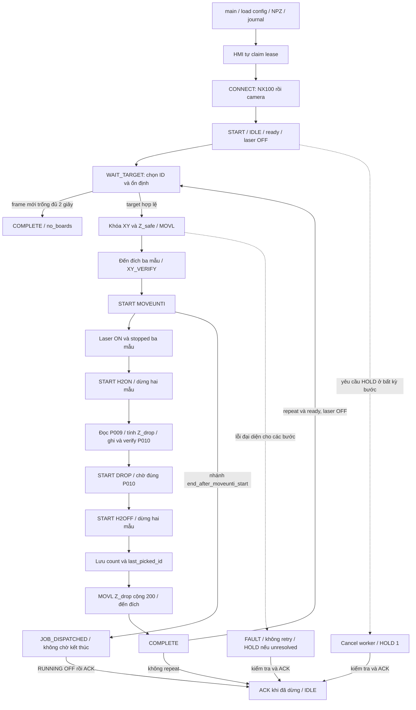
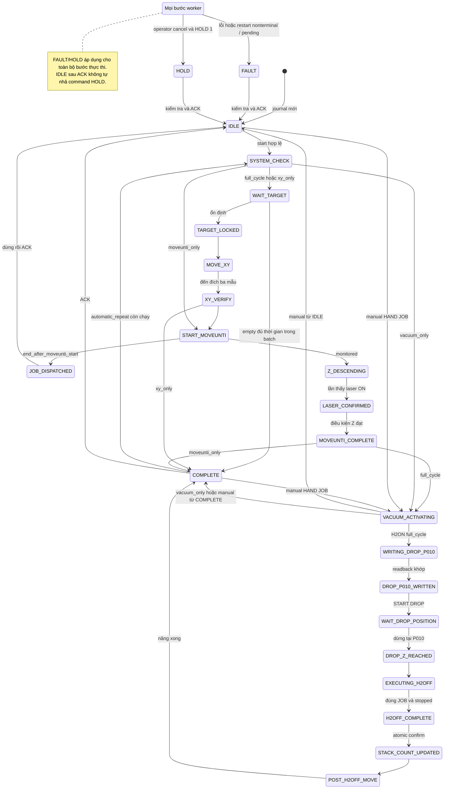

> **27/10/2026 - current full_cycle: SINGLE JOB PICKDROP.** See [migration and HOME report](PICKDROP_MIGRATION.md). REAL is enabled using the operator-confirmed BASE P011 contract. MOVEUNTI + DROP descriptions below are historical.

# PICKING_FULL_CYCLE — SYSTEM TECHNICAL DOCUMENTATION

> Đã dọn snapshot, báo cáo cũ, ảnh chụp và các bản text tham chiếu dư thừa. Các đoạn mô tả artifact đó bên dưới là ghi chép audit lịch sử, không phải phụ thuộc runtime. Hiện chỉ giữ tài liệu này, B090_PREFETCH.md, HW0483202.pdf, asset_hashes.json và LAYOUT_REGRESSION_RESULT.json. Đầu ra kiểm thử mới nằm trong logs/reports/.

Ngày đối chiếu: **26/10/2026, Asia/Bangkok**. Phạm vi: mã nguồn và tài nguyên trong chính thư mục `Picking_full_cycle`; không truy cập dự án nguồn cũ, không chạy ứng dụng/test, không kết nối robot hoặc camera.

Quy ước bằng chứng:

| Nhãn | Ý nghĩa |
|---|---|
| `VERIFIED` | Đã đối chiếu trực tiếp source, cấu hình hoặc nội dung artifact hiện có; không đồng nghĩa đã nghiệm thu phần cứng |
| `INFERRED` | Suy luận có căn cứ từ source/log nhưng chưa có chứng cứ độc lập |
| `UNKNOWN` / `UNVERIFIED` | Chưa đủ bằng chứng xác nhận |
| `REFERENCE ONLY` | Công thức/qui trình tham khảo; không phải triển khai runtime trong repository |

Các tham chiếu `path:Lx` chỉ dòng tại thời điểm lập tài liệu. Liên kết tương đối mở file; tên function giúp truy vết khi số dòng thay đổi.

## Mục lục

1. [SYSTEM OVERVIEW](#phan-1)
2. [SYSTEM ARCHITECTURE](#phan-2)
3. [PROJECT STRUCTURE](#phan-3)
4. [COMPLETE WORKFLOW](#phan-4)
5. [MATHEMATICAL ALGORITHMS](#phan-5)
6. [NX100 COMMUNICATION](#phan-6)
7. [VISION AND CALIBRATION](#phan-7)
8. [FULL CYCLE STATE MACHINE](#phan-8)
9. [WEB UI AND BACKEND](#phan-9)
10. [CONFIGURATION AND DEPLOYMENT](#phan-10)
11. [TESTING AND SAFETY](#phan-11)
12. [CURRENT STATUS AND DEVELOPMENT ROADMAP](#phan-12)
13. [QUICK REFERENCE FOR DEVELOPERS](#phan-13)

<a id="phan-1"></a>
## PHẦN 1 — SYSTEM OVERVIEW

Hệ thống điều phối gắp ván bằng đầu hút trên Yaskawa Motoman UP50N/NX100, dùng camera cố định HIKROBOT, MVS SDK, YOLO và Eye-to-Hand. PC chạy FastAPI/Uvicorn và Web HMI; NX100 thực hiện chuyển động và các JOB có sẵn. Source triển khai cả full cycle, các giai đoạn riêng và simulator; **CLI mặc định REAL** nhưng chỉ kết nối phần cứng khi người vận hành bấm CONNECT.

Camera cấp ảnh BGR gốc cho YOLO. Tâm bounding box được khử distortion, biến thành tia nhìn trong Base và giao với mặt phẳng `plane_z_mm`; cộng offset Base **X+280, Y+215 mm** đúng một lần. Tracker giữ ID/instance; bộ chọn ưu tiên ID lớn hơn ID gắp cuối rồi quay vòng. Target phải ổn định ít nhất **5 frame và 1 giây**, trong dung sai XY 3 mm. Khi khóa target, robot nhận một `MOVL` đến **(X, Y, Z_safe)** với RX/RY/RZ cấu hình; đây là chuyển động XYZ đồng thời, không có bước nâng Z riêng trước khi đi XY.

Z gắp do JOB `MOVEUNTI` trên controller xử lý; PC không suy ra chiều cao từ YOLO và không gửi TCP `IMOV UNTIL`. Theo nhánh hiện tại, PC chờ JOB đúng tên, laser ON và RUNNING OFF đủ ba mẫu, giữ XY/tư thế trong dung sai; rồi gọi `H2ON`. Sau khi JOB hút dừng, PC đọc P009, chỉ thay Z bằng `330 + count × thickness`, ghi/đọc lại P010 rồi gọi `DROP`. JOB DROP chịu trách nhiệm nâng vật, di chuyển và tới điểm thả P010; nội dung JOB chưa có export trong dự án. PC chờ dừng đúng P010, gọi `H2OFF`, tăng đếm theo cycle ID, gửi `MOVL` nâng Z thêm 200 mm và tự lặp tới khi không thấy detection liên tục hai giây trên frame mới.

HMI có CONNECT, START CYCLE, HOLD/UNHOLD, RESET (ACK ứng dụng), HAND 1/2 ON/OFF, thông số vận hành, cảm biến và bộ đếm xếp ván. IN2/IN3 là **tiếp điểm áp suất số chỉ để hiển thị**; code chưa chờ áp suất đạt trước DROP hoặc giám sát mất hút trong lúc mang vật. JOB hoàn thành và bộ đếm tăng chưa chứng minh vật đã bám/nhả thực tế.

`VERIFIED`: có source end-to-end, kết quả test lịch sử, log/journal ghi nhận chu trình. `UNKNOWN`: chất lượng gắp thực tế, an toàn đường đi, nội dung JOB và nghiệm thu cảm biến. Calibration đang `needs_review`, 22/22 outlier; nhánh cấu hình hiện tại bỏ qua các khóa nghiệm thu tĩnh. Giá trị REAL lưu riêng hiện là **350 mm/s**, ghi đè mặc định 80 mm/s. Vì vậy không được coi giao diện READY hoặc COMPLETE là chứng nhận vận hành an toàn.

Nguồn chính: [cycle.py](../workflow/cycle.py):L146–454, [drop.py](../workflow/drop.py):L95–208, [calibration.py](../vision/calibration.py):L63, [config/config.json](../config/config.json), [operator_settings.json](../data/real/operator_settings.json).

<a id="phan-2"></a>
## PHẦN 2 — SYSTEM ARCHITECTURE

PC xử lý ảnh, tạo tọa độ và điều phối; NX100 thi hành MOVL và JOB. Laser/áp suất/relay được truy cập qua I/O của controller, không có kết nối serial/analog trực tiếp từ PC trong source. Quan hệ relay–van–EOAT là suy luận vật lý; source chỉ xác định contact và tên JOB.

```mermaid
flowchart LR
    CAM[HIKROBOT GigE] -->|buffer SDK| MVS[MVS SDK / MvsCamera]
    MVS -->|BGR gốc và frame ID| YOLO[Detector / YOLO]
    YOLO -->|bbox center| CAL[PixelToRobot / NPZ]
    CAL -->|XYZ Base mm| TRACK[BoardTracker / StableTarget]
    TRACK -->|target đã khóa| WF[Cycle / DropWorkflow]
    UI[Web UI] <-->|HTTP JSON / JPEG polling| API[FastAPI backend]
    API <--> WF
    WF -->|Controller / ASCII TCP port 80| NX[NX100 Ethernet Server]
    NX -->|MOVL và JOB| ARM[UP50N]
    LAS[Laser IN1] -->|20050 bit0| NX
    PRESS[Áp suất IN2 / IN3] -->|20051 / 20052| NX
    NX -->|OUT 30050 / 30051| RELAY[Relay]
    RELAY -.->|INFERRED: dây và van chưa có export| VALVE[Van chân không]
    VALVE -.-> EOAT[EOAT đầu hút]
    EOAT -.-> PRESS
    ARM --- EOAT
    WF <--> STORE[Journal / operator settings / StackStore]
```



| Lớp | Trách nhiệm và dữ liệu trao đổi | Nguồn |
|---|---|---|
| `app.py` | Route, lease một HMI, revision/nonce, middleware; trả snapshot, JPEG | `create_app`:L39 |
| `core/launcher.py` | Xác định URL, nhận diện server REAL hiện có, mở Edge sau Uvicorn ready | `existing_real_hmi`:L18, `open_when_ready`:L46 |
| `Vision` | Camera worker + inference worker; đóng gói `frame_id, stamp, items`, preview | [pipeline.py](../vision/pipeline.py):L14 |
| `PixelToRobot` | Load K/distortion/T, kiểm tra rigid transform; ray/plane và bù Base | [calibration.py](../vision/calibration.py):L17 |
| `BoardTracker`, `StableTarget` | ID/instance, association, chọn và xác nhận ổn định | [tracker.py](../vision/tracker.py), [stability.py](../vision/stability.py) |
| `Cycle` | Khóa target, tuần tự hóa lệnh, chờ đến đích/JOB, HOLD/FAULT, batch | [cycle.py](../workflow/cycle.py):L18 |
| `DropWorkflow`, `StackStore` | P009→P010, đích thả, H2OFF, bộ đếm chống trùng, nâng sau thả | [drop.py](../workflow/drop.py):L14, L95 |
| `Controller` | RSTATS/RPOSC/I/O, đọc từng trường độc lập, khóa giao dịch | [controller.py](../robot/controller.py):L12 |
| `Client` | Socket mới cho từng lệnh; handshake ASCII, validate, parse và outcome unknown | [protocol.py](../robot/protocol.py):L188 |
| NX100 JOB | `MOVEUNTI`, `H1ON/OFF`, `H2ON/OFF`, `DROP`; gọi JOB có sẵn trên controller, không upload từ PC | `Cycle._run_once` |

Các thread gồm HTTP handlers, telemetry mỗi 1 giây, workflow theo START, `vision` và `mvs-preview`. `Cycle.lock`, `Controller.lock`, `Vision.lock` là `RLock`; `_WIRE_LOCK` khóa mọi giao dịch TCP trong process. Khóa OS theo journal chỉ bảo vệ các process dùng cùng đường dẫn journal, không chặn host khác hoặc bản sao thư mục khác điều khiển cùng controller.

<a id="phan-3"></a>
## PHẦN 3 — PROJECT STRUCTURE

Tại thời điểm audit có 22 file Python trong ba package runtime (gồm ba `__init__.py` rỗng), cộng ba module `app`, `launcher`, `settings`: **22 module triển khai không rỗng**. Ngoài ra có 19 file test và hai công cụ kiểm thử. Thư mục tài liệu `jobs/` đã được xóa sau audit; ứng dụng gọi JOB có sẵn trên controller. Bảng dưới ghi tài nguyên runtime và hồ sơ lịch sử tại thời điểm audit.

| Path | Vai trò | Thành phần chính | Liên kết |
|---|---|---|---|
| `app.py` | Entry point / backend | `create_app`, `main`, route handlers | [source](../app.py) |
| `core/launcher.py` | Mở HMI và tái dùng server REAL | `APPLICATION_ID`, `hmi_url`, `open_edge` | [source](../core/launcher.py) |
| `core/settings.py`, `config/config.json` | Root path, validate, cấu hình nền | `owned`, `load_config`, `LIMITS`, `fingerprint` | [Python](../core/settings.py), [JSON](../config/config.json) |
| `robot/protocol.py` | Transport TCP ASCII | `Client`, `_Reader`, `encode_command`, `OutcomeUnknown` | [source](../robot/protocol.py) |
| `robot/controller.py` | Facade robot / telemetry | `Controller.connect/status/pose/move/observe` | [source](../robot/controller.py) |
| `robot/cartesian.py` | Pose BASE và payload motion | `Pose`, `coordinate`, `build_move`, `read_pose` | [source](../robot/cartesian.py) |
| `robot/position_variable.py` | P009/P010 Cartesian BASE | `parse_p010`, `with_z`, `verify_p010` | [source](../robot/position_variable.py) |
| `robot/status.py` | Giải mã bit RSTATS | `Status` | [source](../robot/status.py) |
| `robot/io.py` | IOREAD byte, laser tri-state | `read_byte`, `laser_sample` | [source](../robot/io.py) |
| `robot/vacuum.py` | Mapping HAND, đọc contact, nhánh network write | `validate_mapping`, `monitor_inputs`, `read_outputs`, `write` | [source](../robot/vacuum.py) |
| `robot/job_control.py` | Tìm/START/theo dõi MOVEUNTI | `exists`, `current`, `start`, `stop_reason_proven` | [source](../robot/job_control.py) |
| `robot/mock.py` | Controller simulator không socket | `MockClient`, các scenario lỗi | [source](../robot/mock.py) |
| `vision/camera.py` | Adapter MVS Windows | `_InstalledSdkFinder`, `MvsCamera` | [source](../vision/camera.py) |
| `vision/detector.py` | Nạp model và bbox-center→XYZ | `Detector.detect` | [source](../vision/detector.py) |
| `vision/calibration.py` | Ray/plane Base | `PixelToRobot`, `OUTPUT_OFFSET_*` | [source](../vision/calibration.py) |
| `vision/tracker.py` | Bbox association / ID / instance | `BoardTracker` | [source](../vision/tracker.py) |
| `vision/stability.py` | Stable target và pick order | `StableTarget.update` | [source](../vision/stability.py) |
| `vision/pipeline.py` | Luồng ảnh, preview, prefetch target | `Vision` | [source](../vision/pipeline.py) |
| `workflow/cycle.py` | State transitions và batch | `Cycle` | [source](../workflow/cycle.py) |
| `workflow/state_machine.py` | Khóa process và journal bền vững | `InstanceLock`, `Journal`, `STEPS`, `TERMINAL` | [source](../workflow/state_machine.py) |
| `workflow/safety_checks.py` | Ready/workspace/reached/gates | `ready`, `manual_io_ready`, `real_gate` | [source](../workflow/safety_checks.py) |
| `workflow/drop.py` | Đặt/xếp và lưu bộ đếm | `StackStore`, `DropWorkflow` | [source](../workflow/drop.py) |
| `robot/__init__.py`, `vision/__init__.py`, `workflow/__init__.py` | Package markers | Rỗng, không có side effect | [robot](../robot/__init__.py), [vision](../vision/__init__.py), [workflow](../workflow/__init__.py) |
| `calibration/eye_to_hand.npz` | K, distortion, T và report | 22 mẫu; quality `needs_review`; có `T_tool_board` nhưng runtime không dùng | [asset](../calibration/eye_to_hand.npz) |
| `calibration/camera_intrinsic_2.npz` | Asset intrinsic kiểm tra chéo | K/distortion, resolution, report 16 ảnh | [asset](../calibration/camera_intrinsic_2.npz) |
| `models/best.pt` | Trọng số YOLO tùy chỉnh | Nạp bằng `ultralytics.YOLO`; không giải tuần tự hóa PT khi audit | [asset](../models/best.pt) |
| `templates/index.html` | HTML HMI tiếng Việt | Camera, pose, controls, I/O, settings, count | [source](../templates/index.html) |
| `static/app.js`, `static/style.css` | Polling và responsive layout | `refresh`, `render`, `command`, desktop/tablet | [JS](../static/app.js), [CSS](../static/style.css) |
| `data/real/operator_settings.json` | Ghi đè settings REAL | Hiện `movl_speed=350` | [data](../data/real/operator_settings.json) |
| `data/real/execution.json`, `data/mock/execution.json` | Journal theo mode | state, revision, pending, requests, history; không tự replay | [REAL](../data/real/execution.json), [MOCK](../data/mock/execution.json) |
| `data/real/drop_stack.json` | Bộ đếm, thickness, chống đếm trùng | count=6, last_picked_id=1 tại snapshot; next Z=402 | [data](../data/real/drop_stack.json) |
| `data/*/execution.lock` | File phục vụ OS lock | File tồn tại không chứng minh process đang chạy | [lock REAL](../data/real/execution.lock) |
| `data/real/execution.before_auto_count.json` | Snapshot trước đổi cách đếm | Có `AWAIT_DROP_CONFIRMATION`; không được runtime tự load | [snapshot](../data/real/execution.before_auto_count.json) |
| `logs/real/app.log`, `logs/mock/app.log` | Log runtime theo mode | State history và lỗi; có đường dẫn lịch sử, không phải import runtime | [REAL](../logs/real/app.log), [MOCK](../logs/mock/app.log) |
| `logs/ultralytics/Ultralytics/settings.json` | Cấu hình do Ultralytics lưu | Không dùng thay config/config.json | [data](../logs/ultralytics/Ultralytics/settings.json) |
| `tests/test_*.py` | 21 module test, 192 test | Bảng nhóm kiểm thử ở phần 11 | [tests](../tests/) |
| `tools/run_tests.py` | unittest runner | Ghi kết quả vào `logs/reports/tests/` | [source](../tools/run_tests.py) |
| `tools/browser_smoke.py` | Playwright/Edge MOCK integration | Server/journal tạm, screenshot và JSON report | [source](../tools/browser_smoke.py) |
| `requirements*.txt` | Dependencies và inventory khóa | Base, dev, real; chi tiết phần 10 | [base](../requirements/base.txt), [lock](../requirements/lock.txt), [real](../requirements/real.txt), [real-lock](../requirements/real-lock.txt), [dev](../requirements/dev.txt) |
| `README.md` | Hướng dẫn hiện có | Có đoạn lịch sử mâu thuẫn code, xem phần 11 | [README](../README.md) |
| `docs/TEST_REPORT.md`, `test_result.json`, `test_output.txt` | Bằng chứng test lịch sử | 151 test trong artifact; source Python có 151 `test_*` | report, JSON, output |
| `docs/browser_result.json`, `hmi_*.png`, `browser_server.log` | Browser smoke | Kết quả MOCK, screenshot desktop/tablet; log server hiện rỗng | JSON, READY, COMPLETE, tablet |
| `docs/real_preflight.json`, `real_robot_readonly.json`, `laser_live_read.json`, `job_directory_live.json` | Preflight và đọc controller lịch sử | Blank-image inference, TCP timeout, laser raw=4, RJDIR 120 JOB | preflight, TCP, laser, JOB |
| `docs/runtime_smoke.json`, `real_runtime_smoke.json`, `real_before_v1_update.json` | Snapshot server và lỗi lịch sử | Không xác định server đang sống hiện tại | MOCK, REAL, before |
| `docs/IO_MAPPING.md`, `DROP_HEIGHT_CONTROL.md`, `REAL_DEPLOYMENT_CHECKLIST.md` | Ghi chép vận hành cũ/mới | Phải đối chiếu code; một số khóa/UI/mapping đã thay đổi | I/O, DROP, checklist |
| `docs/AUDIT_REPORT.md`, `copied_files.json`, `source_hashes.json`, `source_verification.json`, `asset_hashes.json`, `real_dependency_copy.json`, `source_camera_config.json` | Provenance lịch sử | Không load như runtime config; không dùng dự án cũ làm căn cứ chính | audit, [assets](../docs/asset_hashes.json) |
| `docs/HW0483202.pdf`, `33175396.txt` | Manual Ethernet Server / bản text | Đối chiếu framing và command; §3.1, §3.2, §5 | [PDF](../docs/HW0483202.pdf), text |
| `docs/343135.txt`, `35567548.txt`, `41605397.txt` | Manual bổ trợ NX100 | Operator/troubleshooting/handling; không phải code JOB tại cell | operator, troubleshooting, handling |
| `.gitignore` | Ignore | Bỏ qua venv/cache/runtime data | [source](../.gitignore) |

`.venv/`, `__pycache__/` và binary lớn không được phân tích nội dung. NPZ chỉ được đọc dạng dữ liệu với `allow_pickle=False`; model chỉ kiểm kê/hash và đối chiếu nơi nạp.

<a id="phan-4"></a>
## PHẦN 4 — COMPLETE WORKFLOW

Đây là luồng thực tế với `z_completion=laser_on_and_stopped`, `position_variable=10`, `repeat_until_empty=true`. Các timeout trong bảng là giá trị `config/config.json`; chúng không phải deadline cứng cho toàn bộ bước vì một bước có nhiều giao dịch TCP, mỗi pha đọc có deadline riêng. Khi ghi `FAULT*`, hiểu là xử lý trong `_run_once`: giữ lệnh chưa rõ kết quả, không retry và yêu cầu HOLD một lần nếu còn chuyển động/lệnh chưa giải quyết.

### 4.1 Quy trình 18 bước

| # / Bước | File/function | Input → output | Bắt đầu / điều kiện hoàn thành | Timeout, lỗi / tiếp theo |
|---|---|---|---|---|
| 1. Khởi động | `app.py:L227 main`, `core/launcher.py:L18` | CLI → Uvicorn REAL hoặc URL server sẵn có | `python app.py`; trả UI khi server started; chưa nối phần cứng | Probe server có timeout 5 s; thiếu dependency/dữ liệu/lock thì startup lỗi; →2 |
| 2. Load config/calib | `core/settings.py:L20 load_config`; `Cycle.__init__:L19`; `Vision.__init__:L15` | JSON + hai NPZ + journal + StackStore → cfg và state | Load config nền, validate transform/intrinsic, load operator settings ghi đè | Không có application timeout; asset sai thì tạo app thất bại; journal dang dở→FAULT; →CONNECT |
| 3. Kết nối camera | `Cycle.connect:L45`, `Vision.connect:L35`, `MvsCamera.connect:L111` | IP/SDK/model → worker và frame mới | Thực tế diễn ra **sau bước 4–5**; đúng một GigE camera khớp IP; đủ frame mới thì camera.connected | GetImageBuffer 300 ms/lượt, 10 lỗi liên tiếp thì ngắt; YOLO load không có timeout riêng; →6 |
| 4. Kết nối NX100 | `Controller.connect:L27` | IP:port → status, pose, joints | POST CONNECT sau lease; lần lượt RSTATS/RPOSC/RPOSJ thành công | TCP/pha đọc 3 s; fail thì POST lỗi, không tự START; →5 rồi3 |
| 5. Ready/preflight | `Cycle.start:L146`, `ready:L5`, `_pose_checks:L235` | flags, laser, connected, stage → SYSTEM_CHECK | IDLE, không worker; camera mới; SERVO/REMOTE/PLAY ON, TEACH/ALARM/ERROR/HOLD/RUNNING OFF; laser OFF trừ vacuum_only | Đồng bộ trong START, giao dịch 3 s/pha; guard lỗi từ chối START; →6 |
| 6. Nhận diện | `Vision._work:L64`, `Detector.detect:L16` | BGR gốc → bbox/conf/name/u/v/xyz | Worker camera hoạt động; kiểm tra resolution; predict thành công | Vòng vision chờ 0.1 s + inference; không deadline predict; lỗi ban đầu có grace 3 s, sau đó ngắt vision; →7 |
| 7. Chọn target | `StableTarget.update:L15`, `Cycle._target:L190` | Detection có xyz, confidence≥0.5, không uncertain → ứng viên | ID theo vòng sau `last_picked_id`; `instance` phân biệt tái dùng ID | Chung target_timeout 30 s; không có ứng viên chưa chắc hết ván; →8 |
| 8. Xác nhận ổn định | `StableTarget.update:L32` | Frame ID/timestamp/XY → deepcopy target mới nhất | ≥5 frame và ≥1 s; age≤1 s, gap≤0.5 s; XY lệch≤3 mm với mọi mẫu đang giữ | Quá 30 s→FAULT*; camera lỗi→FAULT*, không coi là hết vật; →9 |
| 9. Tính XY / khóa pose | `PixelToRobot.convert:L63`, `_target:L225` | u/v/Plane Z → xyz Base; pose=(X,Y,Z_safe,RX,RY,RZ) | Transform thực hiện ở bước 6 cho mọi bbox; tại đây khóa bản sao và kiểm workspace | Không timeout riêng; transform lỗi gắn `item.error`, ứng viên đó không đủ xyz; →10 |
| 10. Di chuyển gắp | `Cycle._move:L243`, `Controller.move:L59` | Pose đã khóa + RPOSC metadata → MOVL | Đọc ready/start pose; giữ posture/tool/external axes; xong khi RUNNING OFF và reached ba mẫu; kiểm lại XY_VERIFY | Motion 120 s, poll 0.1 s; mất ACK/metadata đổi/đích sai→FAULT*; →11 |
| 11. Tìm Z | `_start_moveunti:L270`, `_job:L285`, `_wait_laser_and_stopped:L326` | START MOVEUNTI → `stop_position` | Z_safe/tư thế đúng; JOB tồn tại, laser OFF. Xong khi đúng JOB, laser ON + stopped ba mẫu, XY/angles trong dung sai | JOB 60 s; laser UNKNOWN/sai JOB/timeout→FAULT*, không H2ON; →12 |
| 12. Bật hút | `_execute_hand_job:L533`, `Controller.start_hand_job:L79` | channel=2,on=true → START H2ON đúng một lần | Ngay trước gửi kiểm lại ready, MOVEUNTI và laser ON. Xong khi RJSEQ=H2ON, RUNNING OFF hai mẫu | HAND 10 s; không bắt buộc quan sát RUNNING ON; mất reply/timeout/sai JOB→FAULT*; →13 |
| 13. Xác nhận áp suất | `Controller.observe:L94`, UI `renderLaser:L18` | IN2/IN3 → hai boolean/UNKNOWN | **Chỉ telemetry, không có state chờ áp suất, không có điều kiện đạt để chuyển bước** | **NOT IMPLEMENTED** interlock/timeout hút; code đi thẳng →14 |
| 14. Nâng vật | `_run_once:L428`, `DropWorkflow._prepare_drop_variable:L96` | P009 + height → LOADV P010, readback, START DROP | Sau H2ON; P009 Cartesian BASE, Z trong workspace và ≤safe+tol; readback toàn bộ khớp | Giao dịch 3 s/pha; fail chặn START DROP; **đường nâng trong JOB DROP UNKNOWN**; →15 |
| 15. Đi đến nơi đặt | `_run_once:L429`, `_wait_drop_variable_target:L117` | START DROP → pose tại P010 | Controller thực hiện JOB; PC kiểm current_job=DROP, ready, workspace, RUNNING OFF + reached ba mẫu | DROP 120 s; sai JOB/pose/timeout→FAULT*, không H2OFF; →16 |
| 16. Hạ và nhả | `_finish_drop:L158`, `_execute_hand_job:L533` | Đã đến P010 → H2OFF completion receipt | Hạ Z thuộc JOB DROP; PC không gửi MOVL hạ trong nhánh P010. Kiểm lại pose, START H2OFF một lần, dừng hai mẫu | HAND 10 s; lỗi không tăng đếm; receipt `board_release_confirmed=false`; →17 |
| 17. Hoàn tất đặt | `StackStore.confirm:L82`, `_finish_drop:L188` | cycle ID, picked ID → count+1 và last_picked_id | H2OFF đã kết thúc; lưu atomic/fsync/replace; cycle đã có thì không đếm lại | Không timeout filesystem; lỗi lưu→FAULT*; count đã lưu không hoàn tác nếu nâng sau đó lỗi; →18 |
| 18. Nâng sau thả/lượt mới | `_after_h2off_move:L198`, `_run_batch:L362`, `_target:L190` | Z_drop→Z_drop+200; ảnh mới→lượt tiếp | MOVL giữ XY/angles, đến đích; ready và laser OFF trước lượt mới. Không có HOME tự động | MOVL 120 s; trống ≥2 s và ≥5 frame mới→COMPLETE/no_boards; stage riêng chỉ chạy một lần; lỗi/HOLD dừng batch |

### 4.2 Flowchart thực thi



### 4.3 Sequence diagram

```mermaid
sequenceDiagram
    actor OP as Người vận hành
    participant UI as Web UI
    participant API as FastAPI
    participant WF as Cycle / Journal
    participant V as Vision / MVS / YOLO
    participant NX as NX100
    OP->>UI: CONNECT rồi START
    UI->>API: POST JSON revision + request_id
    API->>WF: authorized và start
    WF->>V: sample / StableTarget
    V-->>WF: Target frame mới ổn định / XYZ Base
    WF->>WF: persist intent MOVL
    WF->>NX: MOVL X,Y,Z_safe,RX,RY,RZ
    NX-->>WF: 0000 (nhận lệnh)
    loop Chờ đến đích
        WF->>NX: RSTATS / RPOSC
        NX-->>WF: flags / pose
    end
    WF->>NX: RJDIR rồi START MOVEUNTI
    loop Chờ Z
        WF->>NX: RSTATS / RPOSC / IOREAD / RJSEQ
        NX-->>WF: Laser ON + stopped + đúng JOB
    end
    WF->>NX: START H2ON
    WF->>NX: RJSEQ / RSTATS đến khi dừng hai mẫu
    Note over WF,NX: IN2/IN3 chỉ hiển thị, không chờ áp suất
    WF->>NX: SAVEV 4,9
    WF->>WF: Z_drop / chuẩn bị lịch sử target tiếp
    WF->>NX: LOADV P010 rồi SAVEV 4,10
    WF->>NX: START DROP
    Note over NX: JOB thực hiện nâng / đi / hạ; chưa có export
    WF->>NX: Poll đến khi DROP dừng đúng P010
    WF->>NX: START H2OFF rồi poll dừng
    WF->>WF: Lưu count đúng một lần
    WF->>NX: MOVL Z_drop + 200 / poll đến đích
    loop Batch khi còn detection
        WF->>V: Frame sau nâng / chọn target tiếp
    end
    UI->>API: GET state mỗi 500 ms
    API-->>UI: COMPLETE khi no_boards hoặc trạng thái lỗi
```

### 4.4 Các nhánh cần phân biệt

| Nhánh | Hành vi thật |
|---|---|
| `xy_only` | Chọn target và một MOVL, xác nhận đích rồi COMPLETE; không tìm Z |
| `moveunti_only` | Cần robot đã ở Z_safe/tư thế cấu hình; START MOVEUNTI và chờ theo mode; không H2ON/DROP |
| `vacuum_only` | Gọi H2ON rồi COMPLETE; START vẫn yêu cầu camera và motion-ready, REAL gate hiện còn cần nghiệm thu riêng |
| `end_after_moveunti_start=true` | Sau ACK START chuyển JOB_DISPATCHED, không chờ laser, không hút/đặt; không tự batch tiếp |
| Không `laser_on_and_stopped` | Nhánh `_job` cũ đòi RUNNING đã ON, laser edge, descent và stop_reason_proven; REAL chưa có adapter chứng minh nguyên nhân dừng |
| `drop.position_variable` không có | Nhánh hồi quy: chờ DROP dừng Z=600, tính Z_drop, PC MOVL hạ Z rồi H2OFF |
| Quy trình đề xuất, chưa có | Chờ áp suất sau hút, theo dõi bám vật khi nâng/chuyển, cảm biến nhả, kiểm chứng cause-of-stop và đường đi; không vẽ chúng như bước runtime đã triển khai |

<a id="phan-5"></a>
## PHẦN 5 — MATHEMATICAL ALGORITHMS

Runtime dùng giao tia nhìn với mặt phẳng Base, không dùng depth camera hay inverse kinematics trên PC. Các phép toán bên dưới phân biệt rõ code đang tính, dữ liệu report đã lưu và lý thuyết tham khảo. Ký hiệu \({}^{A}T_B\) biến đổi tọa độ từ frame B sang frame A, vector cột; chiều dài runtime là mm, góc robot là độ.

### 5.1 Intrinsic, distortion và pixel → camera

Intrinsic chứa:

\[
K=\begin{bmatrix}f_x&s&c_x\\0&f_y&c_y\\0&0&1\end{bmatrix},\quad
\tilde p=K[x_d,y_d,1]^T.
\]

Input: điểm ảnh `(u,v)` pixel; output chuẩn hóa `(x_n,y_n)` không đơn vị sau khử méo. K có `fx=4674.729315`, `fy=4693.272834`, `cx=2549.936888`, `cy=1973.510994`, `s=0`; ảnh **5472×3648**. Dữ liệu hai NPZ trùng K/distortion; `Vision.__init__:L24` kiểm tra chéo hai trường này, không kiểm tra toàn bộ report hay equality resolution của intrinsic thứ hai.

Với model năm hệ số trong asset, mô hình forward là:

\[
r^2=x_n^2+y_n^2,\qquad q=1+k_1r^2+k_2r^4+k_3r^6,
\]
\[
x_d=x_nq+2p_1x_ny_n+p_2(r^2+2x_n^2),\quad
y_d=y_nq+p_1(r^2+2y_n^2)+2p_2x_ny_n.
\]

`REFERENCE ONLY` đối với khai triển forward: project không tự lập trình các biểu thức này; nó gọi `cv2.undistortPoints` trong [calibration.py](../vision/calibration.py):L69 để giải ngược. Distortion không đơn vị, thứ tự `(k1,k2,p1,p2,k3)` = `(-0.2532737023, 0.2234199981, -0.00316510373, 0.01094859233, 0.06345229704)`. Không được chỉ lấy \(K^{-1}[u,v,1]^T\) rồi bỏ qua distortion.

Ray camera và điểm theo độ sâu:

\[
d_C=[x_n,y_n,1]^T,\qquad p_C=\lambda d_C.
\]

Input pixel→ray, output hướng không đơn vị; \(\lambda\) là mm khi translation dùng mm. Đây là cách biểu diễn tương đương `convert`: code trực tiếp quay ray sang Base; nó không đo \(\lambda\) bằng camera. Camera frame theo report: +X sang phải, +Y xuống dưới, +Z ra trước.

### 5.2 Eye-to-Hand và homogeneous transform

\[
{}^BT_C=\begin{bmatrix}R_{BC}&t_{BC}\\0&1\end{bmatrix},\quad
\begin{bmatrix}p_B\\1\end{bmatrix}={}^BT_C\begin{bmatrix}p_C\\1\end{bmatrix},\quad
p_B=R_{BC}p_C+t_{BC}.
\]

Input điểm Camera mm; output Base mm. `PixelToRobot.__init__:L21` load `T_base_camera`, `convert:L71` dùng R/t; kiểm tra \(R^TR\approx I\), \(\det R\approx1\) với atol `1e-5`, hàng cuối `[0,0,0,1]` atol `1e-8`, mọi phần tử hữu hạn. Ma trận dưới làm tròn để đọc; runtime dùng đầy đủ precision của NPZ:

\[
{}^BT_C\approx\begin{bmatrix}
0.024963289&-0.998402026&-0.050697426&1260.248627\\
-0.999665076&-0.024584400&-0.008083517&73.614719\\
0.006824233&0.050882237&-0.998681344&1390.587877\\
0&0&0&1
\end{bmatrix}.
\]

Quan hệ calibration lưu trong `eye_to_hand.npz/report_json`:

\[
A_iY=XB_i,\quad
A_i={}^BT_{Tool,i},\quad Y={} ^{Tool}T_{Board},\quad
X={}^BT_C,\quad B_i={}^CT_{Board,i}.
\]

Input các pose tool và board; output transform X/Y, translation mm, rotation không đơn vị. **Đây là quan hệ trong metadata, không có solver calibration trong source hiện tại.** Asset giữ 22 cặp ma trận mẫu `(22,4,4)`, `T_tool_board`, diagnostics; chương trình chỉ load X/K/distortion/size/report. Không dùng `T_tool_board` để cộng một tool offset lúc gửi MOVE.

### 5.3 Giao ray với mặt phẳng và tọa độ gửi robot

Trong [calibration.py](../vision/calibration.py):L63 `convert(u,v,plane_z)`:

\[
o_B=t_{BC},\quad d_B=R_{BC}d_C,\quad
\lambda=\frac{z_{plane}-o_{B,z}}{d_{B,z}},\quad
p_{B,raw}=o_B+\lambda d_B,
\]
\[
p_{B,out}=p_{B,raw}+[280,215,0]^T\ \text{mm}.
\]

Input `u,v` pixel và `plane_z` mm Base; output `(X,Y,plane_z)` mm. Code từ chối pixel ngoài ảnh, không hữu hạn, \(|d_{B,z}|<10^{-9}\), \(\lambda\le0\); gán Z đúng `plane_z` trước cộng offset. Đây là offset theo trục Base, không phải tịnh tiến quay theo TCP.

Ví dụ số được tính chỉ từ **NPZ hiện có**, không phải điểm đã đo trên vật: `(u,v)=(2736,1824)`, `plane_z=0` cho `(x_n,y_n)≈(0.03975694,-0.03183497)`, `d_B≈(-0.01792086,-0.04704449,-1.00002987)`, `λ≈1390.546344 mm`; `p_raw≈(1235.328842,8.197169,0)`, `p_out≈(1515.328842,223.197169,0) mm`. Target MOVL với settings hiện tại là `(1515.329,223.197,500,180,0,90)` sau làm tròn; chất lượng calibration chưa được chứng minh bằng ví dụ này.

### 5.4 Bounding box, association và object selection

Tâm bbox trong [detector.py](../vision/detector.py):L25–33:

\[
u=(x_1+x_2)/2,\qquad v=(y_1+y_2)/2.
\]

Input `xyxy` pixel gốc; output tâm pixel cho `convert`. Bbox phải hữu hạn, \(0\le x_1<x_2\le W\), \(0\le y_1<y_2\le H\). Không dùng segmentation/centroid vật hoặc ước lượng orientation từ bbox. Test xác thực thuật toán bằng bbox giả `[10,20,30,60]` → tâm `(20,40)`; không phải detection phần cứng.

Score trong [tracker.py](../vision/tracker.py):L13:

\[
IoU=\frac{A_{overlap}}{A_a+A_b-A_{overlap}},\quad
d_{rel}=\frac{\|c_a-c_b\|_2}{\max(\sqrt{w_a^2+h_a^2},\sqrt{w_b^2+h_b^2})},
\]
\[
S=IoU+0.2(1-\min(d_{rel},1)).
\]

Input hai bbox pixel và class name; output score không đơn vị hoặc không ghép. Width/height mỗi bbox lấy tối thiểu 1 pixel; khác name hoặc tỷ lệ kích thước lớn hơn 2 bị loại; `IoU<0.1 AND d_rel>0.5` cũng bị loại. Greedy ghép theo score giảm dần; hai ghép cạnh tranh chênh score `<0.05` làm detection `uncertain`. Không phải Kalman/Hungarian hay Ultralytics `track()`.

ID mới là số nguyên dương nhỏ nhất chưa bị reserve, các detection cùng frame được cấp từ trái qua phải rồi trên xuống dưới. Track vắng giữ ID khi \(now<last\_seen+10\,s\); sau đó ID có thể tái dùng với `instance` mới. Detection trả về chỉ gồm vật đang thấy, không biến track ẩn thành target cũ.

Chọn ứng viên tại [stability.py](../vision/stability.py):L23–31:

\[
i^*=\arg\min_{i\in C}\big(\mathbb{1}[c\ne\varnothing\land id_i\le c],\ id_i\big),
\]

với C gồm detection không uncertain, có xyz hữu hạn, confidence≥0.5; c là `last_picked_id`. Input IDs và cursor; output một detection. Confidence là điều kiện lọc, không phải hàm xếp hạng; ví dụ cursor=1, IDs `{1,4}` chọn 4, cursor=4 và `{1,2}` chọn 1. Cursor chỉ cập nhật cùng giao dịch tăng đếm sau H2OFF, không cập nhật khi vừa lock target.

### 5.5 Tracking stability, khoảng cách và ngưỡng vị trí

Khoảng cách XY:

\[
d_{XY}(a,b)=\sqrt{(X_a-X_b)^2+(Y_a-Y_b)^2}\quad[mm].
\]

`StableTarget.update:L32` so **mẫu mới với mọi mẫu đang giữ**, reset nếu có khoảng cách `>3 mm`, identity đổi hoặc gap `>0.5 s`; không kiểm tra full pairwise diameter trong một lần gọi. Mẫu phải có frame ID và stamp tăng, tuổi \(0\le now-stamp\le1\,s\). Điều kiện output target:

\[
N\ge5\quad\land\quad t_{newest}-t_{oldest}\ge1\,s.
\]

Output là deepcopy **mẫu mới nhất**, không lấy trung bình XY. Lịch sử được cắt nhưng giữ đủ cửa sổ dwell; timestamp là monotonic phía PC khi nhận/chuyển frame, không phải thời gian phơi sáng hardware. Prefetch giữ cùng yêu cầu nhưng bắt buộc frame sau khi bước nâng kết thúc.

Reached trong [safety_checks.py](../workflow/safety_checks.py):L81:

\[
\Delta\theta=\left((\theta_{current}-\theta_{target}+180)\bmod360\right)-180,
\]
\[
reached=\bigwedge_{a\in\{x,y,z\}}|p_a-q_a|\le1\,mm\quad\land\quad
\bigwedge_{a\in\{rx,ry,rz\}}|\Delta\theta_a|\le0.5^\circ.
\]

Input hai pose và config; output boolean. Đây là ngưỡng **từng trục**, không phải tổng norm XYZ. Bộ đếm settle là \(s_k=s_{k-1}+1\) khi `RUNNING=false AND reached`, ngược lại 0; MOVL/P010 đòi \(s_k\ge3\). `_wait_laser_and_stopped` đếm ba mẫu laser+stopped, không bắt buộc Z không đổi giữa ba mẫu.

`workspace:L14` chỉ kiểm từng tọa độ hữu hạn và giới hạn \(l_a\le p_a\le u_a\). `_wait_laser_and_stopped:L341` dùng norm XY≤1 mm và angle wrap≤0.5° so với start. Nhánh `_job` cũ còn kiểm \(Z\ge min_z\), \(Z_{start}-Z\le max\_descent\), \(Z\le Z_{start}+1\) mm; **nhánh hiện tại không có các kiểm tra hành trình Z chuyên biệt này**, chỉ workspace.

### 5.6 Z offset, stack height, tool và đơn vị

Trong [drop.py](../workflow/drop.py):L59 và L198:

\[
Z_{drop}=Z_{first}+n\,h,\qquad Z_{after}=\operatorname{round}(Z_{drop}+200,3)\quad[mm].
\]

Input count n trước tấm đang thả, thickness h mm, first Z mm; output Z tuyệt đối Base. Dùng `Decimal(str(...))` cho tổng chiều cao; h phải `0<h≤1000` và tối đa ba số thập phân. Với `first=330,h=12`: n=0/1/2 → 330/342/354 mm; snapshot n=6 → **402 mm**, sau thả dự kiến nâng tới 602 mm. P010 giữ nguyên mọi trường P009 ngoài Z; check `Z_drop≤safe_z+xyz_tolerance=601 mm` không phải giới hạn Z+200.

`z_safe=500` là Z tuyệt đối của pose gắp ban đầu, không cộng vào `plane_z=0`; Z gắp sau MOVEUNTI được đọc từ RPOSC, không cộng suction offset. Không có công thức bù chiều dài EOAT/TCP trong Python; TOOL/posture lấy metadata controller. `Pose.verify_unchanged` có kiểm 0.05 cho sáu trường đầu, 0.001 cho trục ngoài nhưng **không được Cycle gọi**; đường chạy hiện dùng kiểm riêng trong `_move`.

\[
x_{mm}=1000x_m,\qquad\theta_{rad}=\theta_{deg}\pi/180.
\]

`REFERENCE ONLY`: công thức đổi đơn vị chuẩn; runtime không có bước đổi m→mm hoặc Euler→matrix để gửi robot. [controller.py](../robot/controller.py):L61 định dạng cả sáu giá trị pose `.3f`; `coordinate` dùng `Decimal`, giới hạn biểu diễn `9999999.999` và tối đa ba chữ số thập phân. `MOVL` selection 0 dùng mm/s, RPOSC TX/TY/TZ được đặt tên rx/ry/rz ở PC; không nên suy ra sai quy ước Euler của controller từ tên biến.

Metadata calibration khai báo Euler **intrinsic xyz**, đơn vị độ. Biểu thức \(R=R_x(r_x)R_y(r_y)R_z(r_z)\), với \(R_x=\begin{bmatrix}1&0&0\\0&\cos r_x&-\sin r_x\\0&\sin r_x&\cos r_x\end{bmatrix}\) và các rotation cơ bản tương ứng, là `REFERENCE ONLY` theo quy ước active/column nêu trên: source hiện tại không dựng R từ rx/ry/rz và không kiểm chứng quy ước đó trên NX100.

### 5.7 Calibration residual và reprojection error

Report trong NPZ lưu weighting:

\[
r_i=\begin{bmatrix}
(t(A_iY)-t(XB_i))/s_t\\
\operatorname{Log}(R(XB_i)^T R(A_iY))/s_r
\end{bmatrix},\quad
J=\frac12\sum_j\rho(r_j^2),\quad s_t=1\,mm,\ s_r=0.01\,rad.
\]

Đây là **metadata của lần tối ưu**, không phải function đang có trong repository. Input pose samples; output residual không đơn vị/cost; report ghi loss linear, optimizer success=true, 29 evaluations, normalized Jacobian condition≈44.10. Thành công optimizer không có nghĩa residual đạt.

\[
e_t=\|t(A_iY)-t(XB_i)\|_2,\quad
e_R=\arccos\!\left(\operatorname{clip}\left(\frac{\operatorname{tr}(R_1^TR_2)-1}{2},-1,1\right)\right),
\quad e_{px}=\sqrt{\frac1N\sum_j\|p_j-\hat p_j\|_2^2}.
\]

`REFERENCE ONLY`: định nghĩa thông dụng để đọc report, không có hàm tính residual/reprojection trong project. Input pose hoặc điểm ảnh quan sát/dự báo; output mm, rad (đổi sang độ trong summary), pixel. `quality_message:L46` chỉ định dạng các giá trị đã lưu, không recompute.

| Dữ liệu đọc từ asset | Giá trị | Diễn giải bằng chứng |
|---|---|---|
| Intrinsic / 16 ảnh / bàn 6×9, ô 27 mm | RMS 0.630883 px | Report lịch sử, chưa tái fit |
| Eye-to-Hand / 22 mẫu / bàn 9×6, ô 27 mm | `quality_status=needs_review`, outlier 22/22 | Không đạt nhãn residual_checks_passed |
| Translation residual | RMS 63.967298 mm; max 129.272143 mm | Sai lệch consistency lớn, không phải đo accuracy của điểm gắp |
| Rotation residual | RMS 16.812057°; max 38.012172° | Cần đối chiếu ghép ảnh/pose và quy ước góc |
| Eye-to-Hand reprojection | RMS 184.332850 px; max 424.400146 px | Khác RMS intrinsic |
| PnP reprojection summary | RMS 2.353755 px | Không thay thế residual Eye-to-Hand |
| Threshold outlier trong report | 3 mm / 1° / 2 px | Dữ liệu diagnostic, không phải guard motion runtime |

<a id="phan-6"></a>
## PHẦN 6 — NX100 COMMUNICATION

Driver thực hiện **NX100 Ethernet Server bằng ASCII/TCP**, IP `192.168.255.1`, port `80`, timeout cấu hình 3 giây. Port 80 không biến giao thức thành HTTP; không dùng YERC/HSES UDP. Code và manual cục bộ [HW0483202](../docs/HW0483202.pdf) / bản text được đối chiếu ở handshake, START, motion và variables.

### 6.1 Packet request/response

| Pha | Byte trên wire / parser |
|---|---|
| 1 | Mở `socket.create_connection`, gửi `CONNECT Robot_access\r\n` |
| 2 | Đọc đến CRLF; regex chấp nhận `OK: NX Information Server(version).` với khoảng trắng tùy chọn trước dấu ngoặc |
| 3 | Gửi `HOSTCTRL_REQUEST <COMMAND> <N>\r\n`; N là số byte payload **gồm CR cuối**; không data thì N=0 |
| 4 | Chờ chính xác `OK: <COMMAND>\r\n`, mới gửi `<data>\r` nếu có |
| 5 | Data read thường kết thúc CR; command điều khiển còn bắt buộc LF và kết quả `0000`; ERROR/NG là lỗi |
| 6 | Đóng socket sau mỗi command; không Keep-Alive. Riêng RJDIR đọc đến EOF và yêu cầu final CR/CRLF để không cắt danh sách |

Ví dụ source `START MOVEUNTI`: header `HOSTCTRL_REQUEST START 9\r\n`, payload `MOVEUNTI\r` (8 ký tự + CR). `H2OFF` có N=6, `RJDIR *` có N=2, `HOLD 1` có N=2. `0000` chứng minh lệnh được chấp nhận, completion phải do workflow xác minh riêng.

[protocol.py](../robot/protocol.py):L45 validate ASCII printable, cấm CR/LF do caller chèn, numeric hữu hạn không exponent, payload≤256 bytes trước mở socket. `_Reader:L131` đệm dữ liệu để xử lý TCP fragmentation/coalescing, giới hạn khoảng 64 KiB; RJDIR timeout/EOF sai không bị diễn giải thành JOB không tồn tại.

### 6.2 Command/API quan trọng

| Command / input | Output / sử dụng | Source reference |
|---|---|---|
| `RSTATS`, không data | Hai word decimal; flags | `Controller.status:L34`, `Status:L1` |
| `RPOSC`, `0,1` | 14 trường: XYZ/TX/TY/TZ, posture, tool, sáu trục ngoài; BASE | `read_pose:L61`, `Pose.parse:L14` |
| `RPOSJ`, không data | Joint position raw; connect chỉ kiểm giao dịch thành công, không parse số joint | `Controller.connect:L31` |
| `MOVL` | Payload 17 trường; `0000`, sau đó chờ pose | `Controller.move:L59`, `build_move:L47`, `_move:L243` |
| `RJDIR`, `*` | Toàn bộ tên JOB, parse comma/CR/LF, tìm MOVEUNTI | `job_control.exists:L5`, `_Reader.until_closed:L138` |
| `RJSEQ`, không data | `job,line,step`; ba trường, hai trường cuối số | `Controller.current_job:L86`, `job_control.current:L13` |
| `START`, `MOVEUNTI` | Chạy JOB có tên từ đầu, không resume | `job_control.start:L21`, `Cycle._start_moveunti:L270` |
| `START`, H1ON/H1OFF/H2ON/H2OFF | Các JOB được config cho phép | `Controller.start_hand_job:L79`, `_execute_hand_job:L533` |
| `START`, `DROP` | JOB thả có sẵn, nằm trong allowlist | `Controller.__init__:L17`, `_run_once:L432` |
| `SAVEV`, `4,9` hoặc `4,10` | Chỉ đọc P009/P010; reply mười trường | `position_variable.parse_p010:L7`, `_prepare_drop_variable:L105` |
| `LOADV`, `4,10,1,0,X,Y,Z,RX,RY,RZ,posture,tool` | Chỉ ghi P010 Cartesian BASE, 12 trường; readback bắt buộc | `encode_command:L98`, `with_z:L17`, `verify_p010:L27` |
| `IOREAD`, `20050,8` | Byte laser/áp suất; decimal 0..255 | `io.read_byte:L5`, `laser_sample:L12` |
| `IOREAD`, `30050,8` | Byte output relay, bit0/bit1 | `vacuum.read_outputs:L35` |
| `IOWRITE`, start/count/bytes | Chỉ network input #22010..#23287, count bội 8; nhánh REAL hiện không dùng | `encode_command:L106`, `vacuum.write:L46` |
| `HOLD`, `1` / `0` | Command HOLD ON/OFF; không điều khiển external/pendant HOLD | `Controller.hold:L63`, `release_hold:L67` |
| `SVON` | `SVON 1` bật hoặc `SVON 0` tắt; ghi intent, chờ RSTATS xác nhận trạng thái yêu cầu, không retry | `Cycle.set_servo` |
| `MOVJ`, TCP `IMOV`, `RESET`, `CANCEL`, `RALARM`, `SETMJ` | **Không trong allowlist thực thi**; có tên/helper/nhánh cũ không có nghĩa command gọi được | `encode_command` |

MOVL wire layout: `0,speed,0,X,Y,Z,RX,RY,RZ,posture,tool,ext1,ext2,ext3,ext4,ext5,ext6`. `build_move` có nhánh MOVJ nhưng `encode_command` từ chối MOVJ ngay đầu; chương trình hiện chỉ gửi MOVL. `IMOV ... UNTIL IN#(1)=ON` là nội dung JOB được ghi nhận trong tài liệu lịch sử, **chưa có export để xác minh operand/cú pháp/tốc độ/giới hạn**. Không có encoder INFORM hoặc upload JOB trong source.

### 6.3 Status và I/O

| Word RSTATS | Bit | Ý nghĩa |
|---|---|---|
| data_1 (0..255) | 0/1/2 | step / one-cycle / auto |
| data_1 | 3/4/5/6/7 | running / safety speed / teach / play / command remote |
| data_2 (0..127) | 1/2/3 | pendant / external / command hold |
| data_2 | 4/5/6 | alarm / error / servo |

`Controller.status` gộp `hold` bằng OR ba nguồn; `ready` dùng giá trị boolean chính xác, UNKNOWN không đạt. Nút servo đổi thao tác theo trạng thái đọc được: servo OFF hiện SERVO ON, gọi POST `/api/robot/servo-on`; servo ON hiện SERVO OFF, gọi POST `/api/robot/servo-off`. Cả hai chiều chỉ cho phép khi IDLE, không worker/pending/outcome_unknown, đã kết nối robot, REMOTE/PLAY ON, TEACH/RUNNING/ALARM/ERROR/HOLD OFF và trạng thái servo đã biết, khác trạng thái yêu cầu. Gửi SVON đúng giá trị một lần rồi chờ RSTATS xác nhận; ACK chưa đủ là thành công. Thao tác đang chờ dùng SERVO_ENABLING hoặc SERVO_DISABLING, không cho START xen vào. Điều kiện EXSVON/controller phải phù hợp manual. Không tự bật/tắt servo khi khởi động/kết nối/START, không đổi PLAY/REMOTE hay reset alarm; RESET vẫn chỉ ACK ứng dụng.

Bit số input/output được giải mã:

\[
value(b,k)=\operatorname{bool}(b\ \&\ 2^k),\qquad
laser=(value(b,bit)=active\_high).
\]

Input byte integer→output boolean; [io.py](../robot/io.py):L12 áp dụng polarity laser, [vacuum.py](../robot/vacuum.py):L25 đọc pressure/output contact theo digit cuối địa chỉ. Pressure/output telemetry không áp dụng `active_high` của network-write mapping. `20050/20051/20052` tương ứng bit0/1/2; `30050/30051` bit0/1 của byte khác. IN2/IN3 không cung cấp kPa, không dùng output thay pressure.

Nhánh network vacuum dùng read-modify-write một byte: đổi bit theo polarity, bảo toàn bit khác, rồi IOREAD so khớp cả byte và output nếu có mapping. Complementary đặt channel kia bằng `not on`; bảo vệ này nằm trong `vacuum.write`, **không cưỡng chế tương đương cho nhánh JOB** — quan hệ hai van phụ thuộc nội dung JOB/ladder chưa export.

### 6.4 Timeout, reconnect và đồng bộ

`Client.execute:L202` serialize toàn bộ transaction, không retry khi đã gửi. Sau khi command điều khiển có thể đã thực thi nhưng reply lỗi/mất thì ném `OutcomeUnknown`; reject rõ ràng là `ProtocolError`. Workflow journal ghi intent **trước** send và clear pending **sau** accepted; chấp nhận lệnh không đồng nghĩa đến đích.

Không có session TCP lâu dài để reconnect: mỗi telemetry poll mở socket mới, nên đọc có thể tự phục hồi ở lần sau; lệnh điều khiển không tự phát lại. `Controller.observe` vẫn trả `connected=true` nếu ít nhất một nhóm status/position/laser/output đọc được; các trường lỗi là UNKNOWN với `read_errors`, không được dùng connected như bằng chứng mọi dữ liệu đều tốt. Snapshot quá hai giây sẽ xóa flags/pose/laser/pressure/output thành UNKNOWN.

Một command có thể tốn nhiều lần timeout 3 giây (connect, greeting, ACK, answer), `observe` có nhiều command nối tiếp. Cancel được kiểm tra giữa các giao dịch; không cắt socket đang chờ và HOLD có thể phải chờ khóa, vì vậy poll 0.1 giây không bảo đảm dừng trong 0.1 giây.

<a id="phan-7"></a>
## PHẦN 7 — VISION AND CALIBRATION

Ảnh gốc được giữ nguyên resolution cho inference và transform; chỉ preview được thu nhỏ. MVS cung cấp capture, Ultralytics cung cấp predict; project tự triển khai association và stable selection. Model architecture/class mapping, exposure/gain thực tế và accuracy trên vật thật chưa được kiểm chứng trong lần đọc source này.

### 7.1 Camera và SDK

| Khâu | Triển khai thực tế |
|---|---|
| SDK discovery | `MvsCamera.__init__:L30`: `vision.sdk_root`, `MVCAM_COMMON_RUNENV`/Development, rồi Program Files/MVS/Development; wrapper `Samples/Python/MvImport/MvCameraControl_class.py` |
| Runtime DLL | Common Files/MVS/Runtime/Win64_x64 hoặc Win32_i86; đọc PE machine để so kiến trúc Python; `os.add_dll_directory`, `ct.WinDLL` |
| Python wrapper | `_InstalledSdkFinder` tạm thời trong `sys.meta_path`, không sửa sys.path; tắt ghi bytecode lúc import wrapper |
| Initialize | GetSDKVersion, `MV_CC_Initialize` nếu có; lỗi SDK lưu status/error |
| Device selection | Enum GigE/USB nhưng `Vision.connect` chỉ chọn đúng một **GigE IP 192.168.255.3**, không tự chọn camera khác |
| Open | CreateHandle, OpenDevice Exclusive; GigE optimal packet size; TriggerMode OFF; StartGrabbing |
| Resolution / ROI | Không set Width/Height/ROI; lấy từ frame, yêu cầu **5472×3648** theo Eye-to-Hand NPZ |
| Exposure/gain | Không có setter/API/UI trong project; dùng thiết lập sẵn trên camera. Giá trị thực **UNKNOWN** |
| Capture | GetImageBuffer 300 ms; ConvertPixelTypeEx→RGB8; copy NumPy; RGB→BGR; FreeImageBuffer trong finally |
| Identity/time | Chênh `nFrameNum` modulo 2³² tăng frame_id; delta=0 không publish frame_id mới; stamp PC monotonic |
| Freshness/failure | Camera.frame yêu cầu age≤2 s; Vision.sample/status yêu cầu≤1 s; 10 buffer failures liên tiếp gây stop |
| Shutdown | Join camera thread 2 s rồi StopGrabbing/CloseDevice/DestroyHandle; chỉ finalize/unload nếu handle đã giải phóng |

Thông báo fallback “có thể import PNG/JPG/BMP” nằm trong adapter nhưng **Web app này không có route upload ảnh**. Không nên hướng dẫn người vận hành dùng tính năng không được nối vào UI.

### 7.2 YOLO và pipeline tọa độ

`Detector.__init__:L7` dùng `YOLO(models/best.pt)` và đặt `YOLO_CONFIG_DIR` trong logs. `detect:L16` gọi `predict(source=frame,conf=0.5,imgsz=960,device='cpu',verbose=False)[0]`; resize/letterbox/normalization và NMS do **thư viện Ultralytics** đảm nhiệm, source không ghi đè IoU NMS/max_det/classes/agnostic. Không khẳng định giá trị mặc định thư viện từ source của project, và không gọi `model.track`.

| Dữ liệu | Nơi tạo / biến đổi |
|---|---|
| Frame BGR gốc | `MvsCamera.sample` → `Vision._work` |
| Bbox `xyxy` pixel gốc | Ultralytics results; kiểm orig_shape khớp calibration |
| `u,v,name,confidence` | `Detector.detect`: center, class name từ result.names |
| `xyz` hoặc `error` | `PixelToRobot.convert`; transform fail được giữ như detection có error nhưng không thành target hợp lệ |
| `id,instance,uncertain` | `BoardTracker.update`; sau đó sort ID |
| Sample robot target | `StableTarget.update`; newest sample, khóa bản sao |
| Pose gửi robot | `_target`: X/Y từ xyz đã bù, Z=Z_safe, rx/ry/rz từ operator settings |
| Wire | `Controller.move`: round `.3f`, `build_move` bảo toàn metadata rồi encode/send |

Không dùng kích thước preview để transform: `Vision._work:L83` hard-code `scale=min(1,960/width)` rồi draw/JPEG. `vision.preview_max_width` có trong config nhưng **không được dùng** ở chỗ scale này. `fps` là tốc độ vòng publish/inference gồm thời gian chờ, không phải frame rate sensor đã đo độc lập.

Prefetch: `_prepare_drop_variable` gọi `_prefetch_next_pick` sau tính height, trước LOADV. Vision worker tiếp tục tích lũy `StableTarget(after_id=current_id)` trong DROP/nhả/nâng. Khi lượt kế bắt đầu `_target` chỉ dùng nếu cursor khớp, bắt buộc frame có stamp sau lúc vào `_target`, rồi kiểm lại identity/XY/confidence; dùng XY của frame mới. HOLD, lỗi vision, kết thúc worker batch và start mới xóa preparation; không dùng frame đang che camera để kết luận hết ván.

### 7.3 Asset calibration và giới hạn

NPZ phải có T rigid hợp lệ, K 3×3 với fx/fy>0, hàng K cuối `[0,0,1]`, distortion 4/5/8/12/14 phần tử hữu hạn, size dương, report units translation=`mm`, định nghĩa chính xác `Camera -> robot Base`. `quality=needs_review` chỉ cảnh báo, không chặn transform/connect/start; `coordinates_verified` trong status chỉ so sánh nhãn quality, chưa phải đo lường accuracy độc lập.

Hai NPZ chứa đường dẫn provenance tới ảnh/session cũ trong metadata; runtime không mở các đường dẫn đó. Bảng 5.7 là kết quả đọc trực tiếp dữ liệu đang nằm trong project, không lấy kết luận từ dự án bên ngoài. Model và hai NPZ có SHA-256 kỳ vọng trong [asset_hashes.json](../docs/asset_hashes.json); đối chiếu toàn vẹn file không chứng minh hiệu chuẩn đúng cho setup vật lý hiện tại.

<a id="phan-8"></a>
## PHẦN 8 — FULL CYCLE STATE MACHINE

State machine được viết bằng các lời gọi `journal.update`/`_step`, không có engine transition kiểm tra `STEPS`. `STEPS` là danh sách tên, `TERMINAL` dùng quyết định phục hồi journal sau restart. Có các state giữ cho nhánh cũ nhưng không được phát trong cấu hình hiện tại.



### 8.1 Danh mục đầy đủ các state trong code

| State | Điều kiện chuyển / nơi thực hiện |
|---|---|
| `IDLE` | Journal mới hoặc ACK; duy nhất state được START |
| `SYSTEM_CHECK` | `start:L172`, đầu mỗi lượt batch:L375; preflight đã kiểm |
| `WAIT_TARGET` | `_target:L191`; chờ sample hợp lệ/empty |
| `TARGET_LOCKED` | `_target:L229`; giữ target deepcopy và pose |
| `MOVE_TO_SAFE` | Có trong `STEPS`, **không được phát** bởi Cycle hiện tại |
| `MOVE_XY` | `_run_once:L395`; tên state nhưng MOVL thay cả XYZ/angles |
| `XY_VERIFY` | `_run_once:L397`; refresh và reached lần nữa |
| `START_MOVEUNTI` | `_start_moveunti:L271`; tồn tại JOB/laser/ready rồi gửi |
| `Z_DESCENDING` | `_job:L289` hoặc `_wait_laser_and_stopped:L327`; tên không chứng minh đang giảm Z |
| `LASER_CONFIRMED` | Lần đầu thấy laser ON; chưa đủ điều kiện hút |
| `MOVEUNTI_COMPLETE` | L349–351 nhánh hiện tại; L316–322 nhánh cũ |
| `VACUUM_ACTIVATING` | Tự động H2ON hoặc manual HAND; cùng state được ghi trước/sau completion |
| `WRITING_DROP_P010` | `_prepare_drop_variable:L111`; persist dự kiến ghi biến |
| `DROP_P010_WRITTEN` | L115; readback khớp, sau đó mới START DROP |
| `WAIT_DROP_POSITION` | `_wait_drop_variable_target:L118`; chờ P010 |
| `WAIT_DROP_SAFE` | `_wait_drop_safe:L135`; chỉ nhánh không P010 |
| `DROP_SAFE_REACHED` | L153; stopped/stable tại safe Z nhánh cũ |
| `CALCULATE_DROP_Z` | `_finish_drop:L177`; nhánh cũ tạo target từ pose safe |
| `MOVING_TO_DROP_Z` | L179; PC MOVL hạ của nhánh cũ |
| `DROP_Z_REACHED` | L180; trước H2OFF |
| `EXECUTING_H2OFF` | L183; đánh dấu attempt theo cycle chống gọi lại |
| `H2OFF_COMPLETE` | L185; receipt JOB đã dừng, chưa xác nhận nhả vật |
| `AWAIT_DROP_CONFIRMATION` | Có trong STEPS và API phục hồi; `_finish_drop` hiện **không chuyển vào** state này; còn snapshot cũ |
| `STACK_COUNT_UPDATED` | L192 hoặc confirm_drop:L230; count và cursor đã lưu |
| `POST_H2OFF_MOVE` | L207 rồi `_move` ghi cùng tên lần nữa; hai log liên tiếp không đồng nghĩa hai MOVL |
| `COMPLETE` | Kết thúc stage/lượt hoặc empty; trong batch có thể chỉ thoáng qua khi `busy=true` |
| `JOB_DISPATCHED` | `_run_once:L412`; ACK START, completion_verified=false, robot có thể đang chạy |
| `HOLD` | `hold:L456`; cancel trước rồi ghi state và gửi HOLD 1 |
| `FAULT` | Exception worker/manual/release/restart; giữ outcome và pending để kiểm tra |

`TERMINAL={IDLE,COMPLETE,JOB_DISPATCHED,HOLD,FAULT}`. Khởi tạo `Journal:L48`: journal hỏng→FAULT; state ngoài TERMINAL hoặc còn pending→FAULT/unknown; không chạy lại lệnh. Một COMPLETE/JOB_DISPATCHED đã lưu không bị tự chuyển IDLE; muốn START mới phải ACK, kể cả sau restart.

### 8.2 Tình huống đặc biệt và giới hạn

| Tình huống | Bảo vệ đang có | Phần chưa bảo đảm |
|---|---|---|
| MOVE/START trùng | Lease một HMI, revision, request ID persist, busy/state guard, lock, journal intent, không retry | Không có transaction ID phía controller để chứng minh exactly-once; host/bản sao khác vẫn có thể gửi lệnh |
| Target đổi khi robot chạy | Target đã deepcopy/freeze; worker vision chỉ cập nhật detections/prefetch | Không theo dõi và hủy pick khi vật đã khóa bị xê dịch trong MOVE_XY/MOVEUNTI |
| Laser không thấy | OFF trước start; UNKNOWN fail; 60 s chờ đồng thời ON và stopped; fail không H2ON | Nhánh hiện tại không kiểm `min_z/max_descent`; workspace rộng và polling không thay hard limit |
| Laser ON và robot stopped | Check đúng JOB, XY/angles và ba mẫu; đọc lại ngay trước H2ON | Không chứng minh nguyên nhân dừng do laser; không bắt buộc RUNNING từng ON hoặc Z thực sự giảm trong nhánh này |
| Áp suất hút không đạt/mất hút | IN2/IN3 hiển thị riêng, UNKNOWN khi đọc lỗi/stale | Không có pressure gate, timeout, retry hút, dừng mang vật hoặc interlock thả |
| Mất TCP | Read errors theo trường; control unknown không retry; FAULT và thử HOLD | HOLD không thể được xác nhận khi mất mạng; robot có thể tiếp tục JOB |
| Camera không frame | `sample` lỗi; start bị chặn; lúc WAIT_TARGET fault thay vì no_boards | Không có guard camera sống liên tục sau khóa target; vision lỗi giữa DROP chỉ được phát hiện ở bước lấy target tiếp |
| ALARM/ERROR/HOLD/servo mất | `ready` lặp trong chờ motion/Z/DROP; manual_io_ready trong HAND | HAND completion không yêu cầu servo/play; không tự reset hay servo ON |
| Người dùng HOLD | Cancel ngay, clear prefetch, ghi HOLD, gửi HOLD 1; không tự resume | Chờ transaction/lock đang giữ; không là E-STOP hoặc stop được chứng nhận |
| Server shutdown | Cancel/stop worker, giữ journal; timeout join rồi báo lỗi | `close` không tự gửi HOLD và không khẳng định robot đã dừng |
| Nhả HOLD | Chỉ IDLE, không pending/unknown, command HOLD ON, external/pendant HOLD OFF, xác nhận rồi HOLD 0/readback | Nhả HOLD có thể cho phép hoạt động đang treo tiếp tục; ACK đơn thuần không hủy JOB |
| H2OFF xong nhưng nâng lỗi | Count đã commit, không hoàn tác hoặc đếm lại; restart không replay | Count chỉ dựa completion JOB, không biết có bao nhiêu tấm thực tế được đặt |

<a id="phan-9"></a>
## PHẦN 9 — WEB UI AND BACKEND

HMI là HTML/JS/CSS tĩnh do FastAPI phục vụ, không dùng WebSocket/SSE. Frontend GET state mỗi **500 ms** khi không có POST pending; nếu camera connected thì tải JPEG riêng có query timestamp. Browser tự thử claim quyền điều khiển lần đầu, không còn nút “NHẬN QUYỀN HMI” hoặc dropdown stage trong HTML hiện tại.

### 9.1 Các vùng và thao tác HMI

| Vùng/nút | Hành vi thực tế |
|---|---|
| Camera | JPEG annotated, ID/confidence, FPS; calibration label. Không có chọn camera/upload hoặc exposure UI |
| Robot | 8 flag tri-state, XYZ/RX/RY/RZ BASE, target đã khóa XY/Z_safe |
| CONNECT | Gọi connect robot rồi camera; không tự servo/move/vacuum |
| START CYCLE | Chỉ `full_cycle`; ready/control/IDLE và không sửa dở count; stages khác chỉ qua API |
| HOLD / UNHOLD | Cùng nút, đổi nhãn theo command HOLD; UNHOLD có confirm, dùng capability riêng |
| RESET | Gọi ACK với **`inspected:true` tự động**; không có checkbox xác nhận inspected và không gửi RESET controller |
| HAND 1/2 ON/OFF | Manual JOB REAL, nhánh network/mock tùy Controller config; khóa khi busy/HOLD/FAULT |
| LASER / VACUUM 1 / VACUUM 2 | `laser` và pressure IN2/IN3 ON/OFF/UNKNOWN; không hiển thị kPa. Có fallback giải mã byte trong JS |
| Settings | Plane Z, Z_safe, speed, RX/RY/RZ; chỉ lưu IDLE. Speed HTML min0.1/max500; giá trị hiệu lực từ backend |
| Xếp ván | First drop Z, thickness hiển thị; count editable với LƯU, ĐẶT LẠI có confirm; dirty input không bị poll ghi đè, ESC hủy draft |
| Thickness / confirm drop | Có API, **không có form sửa thickness hoặc nút confirm drop** trong HTML hiện tại |
| Error/log | `notice` ưu tiên uiError/state.error/robot.error/gate reason; không có endpoint xem toàn file log, không có bảng tiến trình state hiển thị đầy đủ |

Nguồn: [index.html](../templates/index.html):L3–22; [app.js](../static/app.js):L9, L18, L26, L39–81. `mode`, `ready`, `state` là các span hidden phục vụ logic/test. UI hiển thị `Calibration: needs_review` nhưng không render đầy đủ chuỗi `calibration_warning`; API vẫn trả warning và residual summary string.

### 9.2 Route và payload

Quy ước **E** cho mọi POST điều khiển trừ claim: `{"revision": <revision vừa đọc>, "request_id": "<ID duy nhất 8..100 ký tự>"}` kèm cookie lease. Response thường là `Cycle.snapshot()`; worker chạy nền nên POST thành công chưa nói công việc hoàn thành. `claim` không yêu cầu E.

| Method / Endpoint | Handler / source | Request bổ sung | Response chính |
|---|---|---|---|
| GET `/` | `index`, `app.py:L100` | — | `templates/index.html` |
| GET `/static/*` | StaticFiles mount:L104 | — | JS/CSS |
| POST `/api/control/claim` | `claim`:L106 | `{}` local hoặc `token` từ môi trường | `{control:true}` + cookie `nx100_control`; lease 30 s |
| GET `/api/state` | `state`:L121 | Cookie nếu muốn renew quyền | Journal + robot/camera/settings/capabilities/drop_height/control/application_id |
| GET `/api/preview.jpg` | `preview`:L129 | — | JPEG, 503 nếu chưa có ảnh mới |
| GET `/api/laser/status` | `laser_status`:L137 | — | laser_in1, mapping, raw_byte, bit, mapping_verified, error |
| POST `/api/system/connect` | `connect`:L146 | E | Snapshot; kết nối được kích hoạt rõ ràng |
| POST `/api/cycle/start` | `start`:L153 | E + `stage` mặc định full_cycle | SYSTEM_CHECK/worker state; stage trong bốn giá trị phần 4.4 |
| POST `/api/cycle/hold` | `hold`:L160 | E; revision không bị kiểm stale | HOLD và telemetry; vẫn cần lease và request_id duy nhất |
| POST `/api/cycle/acknowledge` | `acknowledge`:L166 | E + `inspected:true` khi outcome unknown | IDLE nếu worker dừng và RSTATS running=false |
| POST `/api/cycle/release-hold` | `release_hold`:L173 | E + `confirmed:true` | Snapshot sau HOLD 0/readback hoặc FAULT |
| POST `/api/vacuum/{channel}` | `vacuum`:L180 | E + `on` boolean, channel 1/2 | Snapshot manual worker/nhánh write |
| POST `/api/config` | `configure`:L189 | E + `settings` dict chỉ sáu key cho phép | Settings đã lưu theo mode; không sửa config/config.json |
| POST `/api/drop/settings` | `drop_settings`:L196 | E + `board_thickness_mm` | StackStore cập nhật, không gửi robot command |
| POST `/api/drop/count` | `set_stack_count`:L203 | E + `stacked_count` integer 0..9007199254740991 | Count/next Z mới; giữ lịch sử chống trùng và cursor |
| POST `/api/drop/reset` | `reset_stack`:L210 | E + `confirmed:true` | Count=0; giữ thickness, cursor và IDs đã đếm |
| POST `/api/drop/confirm` | `confirm_drop`:L217 | E + `cycle_id`, `confirmed:true` | API tương thích/phục hồi theo receipt; không gọi H2OFF thay người dùng |

Ví dụ envelope mô tả, không phải lệnh gửi trong lần audit:

```json
{"request_id":"example-unique-start-001","revision":123,"stage":"full_cycle"}
```

Ví dụ cấu trúc response rút gọn (giá trị minh họa schema, không phải trạng thái live):

```json
{
  "state":"IDLE","revision":123,"pending":null,"outcome_unknown":false,
  "mode":"REAL","busy":false,"control":true,
  "robot":{"connected":false,"position":null,"laser":null,"vacuum_inputs":[null,null]},
  "camera":{"connected":false,"frame_id":0,"detections":[]},
  "capabilities":{"full_cycle":{"allowed":true,"reason":""}},
  "drop_height":{"stacked_count":0,"next_drop_z_mm":330}
}
```

`capabilities.full_cycle.allowed` chỉ phản ánh static gate của stage; nó có thể true dù robot offline/camera offline, khác ready. Dữ liệu pose/target chỉ có khi đọc/lock được; `connected` từng nhóm không thay việc kiểm field/UNKNOWN.

### 9.3 Quyền và lỗi HTTP

`access:L57` giới hạn client IP/Host, POST phải application/json và Origin nếu có phải bằng base URL; thêm no-store, nosniff, CSP self. `authorized:L81` kiểm cookie lease, renew 30 s, revision (trừ HOLD), request ID duy nhất, persist admission trước hành động. Request ID đã admission bị tiêu thụ kể cả hành động sau đó lỗi; không retry POST bằng ID cũ hoặc đoán gửi lại lệnh chưa rõ kết quả.

HTTP: 400 invalid Host; 403 client/origin/token; 415 content type; 423 không lease hoặc HMI khác đang giữ; 409 RuntimeError/stale/duplicate/state conflict; 422 ValueError/request validation; 503 preview chưa sẵn. OSError/exception khác không nhất thiết được hai handler chuyển thành 409/422, có thể thành 500; frontend hiện chỉ lấy `detail` từ JSON rồi refresh, không có retry mutation.

Lease được gia hạn khi GET state từ đúng cookie nên polling giữ quyền liên tục; mất lease **không tự HOLD robot**. LAN cần token môi trường `NX100_HMI_TOKEN` tối thiểu 24 ký tự nếu bind ngoài localhost, allowed_hosts/allowed_clients phải được cấu hình phù hợp; source kiểm độ dài token, không tự chứng minh danh sách allowlist an toàn. Không ghi token/cookie thực vào tài liệu.

<a id="phan-10"></a>
## PHẦN 10 — CONFIGURATION AND DEPLOYMENT

Các lệnh dưới là hướng dẫn rút từ source, **không được thực thi trong lần lập tài liệu này**. Môi trường hiện có là Python 3.10 theo interpreter dùng đọc dữ liệu; source dùng `Path.is_relative_to` nên cần tối thiểu Python 3.9 ở mức API ngôn ngữ, nhưng project không khai báo/test ma trận phiên bản khác. REAL camera adapter chỉ hỗ trợ Windows và cần SDK đúng kiến trúc Python.

### 10.1 Dependencies và chuẩn bị máy

| File/thành phần | Nội dung / giới hạn |
|---|---|
| `requirements/base.txt` | fastapi≥0.115,<1; uvicorn≥0.30,<1; numpy≥1.26,<3; opencv-python≥4.10,<6; httpx≥0.27,<1 |
| `requirements/lock.txt` | Inventory base: FastAPI0.115.12, Uvicorn0.34.3, NumPy2.2.6, OpenCV5.0.0.93, HTTPX0.28.1 và transitive dependencies |
| `requirements/real.txt` | Base + ultralytics≥8.3,<9; PyTorch do dependencies/installation phù hợp |
| `requirements/real-lock.txt` | Inventory REAL: ultralytics8.4.182, torch2.13.0+cu126, torchvision0.28.0+cu126...; không có hash wheel, CUDA wheel có thể cần index tương ứng |
| `requirements/dev.txt` | Base + playwright1.64.0; browser smoke dùng Edge đã cài |
| MVS SDK | Cài riêng SDK Windows, vendor Python wrapper và Runtime DLL; không nằm trong pip requirements |
| Asset | Giữ `models/best.pt`, `calibration/eye_to_hand.npz`, `camera_intrinsic_2.npz`; model/NPZ path do source cố định, không chọn từ HMI |

Hướng dẫn tạo môi trường trên máy mới:

```powershell
cd C:\Data\Picking_full_cycle
python -m venv .venv
.\.venv\Scripts\python.exe -m pip install -r requirements/lock.txt
.\.venv\Scripts\python.exe -m pip install -r requirements/real.txt
```

Hai lệnh requirements trên dùng base lock rồi real range, nên không tái lập chính xác toàn bộ inventory REAL. Nếu cần tái lập phiên bản đã ghi, dùng `requirements/real-lock.txt` sau khi chuẩn bị đúng nguồn wheel PyTorch/CUDA; không mặc định nó cài được trên mọi máy/Python. Camera config trên thiết bị phải giữ resolution/ROI/lens phù hợp calibration; code không tự chỉnh exposure/gain.

### 10.2 Thứ tự ưu tiên cấu hình và giá trị hiện có

`load_config` đọc JSON nền → `Cycle` deepcopy → StackStore load persistent data → `data/<mode>/operator_settings.json` được validate và ghi đè `cfg.settings`. Vì vậy sửa default trong config/config.json chưa chắc đổi settings thực dùng; xem `/api/state.settings` khi vận hành. File `docs/source_camera_config.json` không tham gia load runtime.

| Nhóm/key | Default trong config/config.json | Hiệu lực/snapshot cần biết |
|---|---|---|
| Robot / camera | `192.168.255.1:80` / `192.168.255.3` | PC subnet cụ thể không được source tự cấu hình; `.2` chỉ là hướng dẫn cũ |
| `timeout_seconds` | 3 s | Mỗi connect/pha đọc, không phải toàn bộ step |
| `settings` | plane0, safe500, speed80, RX180/RY0/RZ90 | REAL saved **speed350**; các giá trị còn lại giống default |
| Settings limits | Plane[-500,2000], safe[-500,2500], speed[0.1,500], angles[-180,180] | `core/settings.py:L9`; không phải cell safety envelope |
| `workflow` | dispatch=false, z_completion=laser_on_and_stopped, repeat=true, empty_seconds=2 | Full cycle lặp, không dừng sau dispatch |
| Vision | confidence0.5, stable_frames5, stable_seconds1, tolerance3 mm, age1 s, gap0.5 s, imgsz960, CPU | Các con số 10 frame/2 s trong tài liệu cũ không còn là default |
| Workspace | X/Y[-2000,2000], Z[-500,2500] mm | Kiểm số học; không có collision model |
| Motion | timeout120, target_timeout30, job_timeout60, poll0.1 s | reached XYZ1 mm, angle0.5°, settle3; expected_tool/posture=null |
| Laser | start20050, bit0, active_high=true, verified=false | Telemetry vẫn đọc; gate hiện tại không yêu cầu verified=true |
| MOVEUNTI | name MOVEUNTI; verified/start_verified=false; min_z/max_descent/speed=null | Không có export/giới hạn Z riêng được áp dụng ở nhánh hiện tại |
| Vacuum | method job, verified=true, complementary; H1ON/H1OFF/H2ON/H2OFF, timeout10 s | Network start/bits=null; inputs20051/20052; outputs30050/30051; owned_byte=false |
| DROP | position_variable10, safe600, first330, thickness12, timeout120 s, after axis z/distance200 | `StackStore` file có quyền ghi đè first/thickness/count; hiện count6 → nextZ402 |
| Commissioning | Tất cả boolean false, hash/evidence rỗng | Nhánh operator_motion_workflow hiện return sớm cho full/xy/moveunti; không thể nói cờ false đang khóa full cycle |
| Web | 127.0.0.1:8011; allowed_hosts localhost/127.0.0.1; clients127.0.0.1/::1/testclient | Bind nội bộ mặc định; token lấy từ môi trường |

`real_gate:L47` vẫn giữ nhánh nghiệm thu tĩnh cũ cho cấu hình khác và `vacuum_only`; không nên xóa các trường legacy chỉ vì nhánh full_cycle hiện không dùng. `commissioning_hash` loại commissioning/web rồi SHA-256 JSON sorted; hash không bảo đảm độ an toàn và không kiểm phần cứng.

### 10.3 Khởi chạy và kiểm tra trạng thái

```powershell
# REAL mặc định, tự mở Edge khi Uvicorn đã bind
python app.py

# Tương đương khi chọn interpreter project, không mở browser
.\.venv\Scripts\python.exe app.py --no-browser

# Đổi cổng HMI, không đổi endpoint robot/camera
.\.venv\Scripts\python.exe app.py --real --port 8011
```

`app.py:L4` khi chạy trực tiếp sẽ chuyển sang `.venv/Scripts/python.exe` trong project nếu có và interpreter khác. `--real` chỉ tương thích; **không có `--mock` trong CLI hiện tại**. `core/launcher.py` không phải entry point tự chạy server; factory `create_app(mock=True,journal_path=...)` là đường MOCK trong tests/tools. `Cycle` constructor riêng mặc định mock=True, khác `create_app` mặc định false; khi viết integration phải truyền mode rõ ràng.

Mở **http://127.0.0.1:8011**; browser tự claim quyền, CONNECT tạo kết nối robot rồi camera. Trước START, đọc trạng thái servo/remote/play/teach/alarm/error/hold/running, frame freshness, pose và **settings tốc độ hiệu lực**; READY chỉ là điều kiện phần mềm. Backend khởi động không connect/move nhưng vẫn có side effect filesystem: load/save journal, lock, StackStore, log rotation; vì thế không được chạy nó để “chỉ đọc source”.

Sau COMPLETE kết thúc batch, RESET/ACK đưa app về IDLE khi robot stopped; HOLD/FAULT unknown cần kiểm tra thực tế trước thao tác vì UI tự gửi inspected=true. UNHOLD có xác nhận riêng; ACK không reset alarm, không servo ON, không nhả hardware HOLD hay tự resume batch. Khi restart, giữ dữ liệu count/settings/journal, không tự chạy lại chu trình.

<a id="phan-11"></a>
## PHẦN 11 — TESTING AND SAFETY

Lần lập tài liệu này chỉ kiểm tra tĩnh và đọc artifact, **không chạy backend, launcher hoặc test suite**. Các kết quả PASS dưới đây đều là bằng chứng được lưu sẵn, không phải kết quả nghiệm thu mới. Đặc biệt, tests gắn nhãn “REAL branch” vẫn có thể dùng MockClient/socket giả; chúng xác minh logic nhánh code chứ không chứng minh phần cứng hoạt động đúng.

### 11.1 Bộ kiểm thử hiện có

| File test | Phạm vi được code kiểm tra | Loại |
|---|---|---|
| `test_protocol.py` | Framing/coalescing/fragmentation, START size, no payload trước ACK, lost reply, metadata, bit RSTATS | Unit / FakeSocket |
| `test_job_directory.py` | Danh sách 120 JOB nhiều CR/fragment, missing JOB, EOF lỗi, timeout, receive limit | Unit / FakeSocket |
| `test_position_variable.py` | SAVEV/LOADV allowlist, chỉ thay Z, readback, dùng P009, P010 flow/lost reply | Unit + integration MOCK |
| `test_cycle.py` | Motion completion/fault, laser, alarm, duplicate, restart, ACK, same XY, locks, config | Integration MOCK; nhánh cũ và current |
| `test_dispatch_cycle.py` | JOB_DISPATCHED, không H2ON, tool metadata, unknown START, restart | MOCK / logic REAL với transport giả |
| `test_laser_h2_cycle.py` | Laser ON+stopped, short JOB, laser drop/UNKNOWN, default80 và speed max500 | MOCK / logic REAL với transport giả |
| `test_drop.py` | Z stack, H2OFF completion, count trước nâng, timeout/lost reply, restart, disk failure, reset | Integration MOCK / nhánh hạ Z cũ |
| `test_repeat.py` | Hai vật rồi empty, ID1/2/3/4/1, camera loss, HOLD sau nâng | Integration MOCK / nhánh P010 |
| `test_pick_order.py` | ID vòng, missing/single ID, cursor atomic/restart | Unit |
| `test_prefetch.py` | Một frame mới với history đủ dwell; reject stale/occluded/uncertain/moved/new instance/order; clear HOLD | Unit với sample/mock |
| `test_vision.py` | Stability, frame gap/identity, NPZ offset once, bbox center, quality warning không khóa camera giả | Unit / NPZ thật / adapters giả |
| `test_tracker.py` | ID association, reserve/reuse sau10 s, thứ tự và uniqueness | Unit |
| `test_sensor.py` | Pressure independent, raw byte, active-low laser, UNKNOWN và partial telemetry | Unit / mock |
| `test_vacuum.py` | Output read, không ghi physical output như network input, manual không cần servo, echo chưa chứng minh relay | Unit / mock |
| `test_hand_jobs.py` | Bốn JOB, completion không dựa ACK, busy, HOLD, wrong JOB, timeout/lost reply | MOCK / FakeSocket |
| `test_hold_release.py` | HOLD0 confirmation, state gates, external/pendant, loss và framing | Unit / mock |
| `test_api.py` | Lease, origin/host/type, stale/duplicate, connect, configs/count/reset/confirm/HAND/laser | FastAPI TestClient + MOCK |
| `test_core/launcher.py` | Default REAL không connect, reuse server, URL, mở Edge sau ready | Mock subprocess/network/server |
| `test_independence.py` | AST/path, resource escape, asset SHA, relocation cycle và chặn truy cập project cũ | Static + subprocess MOCK |

Hiện có **21 file test Python, 192 định nghĩa `test_*`**, gồm 19 test SERVO ON/OFF (giao thức, guard, API, readback, mất phản hồi, HOLD và restart). Kết quả hồi quy sau gom thư mục trước đây là **173/173 PASS**, lưu trong [LAYOUT_REGRESSION_RESULT.json](LAYOUT_REGRESSION_RESULT.json). Kết quả mới của unittest được ghi vào `logs/reports/tests/`. Các test tracker đang dùng nằm trong `tests/test_tracker.py`. Bảng bằng chứng bên dưới mô tả các artifact lịch sử tại thời điểm audit trước đây.

Bản có nút SERVO ON/OFF đã chạy **192/192 test PASS**, 0 failure/error/skipped; xem [kết quả mới](../logs/reports/tests/test_result.json). Kiểm tra giao diện bằng Edge headless với MockClient xác nhận nhãn đổi ON/OFF theo trạng thái đọc được, một SVON 1 khi bật và một SVON 0 khi tắt, đọc lại cả hai chiều, khóa thao tác khi HOLD và không tự gửi MOVE/START. Không thử lệnh trên robot thật.

### 11.2 Bằng chứng đã lưu và mức tin cậy

| Artifact | Quan sát `VERIFIED` trong file | Giới hạn kết luận |
|---|---|---|
| `docs/test_result.json`, `test_output.txt` | Suite lịch sử 151 PASS | Chưa rerun, không ràng buộc source hiện tại bằng revision/hash mới |
| `docs/browser_result.json` | MOCK COMPLETE, H2ON/H2OFF, count1, postZ530, nextZ342, desktop/tablet fit, js_errors=[] | Không chứng minh nhận diện/motion REAL; tools.browser_smoke ghi artifact nên không chạy lần này |
| `docs/real_preflight.json` | Model nạp được; blank image inference 0 detections, 11.64 s; SDK0x04060168 available, camera_devices=[] | Đường dẫn trong artifact là provenance lịch sử; không phải lần chạy tại workspace hiện tại; không chứng minh camera live/accuracy |
| `docs/real_robot_readonly.json` | RSTATS TCP timeout, chưa gửi lệnh NX100 | Kết quả tại thời điểm trước, không chứng minh hiện vẫn mất kết nối |
| `docs/laser_live_read.json` | RSTATS `194,0`; IOREAD raw `4` → laser bit0 OFF, IN3 bit2 ON | Không có thử che laser ON/OFF hay đối chiếu áp suất; servo bit6 word2 đang OFF trong snapshot đó |
| `docs/job_directory_live.json` | 120 JOB, MOVEUNTI index87, có H1/H2 ON/OFF, trace ASCII | Chứng minh đọc danh sách theo artifact, không có nội dung JOB; không thấy DROP trong danh sách lịch sử này |
| `docs/real_before_v1_update.json`, `logs/real/app.log` | Có START H2ON lỗi2070, START lỗi4040, MOVL timeout, servo=False, hold=True và lỗi ghi journal | Không suy diễn nguyên nhân mọi mã lỗi nếu chưa đối chiếu tình huống/controller; log ghi qua nhiều phiên bản |
| `data/real/execution.json` | Snapshot COMPLETE/no_boards, pending=null, outcome_unknown=false, revision2863 | Chứng minh state ứng dụng đã lưu, không phải quan sát robot live |
| `logs/real/app.log`, `drop_stack.json` | Nhiều lượt qua MOVEUNTI/H2ON/P010/DROP/H2OFF/count/nâng/COMPLETE; snapshot count6, cursor1 | `INFERRED`: từng có vận hành theo nhánh REAL. Log nằm dưới real không chứng minh transport/cell hoặc vật được đặt đúng; không có hồ sơ nghiệm thu độc lập |
| `docs/source_verification.json` | 125 file lịch sử unchanged | Không thay thế baseline SHA-256 riêng cho lần audit này |

Không kết luận “chưa từng có full cycle REAL” chỉ từ đoạn cũ trong TEST_REPORT: journal/log hiện có đã ghi nhận tiến trình vận hành sau các snapshot ban đầu. Đồng thời không nâng log COMPLETE thành PASS phần cứng; cần người nghiệm thu, setup, tool, export JOB, I/O vật lý và đo kết quả để xác nhận.

### 11.3 Timeout và phục hồi

| Sự cố | Hành vi / giới hạn |
|---|---|
| MOVL nhận `0000` nhưng không tới | 120 s rồi FAULT; HOLD request nếu motion unresolved; không START MOVEUNTI |
| MOVEUNTI không có laser+stop | 60 s rồi FAULT, không H2ON; không hard-limit được Z bằng PC khi mất mạng |
| HAND không kết thúc | 10 s hoặc sai RJSEQ→FAULT; full cycle xử lý unresolved; manual worker chỉ ghi FAULT, **không tự HOLD trong `_manual_hand_job`** |
| DROP không tới P010 | 120 s rồi FAULT, không H2OFF/count |
| Không có target hợp lệ | Target timeout30 s→FAULT; chỉ detection list rỗng đủ thời gian mới no_boards; detection có error/uncertain vẫn không được coi rỗng |
| Mất response control | Pending giữ lại/unknown, không retry; kiểm tra thực tế và ACK khi đã stopped |
| Restart giữa lệnh | Journal nonterminal/pending→FAULT; không replay MOVL/JOB/LOADV, không tự tăng đếm |
| Lỗi count save | StackStore commit không đổi memory trước save thành công; receipt có thể đã ghi JOB complete, cần đối chiếu vật thực tế |
| Lỗi nâng sau count | Giữ count đã commit; cycle ID chống đếm lại; không tự resume nâng |

### 11.4 Các rủi ro/thiếu sót đọc trực tiếp từ source

1. **Calibration chưa đạt:** report 22/22 outlier, RMS translation≈63.97 mm; quality chỉ warning. Offset Base+280/+215 không khắc phục được nguyên nhân sai calibration một cách có kiểm chứng.
2. **Motion đang dùng speed REAL350:** operator settings ghi đè default80. Giới hạn500 là validate input, không phải tốc độ đã nghiệm thu ở cell; workspace chỉ kiểm số học, không kiểm collision, payload, singularity hay giới hạn khớp.
3. **MOVL đi XYZ/tư thế cùng lúc:** không có lift-to-safe riêng trước MOVE_XY; tên state dễ gây hiểu nhầm đường chạy chỉ ngang. Đường nối hai pose có thể đi qua vật/cell dù hai đầu trong workspace.
4. **Z stop chưa có bằng chứng cause-of-stop:** nhánh hiện tại chấp nhận laser ON+RUNNING OFF; bỏ gate tĩnh/tool expectation và không có min_z/max_descent riêng. Phải kiểm chứng tốc độ/hành trình/UNTIL trong export thực tế.
5. **Áp suất chưa là interlock:** H2ON completion đủ để START DROP; không kiểm bám vật khi nâng/chuyển hoặc áp suất OFF sau nhả. Count tăng theo JOB, không theo sensor nhả; có thể lệch số vật thực tế.
6. **Hợp đồng P009/P010/JOB chưa xác minh:** code ghi P010 trong khi chỉ có tài liệu cũ nói MOVEUNTI từng dùng P010; ghi chú DROP mới nói đã đổi. Không có JBI để loại trừ xung đột. PC giữ posture/tool của P009 khi ghi P010 nhưng không chứng minh toàn bộ đường JOB và TOOL cell tương thích. Readback đúng chỉ chứng minh biến đã lưu.
7. **Các kiểm tra completion còn giới hạn:** HAND không đòi thấy RUNNING ON trước OFF; laser mode tương tự. Đúng tên JOB và stopped không chứng minh mọi instruction đã chạy đúng hay van đã tác động vật lý.
8. **Dừng bằng phần mềm có độ trễ/không bảo đảm:** lock/TCP đang chờ có thể trì hoãn HOLD; mất mạng hoặc process close không bảo đảm robot dừng. Mất HMI lease/browser không tự stop; safety circuit/E-STOP/cell interlock nằm ngoài source.
9. **Khóa và lưu trữ chưa phải giao dịch phân tán:** lock theo journal, `_WIRE_LOCK` theo process; không bảo vệ host khác/bản sao app. Journal và StackStore là hai file atomic riêng, không một transaction chung; lỗi giữa chúng cần phục hồi/đối chiếu thủ công. `Journal.update` đổi memory trước save, khác StackStore; lỗi filesystem có thể làm state memory/disk lệch và lỗi ghi FAULT tiếp tục thất bại.
10. **ACK và tài liệu cũ:** UI RESET tự gửi inspected=true, không thu xác nhận riêng cho unknown. Một số README/checklist/TEST_REPORT vẫn nói FULL REAL bị khóa, speed5/50/80 tối đa, RZ0, target phải dịch50 mm hoặc ổn định10 frame/2 s; code/config hiện tại khác. Không dùng các đoạn lịch sử đó làm bảo vệ đang hoạt động.

Phần mềm không có PLC/safety-rated stop, collision planner, safety torque monitoring, sensor pressure liên tục hoặc xác minh physical release. Các giới hạn này là phát hiện của lần đọc source, không được sửa code hoặc cấu hình trong nhiệm vụ tài liệu.

<a id="phan-12"></a>
## PHẦN 12 — CURRENT STATUS AND DEVELOPMENT ROADMAP

Trạng thái triển khai và trạng thái kiểm chứng là hai trục riêng. `IMPLEMENTED` nói có code thực thi; `UNVERIFIED` nói chưa có bằng chứng nghiệm thu phù hợp; `MOCK ONLY` nói dữ liệu mô phỏng. Những mục dưới dựa trên source hiện tại và artifact đã lưu, không gán PASS mới.

| Module | Implemented | Tested | Risk | Next action |
|---|---|---|---|---|
| Entry point/settings/launcher | `IMPLEMENTED` | Unit/mock + runtime snapshot lịch sử; bản hiện tại chưa rerun | Override350, default REAL, artifact cấu hình cũ | Làm rõ effective config và baseline deployment |
| TCP ASCII transport | `IMPLEMENTED` | FakeSocket; trace RJDIR/IOREAD lịch sử | Reply lost/latency/host khác; không hard stop | Ghi trace có thời gian và nghiệm thu transaction tại controller |
| Robot status/pose/MOVL | `IMPLEMENTED` | Mock integration; log motion có cả complete/fault | Path/collision/tool thực chưa được nghiệm thu độc lập | Đo pose và đường đi, tốc độ, tải/TCP |
| Camera MVS | `IMPLEMENTED` / phần cứng `UNVERIFIED` | Adapter giả; SDK preflight cũ, không có camera lúc đó | Resolution/ROI/lens/exposure và latency | Kiểm camera đúng IP, thông số quang học và fresh frames |
| YOLO detection | `IMPLEMENTED` | Mock detector + blank-image inference lịch sử | Chưa có metric trên vật thật/class catalog được xác minh | Dataset thử nghiệm tại cell và quality metrics |
| Pixel-to-Base | `IMPLEMENTED` | NPZ/offset test lịch sử, công thức đọc trực tiếp | Calibration needs_review, outlier22/22 | Đối chiếu convention/pose/images, tái hiệu chuẩn và đo độc lập |
| Tracking/stability/order/prefetch | `IMPLEMENTED` | Unit/mock trong artifact151 lịch sử, chưa rerun | Che khuất, ID reuse, target đổi sau lock | Test vật thật/occlusion, đánh giá fail-safe theo target motion |
| MOVEUNTI cause-of-stop | `PARTIAL` | Logic laser+stop mock, có log tiến trình | Không export, không giới hạn descent riêng hiện hành | Export/đối chiếu JOB, xác minh sensor và completion đáng tin cậy |
| Vacuum HAND JOB | `IMPLEMENTED` | Mock/socket + log H2ON/H2OFF lịch sử | ACK/completion không chứng minh áp suất, complementary do JOB | Nghiệm thu từng JOB/relay/van và polarity |
| Pressure telemetry | `IMPLEMENTED` | Unit/raw byte tests | IN2/IN3 chưa dùng bảo vệ chu trình | Đo contact/cực tính/trạng thái lỗi thực |
| Pressure acquisition/loss interlock | `NOT IMPLEMENTED` | Không có test cho gate chưa tồn tại | Rơi vật khi chuyển động | Thiết kế tiêu chí đạt/mất áp, timeout và hành vi dừng cell |
| DROP/P010/stack count | `IMPLEMENTED` | Mock variable/drop/repeat; log/journal có tiến trình | JOB/biến xung đột, count không phải physical receipt | Kiểm JBI, P009/P010, nhả vật/bộ đếm sau crash |
| Physical release verification | `NOT IMPLEMENTED` tự động; API confirm `PARTIAL` | API/mock phục hồi receipt | Đếm sai khi van xong nhưng vật chưa rời | Chọn phản hồi đáng tin cậy và tích hợp |
| Workflow/journal/HOLD | `IMPLEMENTED` | Fault injection/restart mocks, log lỗi thực thi lịch sử | HOLD mất mạng, store lỗi, kiểm soát đa host | Xác minh phục hồi, single-controller ownership, safety stop |
| Web HMI/API | `IMPLEMENTED` | TestClient + browser_result MOCK | Hidden state, auto inspected, lease không stop | Kiểm UX thao tác lỗi/ACK, cảnh báo effective speed/calib |
| Mock hardware/vision | `MOCK ONLY` | Suite lịch sử | Không mô phỏng bám vật/collision/áp suất vật lý; HAND JOB không tự đổi output byte | Bổ sung scenario có ý nghĩa, không coi là mô hình robot vật lý |
| JOB exports và nghiệm thu cell | `UNVERIFIED` / export `NOT IMPLEMENTED` trong repo | Chỉ ghi chú/trace/log | Không tái lập được hợp đồng controller | Lưu bản export/phiên bản và hồ sơ nghiệm thu có kiểm soát |

Tối đa 10 việc ưu tiên cho giai đoạn phát triển tiếp theo (đề xuất, chưa thực hiện):

1. Kiểm kê bản chạy và khóa baseline: effective settings350, controller/tool/camera, source/asset hash, journal/count; thống nhất tài liệu cũ với code.
2. Thu thập export MOVEUNTI/DROP/H1ON/H1OFF/H2ON/H2OFF; kiểm P009/P010 không xung đột, chiều Z, speed, UNTIL và đường nâng/đặt.
3. Giải quyết calibration needs_review: đối chiếu ảnh–pose/Euler/board order, lấy mẫu phủ workspace; đo điểm kiểm tra độc lập trước sử dụng tọa độ.
4. Nghiệm thu motion theo cell: TCP/tool/payload, safe path từng đoạn, speed phù hợp, workspace và giới hạn Z bảo vệ độc lập.
5. Xác minh laser/áp suất/relay ở cả hai mức và mất nguồn; chốt polarity và ánh xạ contact trên controller thật.
6. Thiết kế pressure acquire/loss và physical release interlock cùng xử lý timeout, rơi vật, giữ tải và phục hồi; không suy từ JOB completion.
7. Tích hợp bằng chứng hoàn thành MOVEUNTI đáng tin cậy và giới hạn descent; kiểm short JOB, sensor stuck ON/OFF, alarm và hold.
8. Kiểm thử crash/disk failure/mất response tại mọi điểm journal–count–LOADV–START, đa host/process và thao tác ACK/UNHOLD; chặn replay ngoài ý muốn.
9. Kiểm perception trên ảnh thật: class/confidence/NMS, che khuất/ID reuse, vật dịch sau lock, tốc độ xử lý và frame latency.
10. Chạy lại 151 test hiện có trong môi trường MOCK được kiểm soát, cập nhật artifact gắn source/asset hash; sau đó mới nghiệm thu phần cứng có giám sát và lưu bằng chứng riêng.

<a id="phan-13"></a>
## PHẦN 13 — QUICK REFERENCE FOR DEVELOPERS

Đọc phần 1 trong vài phút, rồi theo bảng này tới module cần chỉnh ở nhiệm vụ phát triển tương lai. Số dòng là điểm bắt đầu function trong source được đối chiếu ngày 26/10/2026; tài liệu hiện tại không thay đổi các file đó. Trước thử vận hành phải phân biệt default config, saved REAL settings và dữ liệu runtime lịch sử.

| Cần tìm | Path:dòng / symbol | Ghi nhớ |
|---|---|---|
| Entry point | [app.py](../app.py):L227 `main`; L39 `create_app` | CLI REAL, `--real`, `--no-browser`, `--port`; không --mock |
| Lệnh chạy tham khảo | `python app.py` hoặc `.\.venv\Scripts\python.exe app.py --no-browser` | HMI http://127.0.0.1:8011; không connect lúc startup |
| Mở Edge / reuse | [core/launcher.py](../core/launcher.py):L18/L27/L46 | `existing_real_hmi`, `open_edge`, `open_when_ready` |
| Config/load/limits | [core/settings.py](../core/settings.py):L7/L9/L20/L24; [config/config.json](../config/config.json):L1 | ROOT, LIMITS, load_config, validate_settings |
| Effective settings | [cycle.py](../workflow/cycle.py):L29, L579 `configure` | Saved REAL speed350, default80; `/api/state.settings` |
| Calibration assets | [eye_to_hand.npz](../calibration/eye_to_hand.npz), [camera_intrinsic_2.npz](../calibration/camera_intrinsic_2.npz) | 5472×3648; quality needs_review; mm |
| Model | [best.pt](../models/best.pt); [detector.py](../vision/detector.py):L7 | YOLO nạp khi CONNECT REAL, CPU/imgsz960 |
| Camera | [camera.py](../vision/camera.py):L30/L111/L142 | `MvsCamera.__init__/connect/_grab`; SDK riêng, GigE đúng IP |
| NX100 controller | [controller.py](../robot/controller.py):L12; [protocol.py](../robot/protocol.py):L188 | Controller, Client; ASCII TCP80, không HTTP |
| Encode/send command | [protocol.py](../robot/protocol.py):L45/L202 | `encode_command`, `Client.execute`; không retry |
| Gửi MOVE | [cycle.py](../workflow/cycle.py):L243 `_move` → [controller.py](../robot/controller.py):L59 `move` → [cartesian.py](../robot/cartesian.py):L47 `build_move` | Một MOVL XYZ/angles, preserve metadata |
| Đọc robot position | [controller.py](../robot/controller.py):L45 `pose` → [cartesian.py](../robot/cartesian.py):L61 `read_pose` | `RPOSC 0,1`, 14 trường |
| Đọc flags | [controller.py](../robot/controller.py):L34 `status`; [status.py](../robot/status.py):L1 | RSTATS, strict booleans; None không ready |
| Tính XY | [calibration.py](../vision/calibration.py):L63 `convert`; [detector.py](../vision/detector.py):L16 `detect` | Undistort/ray/plane, Base+280/+215 một lần |
| ID/pick order | [tracker.py](../vision/tracker.py):L30 `update`; [stability.py](../vision/stability.py):L15 `update` | instance+ID, 5 frame/1 s, cursor lưu sau H2OFF |
| Chọn/freeze target | [cycle.py](../workflow/cycle.py):L190 `_target` | Z_safe500 và RX180/RY0/RZ90; newest XY |
| Laser / áp suất | [io.py](../robot/io.py):L12 `laser_sample`; [controller.py](../robot/controller.py):L94 `observe` | IOREAD20050,8; IN1 bit0, IN2/IN3 bit1/2 |
| START MOVEUNTI / chờ Z | [cycle.py](../workflow/cycle.py):L270/L285/L326 | `_start_moveunti`, `_job`, `_wait_laser_and_stopped` |
| Điều khiển vacuum | [cycle.py](../workflow/cycle.py):L506 `vacuum`, L533 `_execute_hand_job`; [controller.py](../robot/controller.py):L79 `start_hand_job` | REAL H1/H2 ON/OFF JOB; pressure chỉ telemetry |
| Network vacuum phụ trợ | [vacuum.py](../robot/vacuum.py):L46 `write`; [controller.py](../robot/controller.py):L71 `set_vacuum` | Không dùng thay HAND JOB ở cấu hình REAL hiện tại |
| Full workflow/batch | [cycle.py](../workflow/cycle.py):L146/L356/L362/L386 | `start`, `_run`, `_run_batch`, `_run_once` |
| DROP variable / release | [drop.py](../workflow/drop.py):L96/L158/L198 | `_prepare_drop_variable`, `_finish_drop`, `_after_h2off_move` |
| P009→P010 | [position_variable.py](../robot/position_variable.py):L7/L17/L27 | `parse_p010`, `with_z`, `verify_p010` |
| Count/cursor | [drop.py](../workflow/drop.py):L14 `StackStore`, L82 `confirm` | Z=330+n×12; saved count6→next402; reset giữ cursor/history |
| HOLD/ACK/UNHOLD | [cycle.py](../workflow/cycle.py):L456/L468/L488 | Cancel và HOLD1; ACK về IDLE; HOLD0 phải xác nhận riêng |
| Journal / OS lock | [state_machine.py](../workflow/state_machine.py):L16/L47/L83 | `InstanceLock`, `Journal`, `intent`; `.tmp`+fsync+replace |
| Gates/position threshold | [safety_checks.py](../workflow/safety_checks.py):L5/L47/L81 | `ready`, `real_gate`, `reached`; static gates được bypass ở mode hiện tại |
| API START | [app.py](../app.py):L153 `start` | POST `/api/cycle/start`, E + stage |
| API state/lease | [app.py](../app.py):L81/L106/L121 | authorized/claim/state; cookie30 s, revision/request_id |
| HMI controls | [app.js](../static/app.js):L61/L63/L65/L81 | command, click handlers, HOLD/UNHOLD, poll500 ms |
| Test evidence | test_result.json, test_output.txt, browser_result.json | 151 PASS lịch sử; source Python hiện có151 định nghĩa test, chưa rerun |

### Bản đồ thông số hay tra

| Biến | Giá trị/ý nghĩa | Vị trí |
|---|---|---|
| `AXES` | x,y,z,rx,ry,rz | core/settings.py:L8 |
| `OUTPUT_OFFSET_X_MM`, `OUTPUT_OFFSET_Y_MM` | 280/215 mm Base | vision/calibration.py:L13 |
| `stable_frames/seconds/tolerance_mm` | 5 / 1 / 3 | config/config.json:L33 |
| `max_frame_age/gap` | 1 / 0.5 s | config/config.json:L36 |
| `xyz_tolerance/angle_tolerance/settle_samples` | 1 mm / 0.5° / 3 | config/config.json:L62 |
| `plane_z_mm/z_safe` | 0 / 500 mm, khác vai trò | config/config.json:L7 |
| `movl_speed` | Default80; saved REAL350; range0.1..500 | config/config.json:L9; data/real/operator_settings.json:L1; core/settings.py:L10 |
| `end_after_moveunti_start` | false, nhánh dispatch vẫn còn code | config/config.json:L15 |
| `z_completion` | laser_on_and_stopped | config/config.json:L16 |
| `repeat_until_empty/empty_seconds` | true / 2 s | config/config.json:L17 |
| `job.name` | MOVEUNTI | config/config.json:L75 |
| `drop.position_variable` | 10; đọc nguồn P009, ghi P010 | config/config.json:L21; workflow/drop.py:L105 |
| `first_drop_z_mm/board_thickness_mm/safe_z_mm` | 330 / 12 / 600 | config/config.json:L22; saved StackStore có thể ghi đè first/thickness |
| `after_h2off_move` | axis=z, distance_mm=200 | config/config.json:L26 |
| `pending/outcome_unknown` | Intent chưa xác nhận / kết quả chưa rõ | workflow/state_machine.py:L52/L83 |
| `revision/request_id/cycle_id` | Phiên bản state / nonce API / ID riêng từng tấm | app.py:L81; workflow/cycle.py:L146/L375 |
| `last_picked_id/completed_drop_cycle_ids` | Cursor vòng ID / chống tăng trùng | workflow/drop.py:L20/L82 |

### Phạm vi kiểm tra và bảo toàn dữ liệu

Đã phân tích 22 module Python triển khai không rỗng (3 module gốc, 9 robot, 6 vision, 4 workflow), ba package marker, 19 file test, hai tool và ba file frontend; đối chiếu config, requirements, hai NPZ, metadata/model hash, runtime data/log và hồ sơ quan trọng. Không dùng nội dung `.venv` hoặc cache làm tài liệu source; việc dùng interpreter để đọc NPZ chỉ import NumPy/OpenCV, không import module ứng dụng, không tạo bytecode bằng Python `-B`.

Thư mục không có Git repository tại thời điểm kiểm tra (`git status` báo not a git repository). Vì vậy việc bảo toàn được kiểm tra bằng danh sách file và SHA-256 trước/sau, không thay branch/commit/config và không tự hoàn tác dữ liệu người dùng. File duy nhất được phép tạo/cập nhật là chính `SYSTEM_TECHNICAL_DOCUMENTATION.md`; không chạy tools tạo report/log/screenshot.

Kết quả kiểm tra tĩnh cuối: đủ 13 phần/13 anchor mục lục, bốn khối Mermaid, code fence cân bằng, mọi liên kết file nội bộ tồn tại. Đối chiếu AST cho thấy 151 tên test Python khớp đầy đủ 151 tên trong test_output lịch sử, nhưng không thực thi lại test. SHA-256 model và hai NPZ khớp asset_hashes.json. Danh sách/hash 107 file ban đầu ngoài venv/cache/Git không đổi, không có file bị xóa; chỉ thêm tài liệu này, tổng 108 file trong phạm vi kiểm kê.
